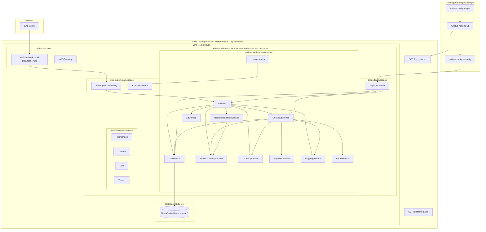
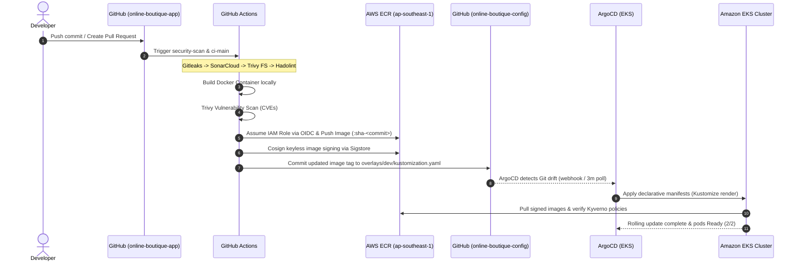
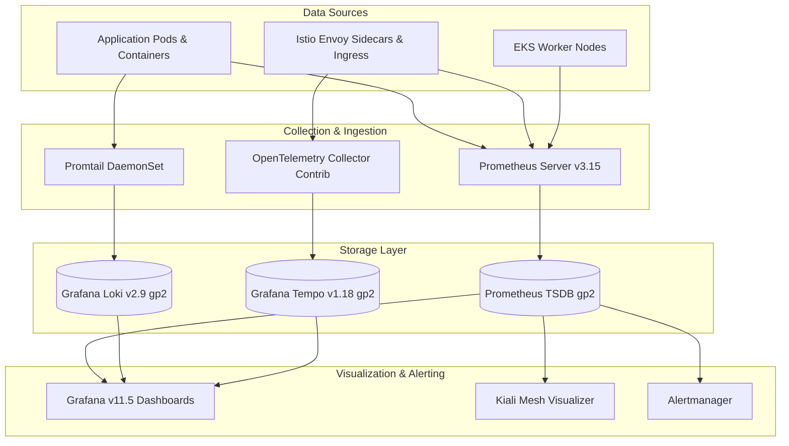

# 🛍️ Online Boutique — DevOps End-to-End on AWS

[](https://github.com/online-boutique-application-demo/online-boutique-app/actions/workflows/ci-main.yml)
[](https://github.com/online-boutique-application-demo/online-boutique-app/actions/workflows/security-scan.yml)
[](https://aws.amazon.com/eks/)
[](https://www.terraform.io/)
[](https://argo-cd.readthedocs.io/)
[](https://istio.io/)
[](LICENSE)

> Production-grade, secure, and observable multi-service e-commerce platform engineered on **AWS EKS** with GitOps continuous delivery, zero-trust service mesh, multi-layered DevSecOps, and unified observability.

---

## 🌟 Highlights

- **11 Polyglot Microservices:** Distributed workload across Go, C# (.NET 8), Node.js, Python, and Java deployed on **Amazon EKS v1.36** utilizing cost-efficient **EC2 Spot Instances** (`t3.medium`) with automated fallback and cluster autoscaling (~70% compute savings).
- **GitOps Continuous Delivery:** Dual-repository GitOps engine powered by **ArgoCD** and **Kustomize**, enforcing declarative infrastructure synchronization, drift detection, automatic rollouts for `dev`, and gate-controlled promotion for `staging`.
- **High-Velocity CI Pipeline:** Automated **GitHub Actions** orchestration featuring matrix builds, change detection (`paths-filter`), passwordless **AWS OIDC authentication**, container packaging, and automated manifest patching.
- **Zero-Trust Service Mesh:** **Istio** mesh enforcement with STRICT mutual TLS (`PeerAuthentication`), explicit least-privilege `AuthorizationPolicy` matrix (SPIFFE identities), and traffic resilience via `DestinationRule` circuit breakers and outlier ejection.
- **Three Pillars of Observability:** Enterprise telemetry stack with **Prometheus** (metrics & custom alerting rules), **Grafana** (curated dashboards), **Grafana Loki** (log aggregation with Promtail), **Grafana Tempo** (distributed tracing via OpenTelemetry Collector), and **Kiali** (topology visualization).
- **Shift-Left DevSecOps:** Integrated security lifecycle including pre-commit secret detection (**Gitleaks**), SAST code analysis (**SonarCloud**), SCA dependency audit (**Trivy FS**), container linting (**Hadolint**), vulnerability scanning (**Trivy Image**), image provenance (**Cosign** keyless signing), runtime governance (**Kyverno** admission policies), and automated dynamic security testing (**OWASP ZAP**).
- **Modular Infrastructure as Code:** Fully automated AWS footprint via **Terraform** (VPC 3-tier subnets, EKS, ECR, ElastiCache Redis 7.1 Multi-AZ, IRSA, and native S3 state locking).

---

## 🏛️ System Architecture

The following diagram illustrates the complete infrastructure topology provisioned on AWS (`ap-southeast-1`, Account ID: `798836978890`):



---

## 🧩 Microservices Catalog

Online Boutique is composed of **11 core microservices** collaborating via gRPC and HTTP:

| Service | Language | Port | Protocol | Description | Dependencies |
|---------|----------|------|----------|-------------|--------------|
| [frontend](src/frontend) | Go | `8080` | HTTP | Serves web UI, manages user cookies, and aggregates product data | All backend services |
| [cartservice](src/cartservice) | C# (.NET 8) | `7070` | gRPC | Stores and manages items in user carts | AWS ElastiCache Redis |
| [productcatalogservice](src/productcatalogservice) | Go | `3550` | gRPC | Searches products and supplies catalog listings | None |
| [currencyservice](src/currencyservice) | Node.js | `7000` | gRPC | Performs high-throughput foreign currency exchange calculations | None |
| [paymentservice](src/paymentservice) | Node.js | `50051` | gRPC | Authorizes and charges payment cards (mock processing) | None |
| [shippingservice](src/shippingservice) | Go | `50051` | gRPC | Computes shipping rates and assigns tracking identifiers | None |
| [emailservice](src/emailservice) | Python | `8080` | gRPC | Generates order confirmation notifications | None |
| [checkoutservice](src/checkoutservice) | Go | `5050` | gRPC | Coordinates order processing across billing, cart, and delivery | `cart`, `catalog`, `currency`, `payment`, `shipping`, `email` |
| [recommendationservice](src/recommendationservice) | Python | `8080` | gRPC | Recommends relevant items based on cart contents | `productcatalogservice` |
| [adservice](src/adservice) | Java | `9555` | gRPC | Returns contextual advertising banners | None |
| [loadgenerator](src/loadgenerator) | Python (Locust) | — | HTTP | Generates synthetic consumer traffic imitating browsing and purchasing | `frontend` |

> [!NOTE]
> `shoppingassistantservice` is excluded from the active topology to remove external proprietary third-party dependencies.

---

## 📁 Repository Structure

The architecture follows a strict **Dual-Repository Pattern** separating business code from GitOps state declarations:

```
online-boutique/
├── online-boutique-app/                      # Application Source, IaC, CI & Runbooks
│   ├── .github/workflows/                   # Automated CI & Security Workflows
│   │   ├── ci-main.yml                      # Change-detection orchestrator & CI dispatcher
│   │   ├── ci-service.yml                   # Reusable build, scan, sign & publish workflow
│   │   ├── security-scan.yml                # Gitleaks and static scanning on pull requests
│   │   ├── dast-scan.yml                    # OWASP ZAP dynamic application scanning
│   │   └── terraform-plan.yml / apply.yml   # Infrastructure deployment pipelines
│   ├── devops/                              # Comprehensive documentation & operations
│   │   ├── architecture.md                  # Detailed architectural blueprints
│   │   ├── destroy-guide.md                 # Daily ephemeral teardown procedure
│   │   ├── runbooks/                        # SRE and operational runbooks
│   │   │   ├── deploy.md                    # Deployment procedures and checklists
│   │   │   ├── rollback.md                  # Immediate recovery strategies
│   │   │   ├── troubleshooting.md           # Triage guide for Pod, Network, and Mesh errors
│   │   │   └── scaling.md                   # HPA, Cluster Autoscaler, and Spot guidance
│   │   └── stage-1 to stage-7 reports       # Step-by-step engineering deliverables
│   ├── src/                                 # 11 Microservice implementations
│   └── terraform-aws/                       # Reusable IaC Modules & Environments
│       ├── environments/ (dev, staging)     # Root Terraform configurations
│       ├── global/ (ecr, github-oidc)       # Shared registries and IAM trust roles
│       └── modules/ (vpc, eks, irsa, etc.)  # Encapsulated AWS resource components
│
└── online-boutique-config/                   # GitOps Deployment State Repository
    ├── argocd/                              # ArgoCD Applications and Helm values
    │   ├── apps/dev/                        # Root application declarations for Dev
    │   └── apps/staging/                    # Promotion declarations for Staging
    ├── base/                                # Base declarative resources
    │   ├── istio/                           # Gateway, VirtualService, mTLS, Telemetry
    │   ├── kyverno/                         # Security admission ClusterPolicies
    │   ├── monitoring/                      # Dashboards, PrometheusRules, and Helm values
    │   └── online-boutique/                 # 11 Microservice K8s deployments & services
    └── overlays/                            # Environment-specific Kustomize overlays
        ├── dev/                             # Automated tag updates by CI pipeline
        └── staging/                         # Controlled pre-production configuration
```

---

## 🔄 CI/CD Pipeline Flow

The deployment lifecycle employs a push-based CI coupled with pull-based GitOps synchronization:



---

## 🛡️ DevSecOps & Security Architecture

Security is baked into every lifecycle stage, forming a comprehensive defense-in-depth model:

```mermaid
graph LR
    subgraph "Shift-Left Security"
        A["Pre-Commit / PR<br/><b>Gitleaks</b> (Secret Scan)"] --> B["Dependencies<br/><b>Trivy FS</b> & <b>Dependabot</b>"]
        B --> C["Static Analysis<br/><b>SonarCloud</b> (SAST)"]
        C --> D["Container Lint & Scan<br/><b>Hadolint</b> & <b>Trivy Image</b>"]
        D --> E["Supply Chain Security<br/><b>Cosign</b> (Image Signing)"]
    end

    subgraph "Admission & Governance"
        E --> F["Policy Enforcement<br/><b>Kyverno</b> Admission Controller"]
    end

    subgraph "Zero-Trust Runtime"
        F --> G["Network Encryption<br/><b>Istio STRICT mTLS</b>"]
        G --> H["Access Matrix<br/><b>AuthorizationPolicy</b>"]
    end

    subgraph "Dynamic Verification"
        H --> I["Post-Deploy DAST<br/><b>OWASP ZAP</b> Active Scan"]
    end
```



### Security Controls Matrix

| Stage | Tool | Type | Purpose |
|-------|------|------|---------|
| **Source / PR** | **Gitleaks** | Secret Detection | Prevents committing API keys, tokens, or private credentials |
| **Source / PR** | **SonarCloud** | SAST | Analyzes code quality, maintainability, and CWE vulnerabilities |
| **Build** | **Trivy (FS)** | SCA | Audits software bills of materials (SBOM) and open-source packages |
| **Build** | **Hadolint** | Dockerfile Lint | Enforces non-root users, pinning, and clean layer creation |
| **Packaging** | **Trivy (Image)** | Vulnerability Scan | Blocks high/critical CVEs in container base images |
| **Packaging** | **Cosign** | Provenance | Generates cryptographic signatures via OIDC identity tokens |
| **Admission** | **Kyverno** | Policy Engine | Enforces read-only root filesystems and blocks privileged pods |
| **Runtime** | **Istio** | Zero Trust | STRICT mTLS mutual authentication and SPIFFE RBAC authorization |
| **Post-Deploy** | **OWASP ZAP** | DAST | Actively exercises ingress endpoints against OWASP Top 10 risks |

---

## 📊 Observability & Monitoring Stack

The observability ecosystem delivers unified real-time visibility across the **Three Pillars of Observability**:



- **Metrics (Prometheus & PromQL):** Scrapes node metrics, cadvisor, Kubernetes API, and Envoy statistics (`port 15090`). Includes 7 production alert rules covering crash looping, latency spikes, pod unreadiness, and EC2 Spot interruption events.
- **Logs (Loki, Promtail & LogQL):** Centralizes container standard output and error streams without heavy indexing overhead, cross-linked to traces via trace IDs.
- **Traces (Tempo, OpenTelemetry & TraceQL):** Distributed context propagation utilizing OpenTelemetry format, ingesting spans emitted by Envoy proxies for complete request visualization.
- **Visuals & Meshes:** 3 pre-provisioned Grafana dashboards (*Microservices Overview*, *Istio Mesh Performance*, *Pod Resources*) paired with Kiali for topological health graphs.

---

## ⚡ Quick Start

### 1. Prerequisites
- **AWS CLI v2** configured with Administrator permissions to account `798836978890`.
- **Terraform** (`>= 1.10.0`)
- **kubectl** (`>= 1.30.0`)
- **Helm** (`>= 3.14.0`)
- **Git**

### 2. Infrastructure Provisioning
```bash
# Clone both repositories
git clone https://github.com/online-boutique-application-demo/online-boutique-app.git
git clone https://github.com/online-boutique-application-demo/online-boutique-config.git

# Initialize and apply Terraform (Dev Environment)
cd online-boutique-app/terraform-aws/environments/dev
terraform init
terraform apply -auto-approve

# Configure local kubectl context
aws eks update-kubeconfig --region ap-southeast-1 --name online-boutique-dev
```

### 3. ArgoCD & Application Bootstrap
```bash
# Apply all ArgoCD applications for the dev environment
kubectl apply -f ../../../../online-boutique-config/argocd/apps/dev/

# Verify all services and sidecars are healthy
kubectl get pods -n online-boutique -w
```

### 4. Accessing Services & Dashboards
```bash
# Retrieve external public DNS for the store
kubectl get svc -n istio-system istio-ingressgateway -o jsonpath='{.status.loadBalancer.ingress[0].hostname}'

# Forward Grafana Dashboard (Credentials: admin / configured secret)
kubectl port-forward svc/grafana 3000:80 -n monitoring

# Forward Kiali Service Mesh Visualizer
kubectl port-forward svc/kiali 20001:20001 -n istio-system

# Forward ArgoCD UI
kubectl port-forward svc/argocd-server 8080:443 -n argocd
```

### 5. Daily Teardown (Ephemeral Infrastructure)
To optimize costs when not running experiments, follow the [Destroy Guide](devops/destroy-guide.md):
```bash
cd online-boutique-app/terraform-aws/environments/dev
terraform destroy -auto-approve
```

---

## 📚 Technical Documentation & Runbooks

Comprehensive guides, architectural decisions, and operational playbooks:

### 📖 Stage Implementation Reports
- [Stage 1: Terraform & AWS Foundation](devops/stage-1-terraform.md) — VPC, EKS Spot v1.36, ECR, ElastiCache Redis, IRSA.
- [Stage 2: CI Pipeline with GitHub Actions](devops/stage-2-ci-pipeline.md) — Change detection, matrix builds, and AWS OIDC.
- [Stage 3: GitOps CD with ArgoCD](devops/stage-3-cd-argocd.md) — Dual-repo GitOps pattern, Kustomize overlays, and controllers.
- [Stage 4: Zero-Trust Service Mesh](devops/stage-4-service-mesh.md) — Istio STRICT mTLS, AuthorizationPolicy, and Kiali.
- [Stage 5: Full Observability Stack](devops/stage-5-monitoring.md) — Prometheus, Grafana, Loki, Tempo, and OpenTelemetry.
- [Stage 6: Multi-Layer DevSecOps](devops/stage-6-devsecops.md) — Gitleaks, Trivy, SonarCloud, Cosign, Kyverno, and OWASP ZAP.
- [Stage 7: Integration & End-to-End Testing](devops/stage-7-integration.md) — Acceptance testing, resilience benchmarks, and wrap-up.

### 🛠️ SRE Operational Runbooks
- [Deployment Runbook](devops/runbooks/deploy.md) — Standard operating procedures for feature rollouts and infrastructure changes.
- [Rollback Runbook](devops/runbooks/rollback.md) — Fast-recovery strategies using Git revert, ArgoCD revisions, and emergency rollbacks.
- [Troubleshooting Runbook](devops/runbooks/troubleshooting.md) — Step-by-step triage for CrashLoopBackOff, mTLS handshake errors, and OIDC failures.
- [Resource Scaling Runbook](devops/runbooks/scaling.md) — Guidance for HPA tuning, Spot instance interruption mitigation, and autoscaling.

---

## 🛠️ Technology Stack & Tooling

| Category | Tool | Version | Purpose |
|----------|------|---------|---------|
| **Cloud Infrastructure** | AWS EKS | `v1.36` | Managed Kubernetes compute engine on Spot Instances |
| **Networking & Database** | AWS VPC / ElastiCache | Redis `7.1` | 3-tier isolated networking & Multi-AZ in-memory session cache |
| **Infrastructure as Code**| Terraform | `>= 1.10.0` | Declarative cloud resource provisioning with native S3 locking |
| **Continuous Integration**| GitHub Actions | Runner 2.3+ | Orchestrated matrix build, scanning, and ECR packaging |
| **Continuous Delivery**   | ArgoCD | `v2.13.0` | GitOps pull-based cluster synchronization and drift correction |
| **Packaging & Templating**| Kustomize / Helm | `v5.0` / `v3.16` | Configuration customization and helm chart lifecycle management |
| **Service Mesh**          | Istio | `v1.24.2` | Sidecar injection, STRICT mTLS encryption, and route resilience |
| **Service Mesh UI**       | Kiali | `v1.89.0` | Topology visualization and mutual TLS validation console |
| **Metrics Collection**    | Prometheus Server | `v3.15.0` | Time-series infrastructure and application metric aggregation |
| **Metrics Dashboard**     | Grafana | `v11.5.2` | Centralized multi-tenant visualization across metrics, logs, traces |
| **Log Management**        | Grafana Loki / Promtail | `v2.9.3` | Cost-effective container log stream processing |
| **Distributed Tracing**   | Grafana Tempo / OTel | `v1.18.2` / `0.176` | OpenTelemetry span ingestion and distributed query engine |
| **Security Scanning**     | Trivy / Gitleaks | `v0.58` / `v8.18` | Vulnerability scanning (SCA/Image) and pre-commit secret hygiene |
| **Code Quality & SAST**   | SonarCloud / Hadolint | Latest | Static code defect scanning and Dockerfile lint validation |
| **Cryptographic Signing** | Sigstore Cosign | `v2.4.0` | Keyless container signing verified via OIDC certificates |
| **Policy Engine**         | Kyverno | `v1.13.0` | Kubernetes-native admission control and security context auditing |
| **Dynamic Testing (DAST)**| OWASP ZAP | Weekly | Automated active and passive web vulnerability scanning |

---

## 💰 Cost Estimation & Optimization

Monthly estimated expenses configured for AWS Region `ap-southeast-1`:

| Resource | Dev Environment | Staging Environment | Total Monthly |
|----------|-----------------|---------------------|---------------|
| **EKS Control Plane** | $73.00 | $73.00 | $146.00 |
| **EC2 Spot Worker Nodes** (3x `t3.medium`) | ~$30.00 | ~$30.00 | ~$60.00 |
| **AWS ElastiCache Redis** (2x `cache.t3.micro`) | ~$25.00 | ~$25.00 | ~$50.00 |
| **Single NAT Gateway** | ~$33.00 | ~$33.00 | ~$66.00 |
| **AWS Network Load Balancer / ALB** | ~$18.00 | ~$18.00 | ~$36.00 |
| **Amazon CloudWatch Logs** | ~$5.00 | ~$5.00 | ~$10.00 |
| **Amazon ECR & S3 State Storage** | ~$2.00 | — | ~$2.00 |
| **Total Estimated Expense** | **~$186.00 / mo** | **~$184.00 / mo** | **~$370.00 / mo** |

> [!TIP]
> **Ephemeral Infrastructure Strategy:** By leveraging automated daily teardowns (`terraform destroy` at end of day, recreating next morning), actual dev operating costs are curtailed to **~$30–$40/month**, maximizing cloud budget efficiency.

---

## 👏 Acknowledgements & Credits

- **Original Application:** The core application architecture is based on the [Google Cloud Microservices Demo (Online Boutique)](https://github.com/GoogleCloudPlatform/microservices-demo).
- **DevOps Architecture & Implementation:** Re-architected and engineered for AWS by **[minhhuy27](https://github.com/minhhuy27)** (`dp1.2a4.minhhuy@gmail.com`).
