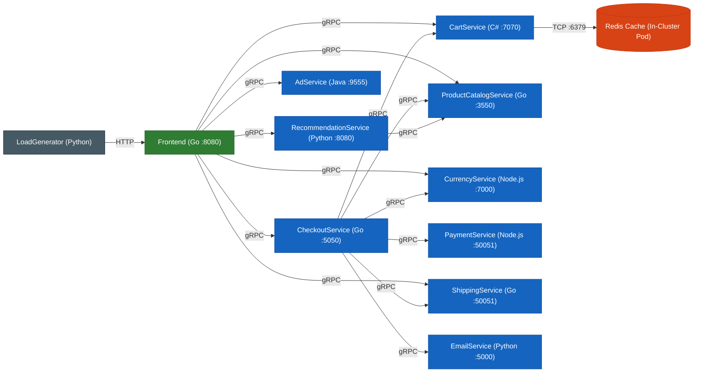
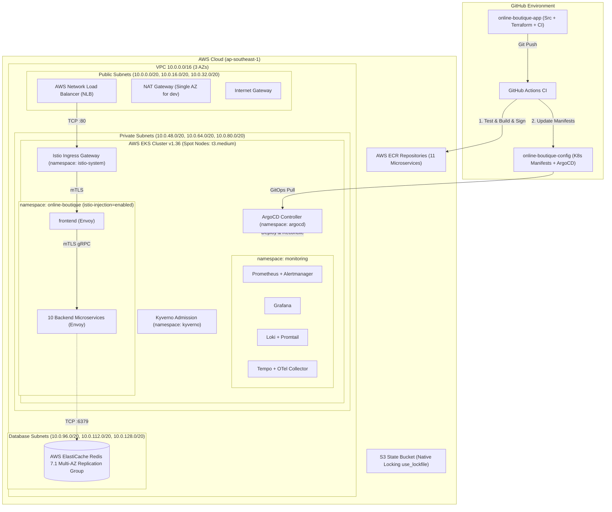
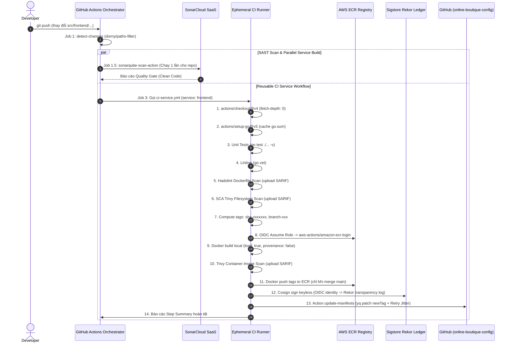
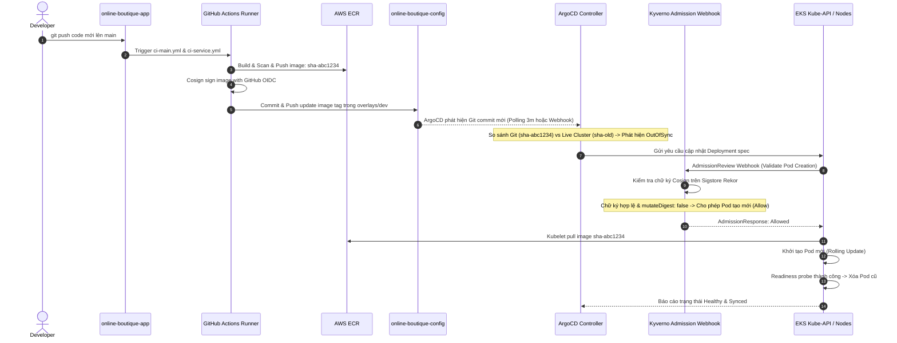
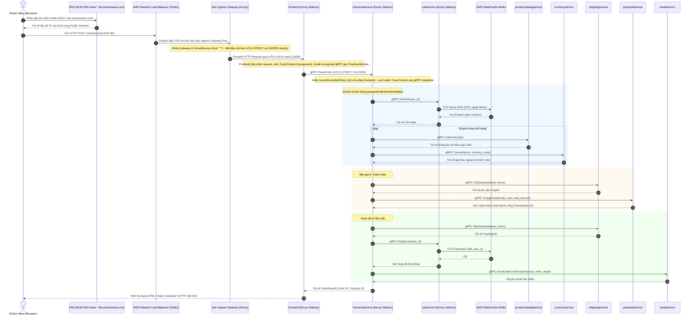
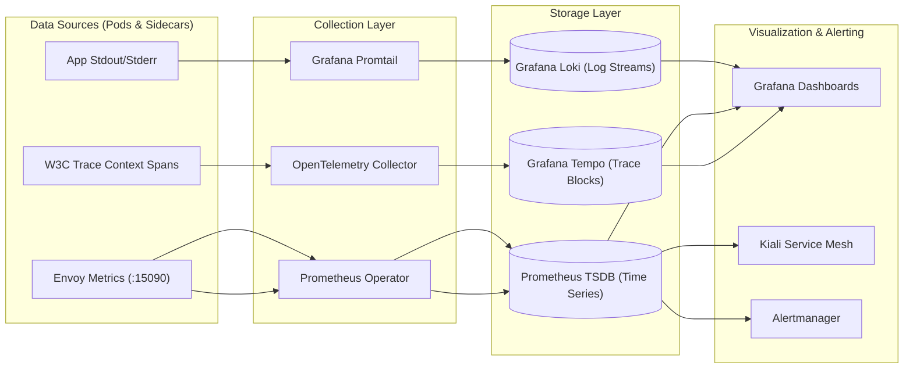

# 🚀 Cẩm Nang Phỏng Vấn DevOps: Dự Án Online Boutique on AWS

> **Tài liệu chuẩn bị phỏng vấn kỹ thuật (DevOps / SRE / Cloud Engineer)**  
> **Dự án:** Triển khai Kiến trúc Microservices & Nền tảng DevOps End-to-End cho Online Boutique trên AWS EKS  
> **Kho lưu trữ:** `online-boutique-app` (Mã nguồn & Hạ tầng) & `online-boutique-config` (Cấu hình GitOps)  

---

## 1. Tổng Quan Dự Án (Elevator Pitch)

### 1.1 Bài Giới Thiệu Ngắn (30s – 1 phút trong phỏng vấn)
> "Dự án của em là xây dựng một nền tảng **Cloud-Native DevOps & DevSecOps toàn diện trên AWS** cho ứng dụng thương mại điện tử **Online Boutique** (gồm 11 microservices đa ngôn ngữ). Em chuyển đổi toàn bộ kiến trúc từ nền tảng GCP/GKE gốc sang **AWS EKS v1.36** sử dụng **Terraform** dạng module hóa, tối ưu chi phí với **EC2 Spot instances** và **ElastiCache Redis Multi-AZ**.  
>
> Về vận hành, em thiết kế hệ thống **GitOps 2 repositories** với **GitHub Actions** và **ArgoCD**: pipeline CI nhận diện thay đổi từng service, kiểm thử, quét bảo mật đa tầng (**SonarCloud, Trivy, Hadolint**), ký số container image không khóa (**Cosign keyless via OIDC**), và tự động cập nhật image tag vào repo config. Trên EKS, em thiết lập **Istio Service Mesh** với chế độ **mTLS STRICT**, kiểm soát truy cập zero-trust bằng **AuthorizationPolicy**, quản lý cổng vào tập trung qua **Istio Ingress Gateway** trên **AWS NLB**, áp dụng **Kyverno** kiểm soát admission, và triển khai hệ thống quan sát toàn diện (**Prometheus, Grafana, Loki, Tempo distributed tracing và Kiali**)."

---

### 1.2 Bảng Tổng Quan Ngăn Xếp Công Nghệ (Tech Stack at a Glance)

| Phân tầng (Domain) | Công nghệ / Công cụ chính | Vai trò & Mục đích trong dự án |
| :--- | :--- | :--- |
| **Cloud Provider** | **AWS (Amazon Web Services)** | Hạ tầng đám mây chính: VPC, EKS, ElastiCache, ECR, NLB, IAM, KMS, S3 |
| **Compute & Container** | **AWS EKS v1.36**, Docker, containerd | Cụm Kubernetes quản lý với Managed Node Group chạy **EC2 Spot Instances** |
| **Infrastructure as Code** | **Terraform (>= 1.10)** | Quản trị hạ tầng dạng mã nguồn: S3 backend native locking (`use_lockfile`), chia tách layer Global và Environment |
| **Database & Caching** | **AWS ElastiCache Redis 7.1** | Cụm Redis Multi-AZ lưu trữ giỏ hàng ngoài mesh, đảm bảo dữ liệu bền vững |
| **CI (Continuous Integration)** | **GitHub Actions** | Tự động hóa kiểm thử, linting, build multi-language, scan bảo mật và ký số image |
| **CD (Continuous Delivery)** | **ArgoCD (GitOps)** | Tự động đồng bộ cấu hình khai báo từ Git về EKS; Auto-sync trên Dev, Manual Approval trên Staging |
| **Configuration Mgmt** | **Kustomize & Helm** | Kustomize overlays cho 11 microservices (Account-agnostic); Helm cho các platform add-ons |
| **Service Mesh** | **Istio & Kiali** | Quản lý lưu lượng L7, mTLS STRICT, AuthorizationPolicy zero-trust, Circuit Breaking, Service Graph |
| **Ingress & Networking** | **AWS NLB + AWS Load Balancer Controller** | Cung cấp IP/DNS tĩnh, chuyển tiếp traffic L4/L7 vào Istio Ingress Gateway |
| **Metrics & Alerting** | **Prometheus + Alertmanager** | Thu thập chỉ số hệ thống và Envoy proxy (port 15090), kích hoạt cảnh báo SLA/SLO |
| **Visualization** | **Grafana** | Trực quan hóa số liệu với 3 dashboards: Istio Mesh, Microservices Overview, Pod Resources |
| **Centralized Logging** | **Grafana Loki + Promtail** | Thu thập stdout/stderr của container và Envoy sidecar, truy vấn bằng LogQL |
| **Distributed Tracing** | **Grafana Tempo + OpenTelemetry Collector** | Thu thập và truy vết W3C TraceContext xuyên suốt 11 microservices, truy vấn TraceQL |
| **DevSecOps (Shift-Left)** | **Gitleaks, SonarCloud, Trivy, Hadolint** | Quét secret, SAST mã nguồn, SCA dependencies, lint Dockerfile, quét lỗ hổng image |
| **Supply Chain Security** | **Cosign (Keyless) + Sigstore Rekor** | Ký số container image qua OIDC token của GitHub Actions, ghi nhận vào Rekor ledger |
| **Policy Engine (Runtime)** | **Kyverno** | Xác thực chữ ký Cosign tại Admission Controller (`mutateDigest: false`), chặn privileged pods |
| **DAST (Post-Deploy)** | **OWASP ZAP** | Kiểm thử bảo mật động từ bên ngoài nhắm vào Public NLB Endpoint của ứng dụng |
| **Auto Scaling** | **Kubernetes Cluster Autoscaler** | Tự động mở rộng/thu hẹp số lượng Spot nodes dựa trên Resource Requests và Pending pods |

---

## 2. Phần A – Kiến Trúc Hệ Thống Ban Đầu (Upstream Google Online Boutique)

### 2.1 Mục Đích & Thành Phần Gốc
Online Boutique (trước đây là Hipster Shop) là ứng dụng thương mại điện tử mẫu do **Google Cloud Platform (GCP)** phát triển nhằm minh họa kiến trúc microservices phân tán chạy trên Kubernetes (GKE).

Hệ thống gốc bao gồm:
- **11 microservices nghiệp vụ** viết bằng 5 ngôn ngữ khác nhau (Go, C#, Python, Java, Node.js).
- **1 microservice tạo tải giả lập (`loadgenerator`)** viết bằng Python/Locust.
- **1 in-cluster database pod (`redis-cart`)** chạy Redis đơn lẻ trong cụm làm bộ nhớ lưu giỏ hàng.
- **1 microservice AI (`shoppingassistantservice`)** tích hợp Gemini / Google Cloud Vertex AI (đã bị loại bỏ trong kiến trúc AWS của chúng ta).
- **Giao tiếp:** Toàn bộ giao tiếp giữa các backend services sử dụng **gRPC** trên nền HTTP/2, định nghĩa tập trung qua tệp Protocol Buffers `protos/demo.proto`. Chỉ duy nhất `frontend` tiếp nhận lưu lượng **HTTP/1.1** từ trình duyệt người dùng.

---

### 2.2 Danh Sách Chi Tiết 11 Microservices (+ LoadGenerator)

| Microservice | Ngôn ngữ | Port & Giao thức | Vai trò nghiệp vụ | Phụ thuộc downstream (Dependencies) |
| :--- | :--- | :--- | :--- | :--- |
| **frontend** | Go | `:8080` (HTTP) | Phục vụ Web UI HTML/CSS, nhận request từ khách hàng, điều phối gọi các backend gRPC | Tất cả services (trừ email, payment, loadgenerator) |
| **cartservice** | C# (.NET 8.0) | `:7070` (gRPC) | Quản lý thêm, lấy, xóa giỏ hàng của từng phiên khách hàng | Cụm cơ sở dữ liệu Redis (port 6379) |
| **checkoutservice** | Go | `:5050` (gRPC) | Nhận đặt hàng, điều phối thanh toán, tính cước vận chuyển, trừ giỏ hàng và gửi email | cart, productcatalog, currency, payment, shipping, email |
| **productcatalogservice** | Go | `:3550` (gRPC) | Đọc danh mục sản phẩm từ tệp JSON tĩnh, hỗ trợ tìm kiếm sản phẩm | Không có |
| **currencyservice** | Node.js | `:7000` (gRPC) | Chuyển đổi tỷ giá ngoại tệ (USD, EUR, JPY, GBP, CAD...) | Không có |
| **paymentservice** | Node.js | `:50051` (gRPC) | Xác thực thẻ tín dụng và trừ tiền thanh toán (giả lập logic thành công) | Không có |
| **shippingservice** | Go | `:50051` (gRPC) | Tính toán phí vận chuyển dựa trên số lượng mặt hàng và tạo mã vận đơn | Không có |
| **emailservice** | Python 3.12 | `:5000` / target `:8080` (gRPC) | Tạo và gửi email xác nhận đơn hàng thành công (giả lập ghi log) | Không có |
| **recommendationservice**| Python 3.12 | `:8080` (gRPC) | Thuật toán gợi ý danh sách sản phẩm liên quan cho người dùng | productcatalogservice |
| **adservice** | Java 21 | `:9555` (gRPC) | Trả về danh sách quảng cáo ngữ cảnh phù hợp với sản phẩm người dùng đang xem | Không có |
| **loadgenerator** | Python 3.12 | Không lắng nghe port | Tự động duyệt web, xem sản phẩm, thêm giỏ hàng và đặt hàng để tạo traffic | frontend (qua HTTP) |

---

### 2.3 Bảng So Sánh: Upstream GCP vs. Kiến Trúc AWS Triển Khai Thực Tế

| Thành phần kiến trúc | Bản gốc Google Online Boutique (Upstream) | Bản triển khai AWS DevOps của chúng ta (Our Implementation) | Lý do & Giá trị đem lại |
| :--- | :--- | :--- | :--- |
| **Nền tảng Cloud** | Google Cloud Platform (GCP) | **Amazon Web Services (AWS)** | Yêu cầu bài toán chuyển đổi hệ thống sang nền tảng AWS doanh nghiệp. |
| **Managed Kubernetes** | Google Kubernetes Engine (GKE) | **Amazon EKS v1.36** | Tận dụng EKS với Managed Node Groups, tích hợp sâu AWS VPC CNI. |
| **Loại Instance Node** | Standard Compute-Optimized VMs | **EC2 Spot Instances (`t3.medium`)** | **Tiết kiệm ~65–70% chi phí compute**, xử lý failover bằng Cluster Autoscaler. |
| **Quản lý Giỏ hàng (Cache)** | Pod Kubernetes `redis-cart` (lưu trên ổ đĩa ephemeral) | **AWS ElastiCache Redis 7.1 Multi-AZ** (Cluster replication group) | Đảm bảo High Availability, dữ liệu giỏ hàng không bị mất khi Pod K8s bị restart. |
| **Container Registry** | Google Container Registry (GCR) / Artifact Registry | **Amazon ECR (Global Layer)** | Quản lý tập trung 11 ECR repos, mã hóa AES-256, lifecycle policy dọn ảnh cũ. |
| **CI Engine** | Cloud Build / Skaffold cục bộ | **GitHub Actions** với Reusable Workflows & Matrix | Tự động hóa CI hoàn chỉnh trên đám mây, OIDC không dùng static credentials. |
| **CD / Deployment** | `kubectl apply` thủ công hoặc Google Cloud Deploy | **ArgoCD (GitOps Pull Model)** | Single Source of Truth trên Git, tự động phát hiện và sửa chữa lệch cấu hình (Self-Healing). |
| **Chiến lược Repositories** | Monorepo chứa chung code và K8s manifests | **2-Repository GitOps Strategy** (`app` tách biệt `config`) | Phân quyền bảo mật: CI chỉ ghi tag vào config repo; cluster không cần quyền truy cập app code. |
| **Bảo mật Service-to-Service** | Giao tiếp plaintext mở tự do qua K8s CoreDNS | **Istio Service Mesh (mTLS STRICT + AuthPolicy)** | Mã hóa toàn bộ đường truyền nội bộ, áp dụng Zero-Trust (chặn mặc định deny-all). |
| **Cổng tiếp nhận Ingress** | Service type `LoadBalancer` gắn thẳng pod `frontend` | **AWS NLB + Istio Ingress Gateway (Layer 7)** | Gom cổng Ingress duy nhất tiết kiệm tiền Load Balancer, hỗ trợ điều phối L7 linh hoạt. |
| **Giám sát & Khả năng quan sát** | Google Cloud Operations Suite (Stackdriver) | **Kube-Prometheus-Stack + Loki + Tempo + Kiali** | Ngăn xếp mã nguồn mở độc lập, không phụ thuộc vendor-lock-in, tương thích chuẩn OTel. |
| **Bảo mật Chuỗi cung ứng** | Không có ký số container | **Cosign (Keyless) + Sigstore Rekor + Kyverno** | Xác thực nguồn gốc container trước khi cho phép chạy trên EKS cluster. |
| **Dịch vụ AI phụ trợ** | `shoppingassistantservice` (Gemini API / Vertex AI) | **Loại bỏ hoàn toàn** | Cắt bỏ các thư mục và phụ thuộc độc quyền GCP không cần thiết. |

---

## 3. Phần B – Kiến Trúc DevOps Đã Triển Khai Trên AWS (Trọng Tâm)

### B1. Bức Tranh Tổng Thể & Chiến Lược GitOps 2 Repositories

#### Sơ Đồ Kiến Trúc Hạ Tầng & Luồng Điều Phối

#### Chiến Lược 2 Repositories & Bí Quyết "Account-Agnostic"
- **`online-boutique-app`**: Chứa toàn bộ source code của 11 microservices, mã Terraform (`terraform-aws/`), workflows GitHub Actions (`.github/workflows/`), và tài liệu vận hành (`devops/`).
- **`online-boutique-config`**: Kho cấu hình thuần K8s Manifests dành riêng cho ArgoCD:
  - `argocd/`: Chứa file cài đặt và manifests Application cho từng môi trường (`dev/`, `staging/`).
  - `base/`: Chứa K8s manifests gốc của microservices, cấu hình Istio, Kyverno policies, và Monitoring Helm values.
  - `overlays/dev/` & `overlays/staging/`: Tùy biến môi trường.
- **Tính độc lập tài khoản (Account-Agnostic Architecture):**
  - Nhánh `main` của repo config là bản mẫu dùng chung, không chứa bất kỳ giá trị hardcode nào như AWS Account ID, VPC ID hay Redis Host.
  - Sử dụng kết hợp **Kustomize `configMapGenerator`** và **Kustomize `replacements`**:
    - Tệp `env.properties` tại mỗi overlay khai báo giá trị thực tế: `ECR_REGISTRY` và `REDIS_ADDR`.
    - Kustomize `replacements` sẽ đọc dữ liệu từ ConfigMap sinh ra từ `env.properties` và tự động hoán đổi prefix `REGISTRY/` trong danh sách container image cũng như biến môi trường `REDIS_ADDR` của `cartservice`.
  - Nhánh `deploy/dev` hoặc `deploy/staging` chứa cấu hình cụ thể khi bootstrap cluster live.

---

### B2. Hạ Tầng Dạng Mã Nguồn (Infrastructure as Code - Terraform)

Hạ tầng Terraform được cấu trúc 2 tầng (Two-Tier Architecture) giúp cô lập rủi ro và tăng tốc độ triển khai:

#### 1. Tầng Toàn Cục (Global Layer)
- **`terraform-aws/global/s3-backend/`**:
  - Khởi tạo S3 bucket lưu trữ Terraform Remote State: mã hóa KMS (`aws:kms`), bật versioning, chặn 100% public access.
  - **Khóa trạng thái Native S3 State Locking (`use_lockfile = true`):** Tận dụng tính năng từ **Terraform 1.10+**, Terraform tạo file khóa `<key>.tflock` trong cùng S3 bucket thông qua cơ chế S3 conditional writes (sử dụng header `If-None-Match`); tiến trình chạy song song khác sẽ thất bại khi cố lấy khóa (fail to acquire lock), giúp khóa state trực tiếp mà **hoàn toàn không cần tạo bảng DynamoDB**, tối giản hạ tầng và cắt giảm chi phí.
- **`terraform-aws/global/ecr/`**:
  - Tạo trước 11 ECR repositories độc lập cho 11 microservices.
  - Cấu hình **Lifecycle Policy:** Luôn giữ lại tối đa 30 images có tag tiền tố `sha-`, tự động dọn sạch các images untagged sau 1 ngày.
  - Tách rời ECR khỏi stack môi trường để khi chạy `terraform destroy` cụm dev/staging, toàn bộ container image đã build không bị xóa nhầm.
- **`terraform-aws/global/github-oidc/`**:
  - Tạo `aws_iam_openid_connect_provider` kết nối với `https://token.actions.githubusercontent.com`.
  - Khởi tạo 2 IAM roles chuyên biệt được xác thực qua OIDC Web Identity:
    1. `online-boutique-github-ci`: Quyền hạn hẹp (`ecr:GetAuthorizationToken`, `ecr:PutImage`, `eks:DescribeCluster`).
    2. `online-boutique-github-terraform`: Quyền chạy hạ tầng tự động qua PR và Merge.
  - **Kiểm soát phạm vi Subject (`sub` scoping):** Cấu hình chặt chẽ điều kiện `StringLike` trên claim `sub` trỏ chính xác về repository `repo:<GITHUB_ORG>/online-boutique-app:*`, hỗ trợ cả format classic và immutable repo ID.

#### 2. Tầng Môi Trường (Environment Layer: `dev` / `staging`)
- **Mạng VPC 3 Tầng Subnet (3-Tier Subnets):**
  - **Public Subnets (3 AZs):** Cấp phát IP Public, chứa NAT Gateway, Internet Gateway và AWS NLB (gắn tag `kubernetes.io/role/elb = 1`).
  - **Private Subnets (3 AZs):** Chứa các EKS Worker Nodes, định tuyến ra ngoài qua NAT Gateway (gắn tag `kubernetes.io/role/internal-elb = 1`).
  - **Database Subnets (3 AZs):** Subnet hoàn toàn cô lập, không có Internet Gateway, không có NAT Gateway, dành riêng cho cụm AWS ElastiCache Redis.
  - **VPC Flow Logs:** Thu thập lưu lượng mạng đẩy vào CloudWatch Log Group với retention 14 ngày.
- **EKS Cluster & Managed Node Group:**
  - Phiên bản: Kubernetes **v1.36**.
  - **Mã hóa Secrets:** Sử dụng AWS KMS Key (`aws_kms_key.eks`) mã hóa toàn bộ K8s Secrets ở tầng lưu trữ.
  - **Spot Instance Node Group:** Cấu hình `capacity_type = "SPOT"` sử dụng loại máy ảo `t3.medium`, kích thước ban đầu: Min 2, Desired 3, Max 5.
  - **EC2 Launch Template & IMDSv2:** Bắt buộc sử dụng token an toàn (`http_tokens = "required"`), cấu hình `http_put_response_hop_limit = 2` để cho phép các Pods (đặc biệt là AWS Load Balancer Controller) truy cập được Instance Metadata Service.
  - **Thứ tự Add-ons chính xác:** `vpc-cni` (bật Prefix Delegation: `ENABLE_PREFIX_DELEGATION=true` tăng số lượng Pod/node từ 17 lên 110 pods) và `kube-proxy` được tạo **trước** node group; `coredns` và `aws-ebs-csi-driver` được cài đặt **sau** khi node group đã ready.
  - **IRSA (IAM Roles for Service Accounts):**
    - `aws-load-balancer-controller`: Cho phép controller tạo/xóa AWS NLB/ALB.
    - `cluster-autoscaler`: Cho phép tự động điều chỉnh Auto Scaling Group của EKS.
    - `ebs-csi-controller-sa`: Cho phép gắn ổ đĩa EBS gp2 cho Prometheus và Tempo.
- **ElastiCache Redis:**
  - Replication Group 2 nodes Multi-AZ, phiên bản Redis 7.1, loại node `cache.t3.micro`.
  - Security Group: Chỉ mở duy nhất cổng TCP 6379 từ Security Group chính của cụm EKS (`cluster_primary_security_group_id`).

---

### B3. CI Pipeline – Luồng Chi Tiết Từng Bước (Step-by-Step Flow)

Quy trình CI được xây dựng dựa trên nguyên lý **Orchestrator – Worker Pattern** qua GitHub Actions.

#### Triggers & Điều Kiện Kích Hoạt
- Kích hoạt khi có `push` lên `main`, `feature/**`, `fix/**` hoặc khi tạo `pull_request` vào `main`.
- Bỏ qua các commit chỉ sửa tài liệu qua `paths-ignore`: `**/*.md`, `docs/**`, `devops/**`, `LICENSE`.
- Khóa tương tranh (`concurrency`): Nhóm theo `ci-${{ github.ref }}` với `cancel-in-progress: true` nhằm tự động hủy các lần chạy cũ khi có commit mới đẩy lên cùng branch.

#### Sơ Đồ Trình Tự Thực Thi CI Pipeline (Mermaid Sequence)

#### Chi Tiết 16 Bước Tuần Tự Trong Reusable Workflow `ci-service.yml`
Khi một service có thay đổi code, workflow tái sử dụng `ci-service.yml` thực thi tuần tự các bước sau:
1. **Checkout Code:** Sử dụng `actions/checkout@v4` với `fetch-depth: 0` để lấy đầy đủ lịch sử commit.
2. **Setup Môi Trường Ngôn Ngữ & Cache:** Dựa vào tham số `language` (`go`, `dotnet`, `node`, `python`, `java`), runner thiết lập runtime tương ứng kèm cơ chế cache gói phụ thuộc (`go.sum`, `package-lock.json`, `pip`, `gradle`). Riêng Java dùng Temurin JDK 21, .NET dùng phiên bản 8.0.
3. **Cài Đặt Thư Viện Phụ Thuộc (Dependencies):** Chạy `npm ci` (Node) hoặc `pip install -r requirements.txt` (Python).
4. **Kiểm Thử Đơn Vị (Unit Tests):** Chạy `go test ./...`, `dotnet test`, `npm test`, `pytest`, hoặc `./gradlew test`.
5. **Kiểm Tra Định Dạng Mã Nguồn (Linting):** Phân tích tĩnh code thông qua `go vet`, `flake8` (Python), hoặc `eslint` (Node).
6. **Kiểm Tra Dockerfile (Hadolint):** Chạy `hadolint/hadolint-action@v3.1.0` quét Dockerfile, xuất file SARIF và upload lên GitHub Security tab.
7. **Phân Tích Thành Phần Phần Mềm (SCA - Trivy Filesystem):** Chạy `aquasecurity/trivy-action` chế độ `fs` quét các lỗ hổng bảo mật (CVEs) trong dependencies, ghi nhận cảnh báo `CRITICAL,HIGH`.
8. **Tính Toán Image Tags:** Sinh tag bất biến duy nhất `sha-<short-sha>` làm primary tag, kèm theo tag phụ `branch-<name>` và `latest` (nếu trên nhánh `main`).
9. **Xác Thực AWS Qua OIDC:** Gọi `aws-actions/configure-aws-credentials@v4` nhận diện token GitHub OIDC để assume IAM role `online-boutique-github-ci` mà **không dùng Access Key tĩnh**, sau đó đăng nhập ECR bằng `amazon-ecr-login@v2`.
10. **Build Docker Image Cục Bộ (Local Build):** Gọi `docker/build-push-action@v6` nạp ảnh vào Docker daemon local (`push: false`, `load: true`), cấu hình `provenance: false` để tương thích với docker driver tiêu chuẩn.
11. **Quét Lỗ Hổng Container Image (Trivy Image Scan):** Quét trực tiếp image vừa build trong local Docker daemon để tìm CVEs tầng hệ điều hành cơ sở (base image OS packages).
12. **Cài Đặt Cosign:** Tải công cụ Sigstore Cosign thông qua `sigstore/cosign-installer@v3`.
13. **Đẩy Ảnh Lên AWS ECR (Push):** Chỉ thực thi khi sự kiện là `push` vào nhánh `main`. Đẩy các tag đã tính toán lên ECR repository tương ứng.
14. **Ký Số Image Không Khóa (Cosign Keyless Signing):** Sử dụng OIDC token của GitHub Actions làm định danh chứng thực (`COSIGN_EXPERIMENTAL="true"`), ký số image và lưu bằng chứng kiểm toán minh bạch trên Sigstore Rekor ledger.
15. **Cập Nhật Manifests (Composite Action `update-manifests`):**
    - Clone repo `online-boutique-config`.
    - Cài đặt công cụ `yq` (v4.44.3).
    - Sử dụng `yq` cập nhật trường `newTag` của service trong `overlays/dev/kustomization.yaml`.
    - **Cơ chế chống xung đột (Conflict-Free Retry with Jitter):** Khi 11 services cùng build song song và đồng thời đẩy commit vào repo config, collision là không thể tránh khỏi. Action được thiết kế vòng lặp retry 15 lần: nếu `git push` thất bại, runner sẽ sleep ngẫu nhiên `((RANDOM % 4) + i)` giây, chạy `git fetch origin` và `git reset --hard origin/$BRANCH`, áp lại `yq` rồi thử push lại.
16. **Tạo Báo Cáo Step Summary:** Xuất bảng tóm tắt kết quả build, SHA commit, tag và URI image lên `$GITHUB_STEP_SUMMARY`.

#### Các Workflow Bổ Trợ Khác
- **`security-scan.yml`:** Tự động chạy **Gitleaks** kiểm tra chống lộ lọt mã bí mật (secrets, passwords, API keys) trên toàn bộ commit và PR.
- **`terraform-plan.yml`:** Khi có PR sửa thư mục `terraform-aws/`, tự động assume role `online-boutique-github-terraform`, kiểm tra format, validate, dọn dẹp log groups mồ côi nếu có, chạy `terraform plan` và dùng GitHub Script bot đăng bình luận chi tiết kết quả plan trực tiếp lên PR.
- **`terraform-apply.yml`:** Khi merge PR vào `main`, tự động thực thi `terraform apply -auto-approve` đưa thay đổi hạ tầng lên môi trường AWS.
- **`dast-scan.yml`:** Workflow thủ công (`workflow_dispatch`) kích hoạt container **OWASP ZAP** (Baseline Scan hoặc Full Scan) nhắm vào URL Public NLB của ứng dụng sau khi deploy để phát hiện lỗ hổng XSS, SQLi, CSRF, insecure headers.

---

### B4. CD Pipeline – GitOps Với ArgoCD

#### Kiến Trúc Đồng Bộ GitOps
Hệ thống sử dụng mô hình **Pull-based GitOps** thông qua ArgoCD cài đặt trong cụm EKS tại namespace `argocd`.

- **Quản lý Application độc lập:** Thay vì sử dụng mô hình monolithic Root Application (App-of-Apps) dễ gây hiệu ứng cascade failure, cụm quản lý độc lập từng manifest Application trong `argocd/apps/dev/`:
  - `online-boutique.yaml`: Quản lý 11 microservices (đọc từ `overlays/dev`).
  - `istio-config.yaml`: Quản lý Gateway, VirtualService, mTLS, AuthPolicies (đọc từ `base/istio`).
  - `kube-prometheus-stack.yaml`, `monitoring-stack.yaml`, `loki.yaml`, `tempo.yaml`, `otel-collector.yaml`: Quản lý các thành phần giám sát.
  - `aws-lb-controller.yaml`, `cluster-autoscaler.yaml`, `kyverno.yaml`, `kyverno-policies.yaml`: Quản lý hạ tầng nền tảng.
- **Chính Sách Đồng Bộ (Sync Policy):**
  - **Môi trường Dev:** Cấu hình **Automated Sync** kèm `prune: true` (tự động xóa tài nguyên K8s nếu Git xóa) và `selfHeal: true` (tự động ghi đè sửa lại trạng thái nếu có ai can thiệp thủ công bằng `kubectl` vào cụm).
  - **Môi trường Staging:** **Manual Sync (Không bật automated)**. Đóng vai trò là Cổng Kiểm Soát (Promotion Gate), đòi hỏi DevOps Engineer hoặc QA xác nhận trước khi bấm đồng bộ.
- **Bootstrap Tự Động Hóa (`scripts/bootstrap-argocd.{sh,ps1}`):**
  - Script Bash (`bootstrap-argocd.sh`) sử dụng `envsubst` với danh sách biến tường minh: `ENVSUBST_VARS='$GITHUB_ORG $AWS_ACCOUNT_ID $AWS_REGION $EKS_CLUSTER_NAME $CONFIG_REVISION'` để render và nạp vào cụm qua `kubectl apply -f -`.
  - Script PowerShell (`bootstrap-argocd.ps1`) sử dụng chuỗi hàm `.Replace('${VAR}', ...)` cho từng biến môi trường tương ứng trước khi nạp vào Kubernetes.

#### Kyverno Admission Controller & Bài Học Sống Còn `mutateDigest: false`
- Kyverno chạy trong cluster để xác thực chính sách bảo mật tầng admission.
- ClusterPolicy `verify-image-signatures` kiểm tra toàn bộ Pod trong namespace `online-boutique`:
  - Đối chiếu container image ECR với chữ ký số Cosign lưu trên Rekor.
  - Kiểm tra subject issuer phải đến từ `https://token.actions.githubusercontent.com`.
- **Cảnh báo lỗi OutOfSync kinh điển:**
  - Mặc định, Kyverno Image Verification có tính năng tự động ghi đè digest (`mutateDigest = true`) để chèn hash SHA256 cố định vào Pod spec sau khi verify thành công.
  - Khi điều này xảy ra, Pod chạy thực tế trong cụm có image là `image@sha256:...`, trong khi manifest trên Git khai báo image là `image:sha-xxxxxxx`.
  - ArgoCD liên tục phát hiện sự sai khác (GitOps Drift) và đánh dấu Application là **`OutOfSync`**, liên tục trigger redeploy vô tận.
  - **Giải pháp dứt điểm:** Bắt buộc cấu hình **`mutateDigest: false`** và **`verifyDigest: false`** trong rule của Kyverno ClusterPolicy.

#### Sơ Đồ Trình Tự: "Từ Git Push Tới Pod Chạy Hoàn Tất"

---

### B5. Luồng Request (Request Flow) End-to-End

#### Sơ Đồ Chi Tiết Yêu Cầu Đặt Hàng (Place Order Request Flow)
Dưới đây là hành trình của một request khi người dùng bấm nút đặt hàng trên trình duyệt:

#### Điểm Phát Sinh Dữ Liệu Quan Sát (Telemetry Points) Suốt Luồng Đi
- **Distributed Tracing:** 
  - Khi request đi qua Istio Ingress Gateway, Envoy proxy tự động sinh mã `x-request-id` và tiêu chuẩn W3C `traceparent`.
  - Frontend và các microservices đọc header này, gắn vào OpenTelemetry SDK context, và lan truyền tiếp qua gRPC Metadata sang các downstream service.
  - Mỗi Envoy sidecar trên đường đi gửi thông tin span về `otel-collector.monitoring.svc.cluster.local:4317` (gRPC), sau đó được Collector đẩy vào kho lưu trữ **Grafana Tempo**.
- **Metrics (Prometheus):**
  - Mọi request HTTP và gRPC đi qua Envoy proxy đều được thống kê chi tiết: số lượng requests, mã phản hồi (2xx, 4xx, 5xx), độ trễ (latency histogram).
  - PodMonitor `istio-proxies-monitor` định kỳ 15 giây cào số liệu từ cổng `:15090/stats/prometheus` của sidecar.
- **Logging (Loki):**
  - Mọi dòng log ứng dụng ghi ra `stdout`/`stderr` và access log của Envoy proxy được **Promtail** thu thập kèm nhãn metadata K8s (`pod`, `namespace`, `app`, `container`), sau đó đẩy về **Grafana Loki**.

#### Cơ Chế Kết Nối Ra Ngoài Mesh (ElastiCache Redis)
- `cartservice` cần gọi AWS ElastiCache Redis ngoài mesh tại endpoint `online-boutique-dev.<hash>.ng.0001.apse1.cache.amazonaws.com:6379`.
- Để tránh bị Istio mTLS can thiệp làm gãy kết nối TCP thuần:
  1. Istio mặc định `outboundTrafficPolicy = ALLOW_ANY` (dự án không bật `REGISTRY_ONLY`), nên sidecar cho phép traffic ra ngoài mesh dạng passthrough.
  2. `DestinationRule` của hệ thống được giới hạn phạm vi chỉ áp dụng cho nội bộ cụm: `host: "*.online-boutique.svc.cluster.local"`. Nhờ vậy, kết nối tới hostname của AWS ElastiCache hoàn toàn không bị ép mã hóa mTLS.
  3. Security Group của Redis cho phép kết nối inbound cổng 6379 trực tiếp từ Security Group chính của cụm EKS.

---

### B6. Lưới Dịch Vụ (Service Mesh - Istio) & Quản Lý Lưu Lượng

#### Các Thành Phần Cốt Lõi Được Cấu Hình
- **Tự động tiêm Sidecar (Automatic Sidecar Injection):** Gắn nhãn `istio-injection=enabled` trên namespace `online-boutique`. Mọi Pod được khởi tạo đều tự động nhận thêm container `istio-proxy` (Envoy) quản lý toàn bộ Inbound/Outbound traffic.
- **Thay thế `frontend-external` bằng Istio Ingress Gateway:**
  - Xóa bỏ Service kiểu LoadBalancer riêng lẻ của frontend.
  - Sử dụng chung 1 AWS NLB Public duy nhất trỏ vào `istio-ingressgateway` trong namespace `istio-system`.
  - Cấu hình Istio `Gateway` lắng nghe port 80 và `VirtualService` định tuyến URL `/` tới Service nội bộ `frontend:80`.
  - **Lợi ích:** Tiết kiệm chi phí tạo nhiều Load Balancer (~$18/tháng mỗi cái), điều phối thông minh L7 (Path/Header routing), và khép kín vòng bảo mật mTLS từ cổng biên.
- **Mã Hóa 2 Chiều Tuyệt Đối (`PeerAuthentication` STRICT):**
  - Thiết lập `mode: STRICT` trên toàn bộ namespace `online-boutique`.
  - Toàn bộ kết nối plaintext bên trong mesh bị từ chối 100%. Chứng chỉ x509 được `istiod` cấp phát và xoay vòng tự động mỗi 24 giờ.
- **Kiểm Soát Truy Cập Đặc Quyền Tối Thiểu (`AuthorizationPolicy`):**
  - Áp dụng chính sách gồm 1 policy `deny-all` mặc định trên toàn namespace `online-boutique` và 10 policies `allow-<service>` chi tiết (tổng cộng 11 policies) dựa trên định danh SPIFFE Principal:
    `cluster.local/ns/online-boutique/sa/<serviceaccount-name>`
  - Ngăn chặn triệt để nguy cơ di chuyển ngang (lateral movement): Nếu một service như `recommendationservice` bị hacker chiếm quyền, nó hoàn toàn không thể gọi tới `paymentservice` hay `emailservice` vì bị Envoy sidecar chặn ở tầng mạng.
- **Khả Năng Phục Hồi & Ngắt Mạch (`DestinationRule` Circuit Breaking):**
  - Cấu hình Connection Pool: giới hạn `tcp.maxConnections = 100`, `http2MaxRequests = 1000`.
  - Cấu hình **Outlier Detection (Ngắt mạch tự động):** Nếu một Pod trả về liên tiếp 5 lỗi server 5xx (`consecutive5xxErrors: 5`) trong vòng 30 giây, Envoy sẽ tạm thời loại bỏ (eject) Pod đó ra khỏi danh sách cân bằng tải trong 30 giây để hệ thống tự hồi phục, tối đa loại 50% số lượng Pod.
- **Trực Quan Hóa Với Kiali:**
  - Tích hợp Kiali Dashboard hiển thị trực quan sơ đồ tương tác giữa 11 microservices thời gian thực, hiển thị biểu tượng ổ khóa chứng thực mTLS, tỷ lệ lỗi và lưu lượng request/giây.

---

### B7. Hệ Thống Giám Sát & Khả Năng Quan Sát (Observability Stack)

Hệ thống triển khai đầy đủ **Ba Trụ Cột Quan Sát (Three Pillars of Observability)** theo mô hình mã nguồn mở hiện đại:

#### Chi Tiết Cấu Hình Giám Sát
1. **Thu Thập Số Liệu (Metrics - Prometheus):**
   - Triển khai qua Helm `kube-prometheus-stack`.
   - Cấu hình tài nguyên CRD `PodMonitor` mang tên `istio-proxies-monitor`: cào dữ liệu từ endpoint `/stats/prometheus` trên cổng 15090 của tất cả các container sidecar trong `online-boutique` và `istio-system`.
   - Cấu hình `ServiceMonitor` mang tên `istiod-monitor` giám sát sức khỏe Control Plane của Istio.
2. **Quy Tắc Cảnh Báo Tùy Biến (Custom PrometheusRule Alerts):**
   Hệ thống khai báo 7 alert rules chuẩn xác trong `base/monitoring/custom-alerts/online-boutique-alerts.yaml`:
   - `OnlineBoutiquePodCrashLooping` (`critical`, `for: 2m`): Kích hoạt khi tốc độ restart trong 15 phút > 1 lần/phút hoặc container kẹt trong `CrashLoopBackOff` quá 2 phút.
   - `OnlineBoutiqueHighErrorRate` (`warning`, `for: 3m`): Kích hoạt khi tỷ lệ lỗi HTTP 5xx của một microservice vượt quá 5% trong 5 phút (tính từ metric `istio_requests_total`).
   - `OnlineBoutiqueHighLatency` (`warning`, `for: 5m`): Cảnh báo khi độ trễ phân vị p95 (`histogram_quantile(0.95, ...)`) của dịch vụ vượt quá 1000ms trong 5 phút.
   - `OnlineBoutiqueContainerMemoryHigh` (`warning`, `for: 5m`): Cảnh báo khi mức chiếm dụng bộ nhớ (`container_memory_working_set_bytes`) vượt quá 85% ngưỡng giới hạn `container_spec_memory_limit_bytes`.
   - `OnlineBoutiqueServiceReplicasUnavailable` (`critical`, `for: 5m`): Cảnh báo khi số replicas sẵn sàng của Deployment thấp hơn số lượng mong muốn khai báo (`replicas_available < spec_replicas`) kéo dài quá 5 phút.
   - `OnlineBoutiqueHighCPUUsage` (`warning`, `for: 5m`): Cảnh báo khi mức tiêu thụ CPU của container vượt quá 80% quota giới hạn (`container_spec_cpu_quota`) trong 5 phút liên tiếp.
   - `SpotInstanceInterruption` (`warning`, `for: 0m`): Cảnh báo tức thì khi node mang taint `aws-node-termination-handler/spot-itn == 1` do nhận thông báo thu hồi Spot instance từ AWS, thông báo node đang được drain.
3. **Bảng Điều Khiển Trực Quan (Grafana Dashboards):**
   - Cung cấp sẵn 3 Dashboards chuyên sâu nạp tự động qua ConfigMap:
     1. `Istio Mesh Dashboard`: Tần suất request, tỷ lệ lỗi 4xx/5xx toàn mesh, lưu lượng Ingress NLB.
     2. `Microservices Overview Dashboard`: Sức khỏe, RPS, và độ trễ p50/p90/p99 của từng microservice trong số 11 services.
     3. `Pod Resources Dashboard`: Mức tiêu hao CPU, RAM thực tế so với Request/Limit, trạng thái OOM.
4. **Nhật Ký Tập Trung (Logs - Loki & Promtail):**
   - Promtail chạy dưới dạng DaemonSet trên từng Node, đọc trực tiếp file log của container tại `/var/log/pods`, tự động gắn nhãn namespace và app name, đẩy về cụm Loki.
5. **Truy Vết Phân Tán (Distributed Tracing - Tempo & OTel Collector):**
   - Istio cấu hình `Telemetry` nạp `provider: otel-tracing` với tỷ lệ lấy mẫu 100% (`randomSamplingPercentage: 100.00`).
   - Envoy sidecar gửi spans qua giao thức OTLP/gRPC tới `otel-collector` (port 4317).
   - OTel Collector tổng hợp, lọc và chuyển tiếp spans vào kho lưu trữ `tempo`.
   - **Xử lý xung đột mạng mTLS:** Vì namespace `monitoring` không bật Istio Sidecar Injection, kết nối gRPC từ sidecar trong `online-boutique` tới `otel-collector.monitoring` sẽ bị từ chối nếu bật mTLS. Giải pháp là khai báo `DestinationRule` mang tên `otel-collector-disable-mtls` và `tempo-disable-mtls` với chính sách `tls.mode = DISABLE`.

---

### B8. Bảng Tổng Hợp Các Tầng Bảo Mật (DevSecOps Layers Matrix)

Dự án áp dụng triệt để chiến lược **Phòng Thủ Đa Tầng (Defense-in-Depth)** và **Dịch Trái Bảo Mật (Shift-Left Security)**:

| Phân tầng bảo mật | Công cụ thực thi | Vị trí áp dụng | Mục tiêu & Cơ chế kiểm soát |
| :--- | :--- | :--- | :--- |
| **Bảo Vệ Mã Nguồn** | **Gitleaks** | Pre-commit & CI Workflow (`security-scan.yml`) | Quét và chặn đứng các secret, token, mật khẩu, AWS keys bị commit vào Git. |
| **An Toàn Thư Viện (SCA)** | **Trivy (Filesystem)** | CI Workflow (`ci-service.yml`) | Quét dependencies (`go.mod`, `package.json`, `requirements.txt`) tìm lỗ hổng CVEs đã công bố. |
| **Phân Tích Tĩnh (SAST)** | **SonarCloud (SaaS)** | CI Orchestrator (`ci-main.yml`) | Phân tích chất lượng mã nguồn, phát hiện code smells, bảo mật yếu và kiểm tra Quality Gates. |
| **Chuẩn Hóa Dockerfile** | **Hadolint** | CI Workflow (`ci-service.yml`) | Kiểm tra cú pháp Dockerfile theo chuẩn best practices (chặn root user, ghim phiên bản package). |
| **Quét Container Image** | **Trivy (Image)** | CI Workflow (`ci-service.yml`) | Quét toàn bộ layer của container image trước khi đẩy lên AWS ECR để tìm lỗ hổng OS packages. |
| **Bảo Vệ Chuỗi Cung Ứng** | **Cosign (Keyless) + Sigstore Rekor** | CI Workflow (`ci-service.yml`) | Ký số container image bằng danh tính OIDC tạm thời; lưu chữ ký và chứng thực lên sổ cái Rekor. |
| **Chính Sách Khởi Chạy (Admission)** | **Kyverno** | Kubernetes Control Plane (Admission Controller) | Xác thực chữ ký Cosign trên ECR image (`mutateDigest: false`), cấm chạy Pods privileged, cấm dùng tag `latest`, bắt buộc khai báo resource requests/limits và probes. |
| **Bảo Mật Tầng Mạng** | **Istio Service Mesh** | EKS Worker Nodes (Envoy Proxy) | Mã hóa mTLS STRICT 100% lưu lượng pod-to-pod; áp dụng chính sách Zero-Trust AuthorizationPolicy (deny-all). |
| **Cô Lập Mạng Đám Mây** | **AWS VPC Subnets & Security Groups** | AWS Networking Layer | Chia 3 tầng mạng Public - Private - Database. ElastiCache nằm trong Database subnet cách ly hoàn toàn với Internet. |
| **Xác Thực Đám Mây Không Khóa** | **AWS IAM OIDC Federation** | AWS IAM Provider | Loại bỏ vĩnh viễn AWS Access Key/Secret Key tĩnh; runner GitHub Actions nhận STS temporary token có thời hạn 1 giờ. |
| **Kiểm Thử Động (DAST)** | **OWASP ZAP** | Post-Deploy Workflow (`dast-scan.yml`) | Quét tự động ứng dụng đang chạy thật từ bên ngoài Internet qua Public NLB để phát hiện các lỗ hổng OWASP Top 10. |

---

### B9. Tối Ưu Chi Phí & Tự Động Co Giãn (Cost Optimization & Autoscaling)

#### 1. Chiến Lược Sử Dụng EC2 Spot Instances
- Toàn bộ EKS Managed Node Group được cấu hình `capacity_type = "SPOT"` sử dụng máy ảo `t3.medium`.
- So với On-Demand (~$0.0416/giờ), Spot Instances giảm chi phí compute chỉ còn ~**$0.0125/giờ** (tiết kiệm tới **~70%** chi phí máy chủ).
- Vì ứng dụng Online Boutique được thiết kế theo chuẩn stateless microservices (trừ Redis đã được chuyển ra ElastiCache quản lý riêng), việc một node Spot bị AWS thu hồi đột ngột không gây mất mát dữ liệu khách hàng.

#### 2. Cơ Chế Co Giãn Tự Động (Cluster Autoscaler)
- Triển khai Kubernetes Cluster Autoscaler tích hợp với AWS Auto Scaling Group thông qua IRSA role `cluster-autoscaler`.
- **Cơ chế kích hoạt:** Autoscaler liên tục theo dõi các Pod có trạng thái `Pending` do thiếu tài nguyên CPU/RAM trên node. Khi phát hiện Pod không thể schedule, Autoscaler tự động tăng `desired_capacity` của ASG để AWS bổ sung node mới.
- **Bài học tính toán dung lượng sống còn:**
  - Một cụm ban đầu gồm 3 nodes `t3.medium` cung cấp tổng dung lượng khả dụng khoảng **~5790m CPU**.
  - Tổng tài nguyên yêu cầu (Resource Requests) của 11 microservices + 11 Envoy sidecars + Istio Control Plane + Monitoring Stack lên tới **~5855m CPU**.
  - Nếu triển khai đồng thời toàn bộ hệ thống ngay từ đầu, cluster 3 nodes sẽ bị cạn kiệt CPU khiến hàng loạt Pod rơi vào trạng thái `Pending`.
  - **Quy trình chuẩn:** Phải khởi tạo EKS và chờ Cluster Autoscaler sẵn sàng trước, sau đó triển khai ứng dụng để Autoscaler tự động mở rộng cụm lên 4–5 nodes Spot, rồi mới triển khai ngăn xếp Monitoring.

#### 3. Quy Trình SOP Destroy Cuối Ngày (Tiết Kiệm ~67% Chi Phí Hàng Tháng)
Để tối ưu hóa ngân sách phát triển và thử nghiệm, nhóm áp dụng quy trình tiêu hủy vào cuối ngày làm việc và tái tạo nhanh vào sáng hôm sau (chi tiết tại [`devops/destroy-guide.md`](./destroy-guide.md)):
- **Thứ tự dọn dẹp 2 bước bắt buộc:**
  1. **Bước 1 (Khi EKS còn sống):** Xóa toàn bộ Load Balancer Services (`istio-ingressgateway`, `argocd-server`) và Persistent Volume Claims (PVCs) của Monitoring để AWS Load Balancer Controller và EBS CSI thu hồi hoàn toàn NLB, Classic ELB, ENIs và ổ đĩa EBS.
  2. **Bước 2:** Chạy `terraform destroy -auto-approve` dọn sạch cụm EKS, ElastiCache Redis và VPC mà không gặp lỗi `DependencyViolation`.

#### Bảng Dự Toán Chi Phí Chi Tiết (USD / Tháng)

| Hạng mục tài nguyên | Bật liên tục 24/7 (Tháng) | Bật 8h/ngày làm việc (Destroy cuối ngày) | Tỷ lệ tiết kiệm (%) |
| :--- | :--- | :--- | :---: |
| **EKS Control Plane** ($0.10/h) | ~$73.00 | ~$24.30 | ~67% |
| **3x EC2 t3.medium Spot** | ~$30.00 | ~$10.00 | ~67% |
| **ElastiCache Redis Multi-AZ** | ~$25.00 | ~$8.30 | ~67% |
| **AWS NAT Gateway** ($0.059/h + Data) | ~$43.00 | ~$14.30 | ~67% |
| **AWS NLB (Istio Ingress)** | ~$18.00 | ~$6.00 | ~67% |
| **AWS Classic ELB (ArgoCD)** | ~$18.00 | ~$6.00 | ~67% |
| **AWS EBS Storage (Prometheus/Tempo)** | ~$10.00 | ~$3.00 | ~70% |
| **S3 Remote State & Native Locking** | < $1.00 | < $1.00 | — |
| **AWS ECR Repositories (Shared)** | ~$2.00 | ~$2.00 | — |
| **TỔNG CỘNG DỰ TOÁN** | **~$220.00 / tháng** | **~$74.90 / tháng** | **Tiết kiệm ~$145 / tháng (~67%)** |

---

## 4. Các Vấn Đề Thực Tế Đã Gặp & Cách Giải Quyết (Troubleshooting Stories - STAR Format)

Dưới đây là 10 câu chuyện xử lý sự cố thực tế được rút ra từ lịch sử commit và vận hành trực tiếp dự án:

### Câu chuyện 1: Kyverno `mutateDigest` Gây Ra Lỗi Vòng Lặp OutOfSync Trên ArgoCD
- **Situation (Tình huống):** Sau khi tích hợp Kyverno ClusterPolicy để kiểm tra chữ ký ảnh Cosign tại Admission Controller, ứng dụng `online-boutique-dev` trên ArgoCD liên tục chuyển sang trạng thái `OutOfSync` và tự động trigger đồng bộ liên tục không dừng.
- **Task (Mục tiêu):** Tìm nguyên nhân gốc rễ gây ra sự lệch cấu hình (GitOps Drift) giữa Git repository và trạng thái cluster thực tế, đưa ứng dụng về trạng thái `Synced` ổn định.
- **Action (Hành động):** Sử dụng `argocd app diff online-boutique-dev` để so sánh manifest. Phát hiện Kyverno mặc định có cờ `mutateDigest: true`, tự động sửa trường `image` của Pod từ `image:sha-xxxxxxx` thành `image@sha256:<digest>`. ArgoCD so sánh Pod thực tế với Git Kustomize thấy khác biệt nên liên tục redeploy. Đã chỉnh sửa ClusterPolicy `verify-image-signatures`, thiết lập tường minh `mutateDigest: false` và `verifyDigest: false`.
- **Result (Kết quả):** Kyverno tiếp tục xác thực chữ ký Cosign thành công mà không chỉnh sửa Pod spec; ứng dụng ArgoCD chuyển về trạng thái `Synced & Healthy` ngay lập tức (commit `5dcaf6a`).

---

### Câu chuyện 2: Xung Đột Concurrent Push Trong CI Khi 11 Microservices Cùng Cập Nhật Image Tag
- **Situation (Tình huống):** Khi lập trình viên merge thay đổi lớn ảnh hưởng tới nhiều service hoặc chạy E2E test cho toàn bộ 11 microservices cùng lúc, 11 job trong GitHub Actions chạy song song. Sau khi build xong, các job đồng thời cố gắng push commit cập nhật image tag vào tệp `kustomization.yaml` của repo `online-boutique-config`, dẫn đến lỗi `git push rejected (fetch first)` và làm đỏ pipeline.
- **Task (Mục tiêu):** Xây dựng cơ chế cập nhật manifest tự động có khả năng chịu lỗi và giải quyết tranh chấp đồng thời mà không làm gián đoạn CI.
- **Action (Hành động):** Thiết kế lại composite action [`.github/actions/update-manifests/action.yml`](../.github/actions/update-manifests/action.yml) với thuật toán **Retry Loop kết hợp Random Jitter**: thiết lập tối đa 15 lần thử lại; trước mỗi lần thử lại, runner sẽ sleep ngẫu nhiên `((RANDOM % 4) + i)` giây, chạy `git fetch origin` và `git reset --hard origin/$BRANCH`, áp lại lệnh `yq` sửa tag mới và thực hiện push.
- **Result (Kết quả):** Các lần build song song 11 microservices đều cập nhật manifest thành công, loại bỏ hoàn toàn tình trạng fail pipeline do xung đột Git lock.

---

### Câu chuyện 3: VPC Flow Logs & EKS CloudWatch Log Group Bị Kẹt Mồ Côi Cản Trở Quá Trình Re-Deploy
- **Situation (Tình huống):** Sau khi chạy `terraform destroy` vào cuối ngày, sáng hôm sau chạy `terraform apply` để dựng lại hệ thống thì bị dừng đột ngột với lỗi `ResourceAlreadyExistsException: The specified log group already exists: /aws/vpc/flow-logs/...` và `/aws/eks/.../cluster`.
- **Task (Mục tiêu):** Đảm bảo quá trình destroy dọn dẹp triệt để các log group và ngăn chặn các dịch vụ AWS tự ý tái tạo log group ngoài ý muốn trong lúc tắt hạ tầng.
- **Action (Hành động):** Phân tích log AWS và phát hiện 2 nguyên nhân:
  1. EKS Control Plane Logging mặc định giữ lại log group để phục vụ kiểm toán khi xóa cluster. Khắc phục bằng cách gắn `provisioner "local-exec"` dạng `when = destroy` chạy `aws logs delete-log-group` ngay sau khi cluster bị hủy.
  2. IAM Role của VPC Flow Logs trước đó được cấp quyền `logs:CreateLogGroup`. Khi VPC đang trong quá trình teardown, Flow Logs vẫn cố gửi log và tự tạo lại log group mồ côi. Khắc phục bằng cách cắt bỏ quyền `logs:CreateLogGroup` trong IAM policy, kết hợp bổ sung `null_resource.cleanup_flow_log_group` và script tự động quét dọn trong CI.
- **Result (Kết quả):** Quá trình destroy và apply diễn ra mượt mà, loại bỏ triệt để lỗi tài nguyên tồn dư mồ côi (commit `7ffa3816`).

---

### Câu chuyện 4: Xóa Bucket S3 Versioned Vượt Quá Giới Hạn 32,767 Ký Tự Của Windows CLI
- **Situation (Tình huống):** Khi thực hiện quy trình dọn dẹp triệt để S3 remote state bucket có bật Versioning bằng lệnh AWS CLI trên Windows PowerShell, lệnh gọi `aws s3api delete-objects` với tham số `--delete` dạng chuỗi JSON nhúng trực tiếp trên dòng lệnh bị sập với lỗi `The command line is too long` (vượt ngưỡng 32,767 ký tự của Windows Win32 API).
- **Task (Mục tiêu):** Xây dựng giải pháp xóa toàn bộ các version và delete markers của S3 bucket chạy ổn định trên mọi nền tảng OS (Windows, Linux, macOS) mà không bị giới hạn độ dài tham số dòng lệnh.
- **Action (Hành động):** Thay vì truyền chuỗi JSON trực tiếp qua CLI argument, sửa lại script trong runbook: phân chia danh sách version thành từng mảng nhỏ tối đa 1000 items (đúng giới hạn của S3 API), ghi ra tệp tạm `s3-del.json` sử dụng UTF-8 không BOM, sau đó gọi `aws s3api delete-objects --bucket <bucket> --delete file://s3-del.json`, và xóa tệp tạm sau khi hoàn tất.
- **Result (Kết quả):** Thao tác dọn sạch S3 state bucket diễn ra trơn tru trên cả môi trường Windows PowerShell và Linux bash mà không bị giới hạn độ dài ký tự dòng lệnh (commit `48504cbd`).

---

### Câu chuyện 5: Thắt Chặt Phạm Vi Subject Của IAM OIDC Trust Policy Trước Khi Public Release
- **Situation (Tình huống):** Trong đợt rà soát bảo mật trước khi công bố mã nguồn mở (pre-public security audit), nhóm phát hiện Trust Policy của IAM Role OIDC (`online-boutique-github-ci` và `online-boutique-github-terraform`) chưa được ràng buộc chặt chẽ theo repository, tiềm ẩn rủi ro nghiêm trọng khi các repository khác trên GitHub có thể lợi dụng để assume role.
- **Task (Mục tiêu):** Thắt chặt phạm vi Subject (`sub` scoping) trong IAM trust policy theo nguyên tắc đặc quyền tối thiểu, đồng thời đảm bảo tương thích với cả định dạng subject truyền thống và định dạng mới của GitHub.
- **Action (Hành động):** Cập nhật tệp Terraform `terraform-aws/global/github-oidc/main.tf`: kết hợp `StringEquals` trên claim `token.actions.githubusercontent.com:aud = "sts.amazonaws.com"` và `StringLike` trên claim `token.actions.githubusercontent.com:sub` giới hạn nghiêm ngặt trong danh sách `["repo:${var.github_org}/${var.github_repo_app}:*", "repo:${var.github_org}@*/${var.github_repo_app}@*:*"]` (hỗ trợ cả định dạng classic và định dạng Immutable ID `repo:ORG@ID/REPO@ID:...` từ giữa năm 2026 của GitHub).
- **Result (Kết quả):** IAM Role được cô lập an toàn, chỉ chấp nhận OIDC token phát hành đúng từ repository của dự án, loại bỏ nguy cơ chiếm quyền từ bên ngoài (commit `2aeadab2`).

---

### Câu chuyện 6: Cạn Kiệt CPU Node Gây Ra Tình Trạng Pods Bị Pending Hàng Loạt
- **Situation (Tình huống):** Khi triển khai đồng thời toàn bộ hệ thống từ Stage 1 đến Stage 5 trên cụm EKS mới, hàng loạt Pods của `kube-prometheus-stack`, `tempo`, và các microservices bị kẹt ở trạng thái `Pending`.
- **Task (Mục tiêu):** Chẩn đoán nguyên nhân Pod không thể schedule và thiết lập quy trình khởi động hạ tầng đảm bảo tính sẵn sàng cao.
- **Action (Hành động):** Chạy `kubectl describe pod` và phát hiện sự kiện `0/3 nodes are available: 3 Insufficient cpu`. Tính toán cho thấy 3 nodes `t3.medium` chỉ có ~5790m CPU allocatable, trong khi tổng request của toàn bộ workloads là ~5855m CPU. Khi deploy đồng loạt, Cluster Autoscaler chưa kịp khởi động và chưa kịp thêm node mới thì CPU đã cạn kiệt. Đã tái cấu trúc quy trình triển khai: chia thành 2 giai đoạn – cài đặt core controllers và chờ `cluster-autoscaler` chuyển sang trạng thái `Available` trước, deploy 11 microservices để Autoscaler scale cụm lên 4–5 nodes, sau đó mới deploy stack giám sát.
- **Result (Kết quả):** Hệ thống scale nhịp nhàng, 100% các Pods tự động schedule và chuyển sang trạng thái `Running 2/2` ổn định.

---

### Câu chuyện 7: STRICT mTLS Làm Gãy Đường Truyền Tracing Từ Envoy Sang OpenTelemetry Collector
- **Situation (Tình huống):** Sau khi kích hoạt Istio mTLS STRICT trên toàn cụm và bật tính năng distributed tracing, Kiali hiển thị kết nối mạng nhưng trên Grafana Tempo hoàn toàn không tìm thấy bất kỳ trace nào của ứng dụng.
- **Task (Mục tiêu):** Khôi phục luồng gửi spans từ các Envoy sidecar trong namespace `online-boutique` về OpenTelemetry Collector trong namespace `monitoring`.
- **Action (Hành động):** Phân tích luồng mạng và nhận diện nguyên nhân: namespace `monitoring` không bật Istio Sidecar Injection (chạy container native không có Envoy sidecar), trong khi các Envoy sidecar trong `online-boutique` bị áp đặt mTLS STRICT nên cố bắt tay mã hóa với dịch vụ monitoring. Đã cấu hình 3 tài nguyên `DestinationRule`: `otel-collector-disable-mtls`, `otel-collector-opentelemetry-disable-mtls`, và `tempo-disable-mtls` với `trafficPolicy.tls.mode = DISABLE`, đồng thời bổ sung trường `appProtocol: grpc` trên Service `otel-collector` (commits `de5b6ca`, `6ee709d`).
- **Result (Kết quả):** Envoy sidecar gửi spans qua gRPC plaintext tới OTel Collector thành công; Grafana Tempo hiển thị đầy đủ end-to-end distributed traces xuyên suốt 11 microservices.

---

### Câu chuyện 8: Lỗi Không Tương Thích Driver Trong Docker Buildx Khi Xuất Provenance Và Cache-To
- **Situation (Tình huống):** Trong workflow CI `ci-service.yml`, bước đóng gói container bằng `docker/build-push-action@v6` gặp lỗi không tương thích với driver Docker cục bộ (`docker` driver).
- **Task (Mục tiêu):** Cấu hình tác vụ build và push container image tương thích hoàn toàn với kiến trúc runner tiêu chuẩn của GitHub Actions mà không cần cài đặt builder phức tạp.
- **Action (Hành động):**
  1. Ở bước build local (Step 8a), cấu hình `load: true` buộc Docker Buildx sử dụng driver `docker` tiêu chuẩn. Driver này không hỗ trợ tính năng xuất bộ nhớ đệm dạng registry (`cache-to: type=registry`), do đó đã loại bỏ `cache-to` (vẫn giữ `cache-from` để đọc cache) (commit `3ca9bd9f`).
  2. Bước push (Step 8d) kế thừa driver này, nhưng việc sinh SLSA provenance attestation mặc định lại yêu cầu driver `docker-container`. Đã thiết lập tường minh `provenance: false` trên cả 2 bước, và cấu hình `sbom: false` ở bước push (commit `01eabc74`).
- **Result (Kết quả):** Container image được đóng gói và đẩy lên AWS ECR ổn định, loại bỏ lỗi không tương thích driver giữa các bước build và push.

---

### Câu chuyện 9: Tự Động Hóa Truyền Organization & ProjectKey Cho SonarCloud Trong CI
- **Situation (Tình huống):** Trong quá trình tích hợp CI, lần chạy pipeline (Run #68) thất bại tại job SAST SonarCloud do tệp `sonar-project.properties` chứa các giá trị giữ chỗ (placeholders) nguyên bản `<SONAR_ORG>` và `<SONAR_PROJECT_KEY>` chưa được thay thế giá trị thực.
- **Task (Mục tiêu):** Tự động hóa việc nạp organization và project key vào SonarCloud scanner trong CI, đồng thời giữ tệp cấu hình ở trạng thái account-agnostic sạch sẽ khi phát hành mã nguồn công khai.
- **Action (Hành động):** Chú thích (comment out) 2 dòng `sonar.organization` và `sonar.projectKey` trong tệp `sonar-project.properties`. Trong workflow `.github/workflows/ci-main.yml`, truyền trực tiếp qua tham số dòng lệnh scanner arguments: `-Dsonar.organization=${{ vars.SONAR_ORG || github.repository_owner }}` và `-Dsonar.projectKey=${{ vars.SONAR_PROJECT_KEY || format('{0}_{1}', github.repository_owner, github.event.repository.name) }}` lấy giá trị từ GitHub Variables với cơ chế fallback tự động.
- **Result (Kết quả):** Job SonarCloud SAST quét mã nguồn thành công và báo cáo Quality Gate chuẩn xác, đảm bảo repo không chứa bất kỳ giá trị tổ chức hardcode nào (commit `87cb37f2`).

---

### Câu chuyện 10: Xung Đột Trọng Yếu Khi Tiêu Hủy Hạ Tầng Do Load Balancer Mồ Côi Kẹt Trong Subnet
- **Situation (Tình huống):** Khi chạy `terraform destroy`, tiến trình bị treo hơn 20 phút và kết thúc với mã lỗi nghiêm trọng `DependencyViolation: The vpc 'vpc-xxxx' has dependencies and cannot be deleted` do các Network Interface (ENI) còn tồn tại.
- **Task (Mục tiêu):** Xử lý dứt điểm tình trạng các tài nguyên do Kubernetes Controllers tạo ngoài luồng Terraform (out-of-band) cản trở việc xóa hạ tầng.
- **Action (Hành động):** Phát hiện nguyên nhân do Service `istio-ingressgateway` (type LoadBalancer) được AWS Load Balancer Controller tạo động trên AWS. Khi Terraform xóa EKS trước, Controller bị tiêu hủy nên AWS NLB và các ENI gắn kèm bị bỏ rơi mồ côi trong Public Subnet. Đã viết một Python cleanup utility script (`cleanup_orphaned.py`) có khả năng quét và cưỡng chế xóa sạch toàn bộ ELBv2, Classic ELB, Target Groups và Security Groups `k8s-*` còn sót lại, đồng thời đưa vào Runbook quy trình chuẩn xóa K8s Services trước khi destroy.
- **Result (Kết quả):** Toàn bộ VPC và hạ tầng liên quan được giải phóng sạch sẽ mà không còn gặp lỗi `DependencyViolation`.

---

## 5. Bộ Câu Hỏi Phỏng Vấn Thường Gặp & Gợi Ý Trả Lời (15 Q&A)

### Q1: Tại sao bạn lại chọn mô hình GitOps với 2 repositories thay vì để chung trong 1 repo monorepo?
**Gợi ý trả lời:**  
"Việc tách biệt **`online-boutique-app`** (chứa mã nguồn microservices, Terraform, CI) và **`online-boutique-config`** (chứa K8s manifests, Kustomize overlays, ArgoCD apps) mang lại 3 lợi ích cốt tử:
1. **Phân quyền và bảo mật (Separation of Concerns):** CI runner chỉ cần quyền ghi (write token) vào config repo để cập nhật tag; cụm Kubernetes (ArgoCD) chỉ cần quyền đọc (read-only) từ config repo mà không bao giờ cần quyền truy cập vào mã nguồn ứng dụng.
2. **Ngăn chặn vòng lặp CI/CD vô tận (Infinite Loop Prevention):** Nếu để chung 1 repo, khi CI build xong và commit tag mới vào K8s manifest, commit đó sẽ vô tình trigger lại chính pipeline CI.
3. **Lịch sử triển khai trong sạch:** Config repo hoạt động như một sổ nhật ký kiểm toán (Audit Trail) rõ ràng, mỗi commit chỉ đại diện cho một thay đổi về mặt triển khai, giúp việc rollback chỉ đơn giản là `git revert`."

---

### Q2: Tại sao nên sử dụng OIDC Federation giữa GitHub Actions và AWS thay vì dùng IAM Access Key/Secret Key?
**Gợi ý trả lời:**  
"Sử dụng AWS IAM OIDC Provider mang lại những ưu điểm vượt trội:
1. **Loại bỏ nguy cơ rò rỉ thông tin xác thực tĩnh (No Long-lived Secrets):** Không cần lưu trữ Access Key và Secret Key trên GitHub Secrets – nơi có nguy cơ bị lộ nếu runner bị xâm nhập hoặc log vô tình in ra.
2. **Khóa bảo mật tạm thời (Short-lived Credentials):** Mỗi job GitHub Actions tự động sinh một token OIDC có chữ ký số (JSON Web Token), AWS STS xác thực token này và cấp quyền IAM Role tạm thời có hiệu lực tối đa 1 giờ.
3. **Kiểm soát phạm vi truy cập chặt chẽ (Fine-grained Scope):** Trong Trust Policy của IAM Role, ta có thể ràng buộc chính xác chỉ cho phép repository cụ thể (`repo:my-org/my-app:*`) hoặc thậm chí chỉ nhánh `refs/heads/main` mới được phép assume role."

---

### Q3: Bạn giải quyết bài toán rủi ro khi sử dụng EC2 Spot Instances trên EKS như thế nào?
**Gợi ý trả lời:**  
"Spot Instances giúp tiết kiệm tới 70% chi phí nhưng có rủi ro bị AWS thu hồi với thông báo trước 2 phút. Em đã thiết kế hệ thống có khả năng chịu lỗi cao:
1. **Thiết kế kiến trúc Stateless:** Toàn bộ 11 microservices của Online Boutique là phi trạng thái. Trạng thái phiên làm việc và giỏ hàng được ủy thác hoàn toàn cho cụm AWS ElastiCache Redis ngoài mesh có Multi-AZ replication.
2. **Phối hợp với Cluster Autoscaler:** Khi một Spot node bị thu hồi, các Pod bị mất sẽ được Kubernetes Controller lập tức tạo lại trên các node còn lại; nếu thiếu tài nguyên, Cluster Autoscaler sẽ yêu cầu AWS mở rộng thêm node mới.
3. **Cơ chế Circuit Breaker của Istio:** Các DestinationRule với Outlier Detection sẽ tự động ngắt kết nối khỏi các Pod đang trong quá trình bị tắt (terminating) và chuyển hướng request sang các Pod khỏe mạnh."

---

### Q4: Trình bày các chiến lược Rollback ứng dụng khi gặp sự cố trên môi trường production?
**Gợi ý trả lời:**  
"Hệ thống của em hỗ trợ 3 cấp độ rollback tùy thuộc vào mức độ nghiêm trọng:
- **Cấp độ 1 – Tiêu chuẩn GitOps (Khuyến nghị, RTO ~2-3 phút):** Chạy `git revert HEAD` trên repo `online-boutique-config` và push lên Git. ArgoCD tự động nhận diện drift và rolling update Pods về image tag cũ. Đây là cách chuẩn mực nhất vì duy trì tính toàn vẹn của Git.
- **Cấp độ 2 – ArgoCD History Rollback (RTO ~3-5 phút):** Dùng CLI `argocd app rollback <app> <revision_id>` hoặc thao tác trên UI. Lưu ý: ArgoCD sẽ tự động tắt Auto-Sync để bảo vệ trạng thái; sau đó kỹ sư phải đồng bộ lại Git rồi mới bật lại Auto-Sync.
- **Cấp độ 3 – Khẩn cấp tối đa (Sev-1 Outage, RTO ~30 giây):** Khi hệ thống sập hoàn toàn, thực thi ngay 2 bước: (1) Tắt ngay Auto-Sync của ArgoCD qua lệnh patch, (2) Chạy `kubectl rollout undo deployment/<service>` để Kubelet lập tức rollback ReplicaSet về bản chạy được trước đó. Sau khi phục hồi, mới tiến hành sửa Git và kích hoạt lại Auto-Sync."

---

### Q5: Cơ chế hoạt động của Istio mTLS STRICT là gì? Làm thế nào microservice trong mesh kết nối được với ElastiCache Redis ngoài mesh?
**Gợi ý trả lời:**  
"- **Cơ chế mTLS STRICT:** `istiod` hoạt động như một Certificate Authority (CA), tự động cấp phát chứng chỉ số X.509 ngắn hạn cho từng Envoy sidecar thông qua giao thức SDS (Secret Discovery Service). Khi Pod A gọi Pod B, Envoy A thiết lập kênh TLS hai chiều với Envoy B, xác thực danh tính SPIFFE của nhau. Ở chế độ STRICT, mọi kết nối không có mTLS đều bị Envoy đích từ chối ngay lập tức.  
- **Kết nối ra ElastiCache Redis ngoài mesh:**
  1. Istio mặc định `outboundTrafficPolicy = ALLOW_ANY` (dự án không bật `REGISTRY_ONLY`), nên sidecar cho phép traffic ra ngoài mesh dạng passthrough.
  2. `DestinationRule` được giới hạn phạm vi chỉ áp dụng cho nội bộ cụm: `host: "*.online-boutique.svc.cluster.local"`, vì vậy các request gửi tới domain AWS ElastiCache sẽ được Envoy pass-through dạng TCP thuần cổng 6379 mà không ép mTLS."

---

### Q6: Bạn đã thiết kế chuỗi cung ứng phần mềm an toàn (Software Supply Chain Security) như thế nào?
**Gợi ý trả lời:**  
"Em áp dụng mô hình bảo vệ toàn diện từ commit đến runtime:
1. **Kiểm tra tiền commit & CI:** Gitleaks quét secrets, Hadolint kiểm tra Dockerfile, Trivy quét SCA mã nguồn và quét lỗ hổng base image OS.
2. **Ký số ảnh không khóa (Keyless Signing):** Sử dụng Sigstore **Cosign** tích hợp GitHub OIDC để ký số container image ngay sau khi push lên ECR. Bằng chứng ký số được lưu trên sổ cái Rekor công khai.
3. **Thực thi chính sách lúc chạy (Runtime Enforcement):** Cài đặt **Kyverno** trên EKS làm Admission Controller. Khi Pod được deploy, Kyverno chặn yêu cầu, đối chiếu chữ ký ảnh trên ECR với Rekor; nếu image không có chữ ký hợp lệ từ workflow GitHub chính chủ, Pod sẽ bị từ chối khởi tạo."

---

### Q7: Trong CI pipeline monorepo chứa 11 microservices, làm sao để tối ưu thời gian và chi phí build?
**Gợi ý trả lời:**  
"Em sử dụng action **`dorny/paths-filter@v3`** ở job đầu tiên (`detect-changes`):
- Action này so sánh commit hiện tại với commit trước đó để kiểm tra thư mục nào trong `src/` có thay đổi (ví dụ: chỉ sửa `src/frontend/**`).
- Các giá trị boolean output sẽ được truyền vào điều kiện `if: needs.detect-changes.outputs.<service> == 'true'` của từng job con.
- Nhờ vậy, GitHub Actions chỉ kích hoạt workflow build cho đúng microservice bị chỉnh sửa; 10 microservices còn lại hoàn toàn không bị build lại, giảm đáng kể thời gian chạy runner và tiết kiệm quota GitHub Actions."

---

### Q8: Cơ chế khóa trạng thái (State Locking) của Terraform hoạt động như thế nào khi bạn không sử dụng DynamoDB?
**Gợi ý trả lời:**  
"Từ phiên bản Terraform 1.10+, nhà phát triển đã hỗ trợ tính năng **S3 Native State Locking** thông qua tham số `use_lockfile = true` trong khối khai báo backend `s3`. Khi một kỹ sư hoặc pipeline chạy `terraform plan/apply`, Terraform tạo file khóa `<key>.tflock` trong cùng S3 bucket thông qua cơ chế S3 conditional writes (sử dụng header `If-None-Match`). Nếu có tiến trình chạy song song khác cùng cố ghi state, S3 API sẽ từ chối và báo lỗi fail to acquire lock. Cơ chế này giúp loại bỏ hoàn toàn sự cần thiết của bảng Amazon DynamoDB, giúp kiến trúc gọn nhẹ và giảm chi phí duy trì."

---

### Q9: Tại sao bạn lại chọn Kustomize cho microservices và Helm cho các add-on hạ tầng?
**Gợi ý trả lời:**  
"- **Kustomize cho Microservices:** Ứng dụng Online Boutique là do chúng ta trực tiếp phát triển và kiểm soát mã nguồn. Kustomize cho phép sử dụng mô hình kế thừa (Base and Overlays) dạng pure YAML không cần template engine, giúp việc patch image tag tự động bằng `yq` trong CI cực kỳ đơn giản và không có rủi ro sai sót cú pháp template.  
- **Helm cho Third-Party Add-ons:** Các thành phần như Istio, Prometheus, Grafana, Loki, Tempo, Kyverno là các gói phần mềm phức tạp của cộng đồng với hàng trăm tài nguyên K8s bên trong. Sử dụng Helm Chart chính thức giúp dễ dàng quản lý phiên bản, nâng cấp và cấu hình tập trung qua tệp `values.yaml`."

---

### Q10: Tại sao bạn lại thay thế Service type LoadBalancer của từng dịch vụ bằng Istio Ingress Gateway?
**Gợi ý trả lời:**  
"Việc gom cổng vào qua **Istio Ingress Gateway** mang lại 3 giá trị kiến trúc lớn:
1. **Tiết kiệm chi phí:** Nếu mỗi service cần public (frontend, kiali, grafana...) đều dùng Service type `LoadBalancer`, AWS sẽ tạo ra nhiều NLB riêng lẻ (mỗi cái tốn ~$18/tháng). Với Istio Ingress Gateway, toàn bộ hệ thống chỉ dùng **duy nhất 1 AWS NLB**, việc định tuyến được xử lý miễn phí bằng phần mềm qua Istio `VirtualService`.
2. **Khả năng điều phối tầng ứng dụng (Layer 7):** Service LoadBalancer của K8s chỉ cân bằng tải ở tầng 4 (TCP/UDP). Ingress Gateway của Istio là một Envoy proxy L7, hỗ trợ phân chia lưu lượng Canary (ví dụ 90/10), định tuyến theo HTTP headers, cookies, và thiết lập rate limiting.
3. **Bảo mật mTLS từ cổng biên:** Ingress Gateway đóng vai trò là một điểm nút có định danh SPIFFE trong mesh, giúp mã hóa mTLS STRICT ngay từ khi request vừa chạm vào cụm."

---

### Q11: Cluster Autoscaler hoạt động như thế nào trên AWS EKS và bài học thực tế bạn rút ra là gì?
**Gợi ý trả lời:**  
"Cluster Autoscaler theo dõi các Pod ở trạng thái `Pending` do thiếu tài nguyên tính toán (CPU/RAM). Khi phát hiện, nó gọi AWS EC2 Auto Scaling API (thông qua quyền từ IRSA role) để tăng số lượng instance trong Node Group.  
**Bài học thực tế:** Cụm 3 nodes `t3.medium` ban đầu chỉ có ~5790m CPU khả dụng, trong khi toàn bộ hệ thống yêu cầu ~5855m CPU. Nếu chúng ta deploy đồng loạt microservices và monitoring stack trước khi Cluster Autoscaler kịp khởi động, cụm sẽ rơi vào tình trạng bế tắc (deadlock) do cạn kiệt tài nguyên. Quy trình đúng là phải đợi Autoscaler sẵn sàng, triển khai app để kích hoạt scale node lên 4-5 nodes, rồi mới deploy monitoring stack."

---

### Q12: Configuration Drift là gì? Tại sao tính năng kiểm tra chữ ký ảnh của Kyverno lại vô tình gây ra drift trên ArgoCD?
**Gợi ý trả lời:**  
"- **Configuration Drift (Lệch cấu hình):** Là hiện tượng trạng thái thực tế của tài nguyên chạy trong cluster bị sai lệch so với trạng thái khai báo chuẩn trên Git repository.  
- **Sự cố với Kyverno:** Khi Kyverno kiểm tra chữ ký ảnh Cosign, nếu bật tính năng mặc định `mutateDigest: true`, Kyverno webhook sẽ tự động chỉnh sửa Pod spec, thay đổi image từ `image:sha-xxxxxxx` thành `image@sha256:<hash>`. Khi ArgoCD so sánh Pod thực tế với Git manifest, nó phát hiện có sự khác biệt (drift) và liên tục đánh dấu `OutOfSync` rồi trigger redeploy vô tận. Khắc phục bằng cách cấu hình `mutateDigest: false` để Kyverno chỉ xác thực mà không sửa đổi spec của Pod."

---

### Q13: Hãy mô tả luồng dữ liệu khi người dùng thực hiện thao tác Đặt hàng (Place Order)?
**Gợi ý trả lời:**  
"Khi khách hàng nhấn đặt hàng:
1. Request HTTP POST gửi tới Public NLB, chuyển tiếp vào **Istio Ingress Gateway**, mã hóa mTLS đưa vào **frontend**.
2. Frontend gọi gRPC `PlaceOrder` sang **checkoutservice**.
3. CheckoutService điều phối một chuỗi các cuộc gọi gRPC:
   - Gọi **cartservice** lấy danh sách giỏ hàng (CartService đọc từ **AWS ElastiCache Redis**).
   - Lặp qua từng mặt hàng: gọi **productcatalogservice** lấy giá và thông tin sản phẩm, gọi **currencyservice** quy đổi ngoại tệ.
   - Gọi **shippingservice** tính phí giao hàng.
   - Gọi **paymentservice** xác thực thẻ và trừ tiền.
   - Gọi **shippingservice** tạo vận đơn.
   - Gọi **cartservice** làm trống giỏ hàng (CartService gửi lệnh DEL sang Redis).
   - Gọi **emailservice** gửi email xác nhận.
4. Mọi giao tiếp giữa các service đều được mã hóa mTLS STRICT, kiểm soát bởi AuthorizationPolicy, và lan truyền mã W3C TraceContext phục vụ tracing."

---

### Q14: Distributed Tracing được lan truyền (context propagation) như thế nào qua các microservices đa ngôn ngữ?
**Gợi ý trả lời:**  
"Hệ thống sử dụng tiêu chuẩn **W3C TraceContext**:
- Khi request chạm vào Istio Ingress Gateway, Envoy proxy tự động sinh ra header `traceparent` (chứa trace-id, parent-id và trace-flags).
- Khi request đi vào microservice, OpenTelemetry SDK của từng ngôn ngữ (Go, C#, Python, Node, Java) sẽ trích xuất (extract) header này từ HTTP hoặc gRPC Metadata để tiếp tục span hiện tại.
- Khi service đó gọi downstream service tiếp theo, SDK sẽ chèn (inject) TraceContext vào gRPC metadata gửi đi.
- Mỗi Envoy sidecar trên đường đi sẽ trích xuất span và gửi bất đồng bộ về OpenTelemetry Collector (port 4317 gRPC) để tập hợp và đẩy vào Grafana Tempo."

---

### Q15: Làm thế nào bạn cân bằng giữa tính sẵn sàng cao, bảo mật nghiêm ngặt và tối ưu chi phí cho môi trường Dev/Staging?
**Gợi ý trả lời:**  
"Em áp dụng 4 nguyên tắc cốt lõi:
1. **Kiến trúc mạng & Compute tối ưu:** Sử dụng Single NAT Gateway cho môi trường Dev thay vì 3 NAT Gateways (tiết kiệm ~$65/tháng); sử dụng EC2 Spot Instances cho node group EKS (tiết kiệm ~70% compute).
2. **Gom tài nguyên biên:** Dùng 1 NLB duy nhất kết hợp Istio Ingress Gateway thay vì tạo hàng loạt Load Balancer riêng lẻ.
3. **Bảo mật Zero-Cost:** Tận dụng OIDC Federation (không tốn phí duy trì secrets), Sigstore Cosign keyless, và Kyverno mã nguồn mở thay vì các giải pháp thương mại đắt tiền.
4. **Quy trình tiêu hủy hàng ngày (Daily Destroy SOP):** Tự động hóa việc xóa K8s LoadBalancers và `terraform destroy` vào cuối ngày làm việc, giảm chi phí hóa đơn AWS hàng tháng từ ~$220 xuống chỉ còn ~$75 (tiết kiệm ~67%)."

---

## 6. Bảng Thuật Ngữ & Từ Khóa Cốt Lõi (Glossary Keywords)

| Thuật ngữ (Keyword) | Phân loại | Định nghĩa & Ý nghĩa cốt lõi trong dự án |
| :--- | :--- | :--- |
| **GitOps** | Phương pháp luận | Mô hình vận hành lấy Git làm Nguồn Sự Thật Duy Nhất (Single Source of Truth) để quản lý cấu hình và triển khai K8s tự động. |
| **ArgoCD** | CD Engine | Công cụ GitOps dạng Controller chạy trong cụm K8s, tự động đồng bộ trạng thái giữa Git và cluster (tự động phát hiện Drift và Self-Healing). |
| **mTLS STRICT** | Bảo mật mạng | Chế độ mã hóa hai chiều tuyệt đối của Istio, buộc 100% kết nối giữa các Pods phải có chứng chỉ X.509 hợp lệ; từ chối plaintext. |
| **AuthorizationPolicy** | Bảo mật Istio | Tài nguyên CRD của Istio áp dụng nguyên tắc Zero-Trust, cho phép hoặc từ chối kết nối dựa trên định danh SPIFFE của ServiceAccount. |
| **SPIFFE ID** | Định danh bảo mật | Chuẩn định danh dịch vụ dạng URI: `spiffe://cluster.local/ns/<namespace>/sa/<serviceaccount>`. |
| **Circuit Breaker** | Phục hồi hệ thống | Cơ chế ngắt mạch trong `DestinationRule` (Outlier Detection) tạm thời loại bỏ Pod lỗi ra khỏi cân bằng tải để tránh sập theo tầng (cascading failure). |
| **Keyless Signing** | Bảo mật chuỗi cung ứng | Ký số container bằng Cosign mà không cần quản lý private key; xác thực danh tính tạm thời qua OIDC token của GitHub Actions. |
| **Sigstore Rekor** | Bảo mật chuỗi cung ứng | Sổ cái minh bạch bất biến (Immutable Transparency Log) lưu trữ bằng chứng ký số và metadata của container image. |
| **Kyverno** | Policy Engine | Kubernetes Admission Controller dạng khai báo YAML thuần túy, dùng để kiểm tra chữ ký ảnh Cosign và thực thi best practices K8s. |
| **IMDSv2** | Bảo mật AWS EC2 | Instance Metadata Service phiên bản 2, bắt buộc dùng session token định hướng phiên để chống tấn công SSRF; cấu hình hop limit = 2. |
| **IRSA** | Bảo mật AWS EKS | IAM Roles for Service Accounts – cấp quyền AWS IAM trực tiếp cho từng K8s ServiceAccount thông qua OIDC mà không cần cấp quyền cho Node. |
| **Prefix Delegation** | Mạng EKS VPC CNI | Cơ chế cấp phát dải IP `/28` (16 IPs) thay vì từng IP đơn lẻ cho ENI, tăng giới hạn số lượng Pod trên mỗi node EC2 lên gấp nhiều lần. |
| **Native State Locking**| Terraform IaC | Tính năng từ Terraform 1.10+ sử dụng file khóa `<key>.tflock` trong S3 bucket qua cơ chế S3 conditional writes (`use_lockfile = true`) để khóa state mà không cần bảng DynamoDB. |
| **Spot Instance** | Điện toán AWS | Máy ảo EC2 tận dụng năng lực tính toán dư thừa của AWS với giá rẻ hơn tới 70–90%, có thể bị thu hồi với thông báo trước 2 phút. |
| **Cluster Autoscaler** | Co giãn K8s | Thành phần tự động điều chỉnh số lượng worker nodes trong Auto Scaling Group khi có Pods bị kẹt ở trạng thái `Pending` do thiếu tài nguyên. |
| **W3C TraceContext** | Distributed Tracing | Tiêu chuẩn quốc tế quy định định dạng HTTP header `traceparent` dùng để lan truyền ngữ cảnh truy vết xuyên suốt các microservices phân tán. |
| **OpenTelemetry (OTel)**| Khả năng quan sát | Khung chuẩn hóa mã nguồn mở (APIs, SDKs, Tooling) để tạo, thu thập và xuất dữ liệu Telemetry (Metrics, Logs, Traces). |
| **Kiali** | Service Mesh Console | Bảng điều khiển trực quan hóa topology của Istio Service Mesh, hiển thị trạng thái mTLS, lưu lượng traffic và tình trạng sức khỏe dịch vụ. |
| **LogQL / PromQL** | Ngôn ngữ truy vấn | Ngôn ngữ truy vấn số liệu chuỗi thời gian của Prometheus (PromQL) và truy vấn luồng nhật ký log của Grafana Loki (LogQL). |
| **DAST** | Kiểm thử bảo mật | Dynamic Application Security Testing – kiểm thử bảo mật động từ bên ngoài nhắm vào ứng dụng đang chạy thật (sử dụng OWASP ZAP). |
| **SAST** | Kiểm thử bảo mật | Static Application Security Testing – phân tích tĩnh mã nguồn để tìm kiếm lỗi logic và lỗ hổng bảo mật trước khi build (sử dụng SonarCloud). |
| **SCA** | Kiểm thử bảo mật | Software Composition Analysis – phân tích các thư viện phụ thuộc của bên thứ ba để phát hiện các mã độc hoặc CVEs (sử dụng Trivy). |
