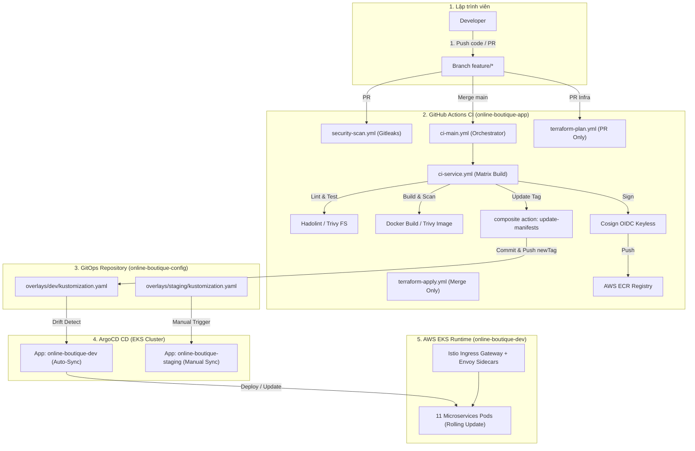
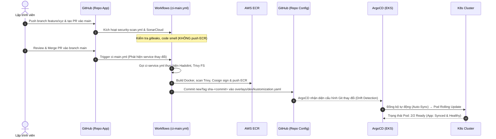
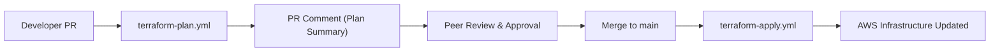
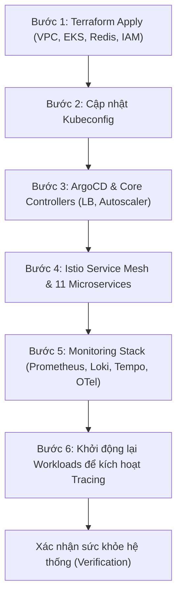

# 🚀 Runbook: Quy Trình Triển Khai (Deployment Guide)

> **Mục tiêu:** Hướng dẫn chuẩn hóa quy trình triển khai tính năng mới (Microservices), thay đổi hạ tầng (Terraform IaC), cũng như quy trình dựng (bootstrap) và tiêu hủy (teardown) hạ tầng hàng ngày cho dự án Online Boutique trên AWS EKS.  
> **Phạm vi áp dụng:** Môi trường `dev` và `staging` trên AWS EKS v1.36.  
> **Tài liệu đối chiếu:** `devops/plan.md`, `devops/architecture.md`, `.ai/context.md`, `devops/destroy-guide.md`.

---

## 1. Thông Tin Môi Trường & Kiến Trúc Triển Khai

### 1.1 Thông Số Cố Định (Fixed Parameters)

| Tham số | Giá trị thực tế | Ghi chú |
| :--- | :--- | :--- |
| **AWS Account ID** | `798836978890` | Cố định trên AWS Cloud |
| **AWS Region** | `ap-southeast-1` (Singapore) | Khu vực triển khai hạ tầng |
| **EKS Cluster Name** | `online-boutique-dev` | Kubernetes v1.36 Spot Instances |
| **ECR Registry URI** | `798836978890.dkr.ecr.ap-southeast-1.amazonaws.com/online-boutique/<service>:<tag>` | Tag format: `sha-<commit_short>` |
| **App Source Repo** | `online-boutique-application-demo/online-boutique-app` | Chứa mã nguồn, Terraform, CI workflows |
| **GitOps Config Repo** | `online-boutique-application-demo/online-boutique-config` | Chứa manifests K8s, Kustomize overlays, ArgoCD Apps |
| **S3 Terraform State** | `online-boutique-tfstate-798836978890` | State lock qua AWS DynamoDB |

### 1.2 Kiến Trúc Luồng Triển Khai End-to-End



---

## 2. Quy Trình Triển Khai Tính Năng Mới (Feature Deployment Workflow)

Mỗi khi có thay đổi nghiệp vụ hoặc sửa lỗi trong bất kỳ microservice nào trong 11 services (`frontend`, `cartservice`, `productcatalogservice`, `currencyservice`, `paymentservice`, `shippingservice`, `emailservice`, `checkoutservice`, `recommendationservice`, `adservice`, `loadgenerator`), quy trình chuẩn gồm 4 bước:

### 2.1 Trình Tự Thực Hiện



### 2.2 Các Lệnh Thực Hiện Chi Tiết

#### Bước 1: Tạo nhánh và phát triển tính năng cục bộ

##### Linux / macOS (Bash):
```bash
# 1. Chuyển vào thư mục repo ứng dụng
cd /d/online-boutique/online-boutique-app

# 2. Đồng bộ nhánh main mới nhất
git checkout main
git pull origin main

# 3. Tạo nhánh tính năng mới theo quy ước git-convention.md
git checkout -b feature/cartservice-redis-retry

# 4. Thực hiện chỉnh sửa mã nguồn, sau đó commit
git add src/cartservice/
git commit -m "feat(cartservice): add exponential retry for redis connection"

# 5. Push nhánh lên GitHub
git push -u origin feature/cartservice-redis-retry
```

##### Windows (PowerShell):
```powershell
# 1. Chuyển vào thư mục repo ứng dụng
Set-Location -Path "d:\online-boutique\online-boutique-app"

# 2. Đồng bộ nhánh main mới nhất
git checkout main
git pull origin main

# 3. Tạo nhánh tính năng mới theo quy ước git-convention.md
git checkout -b feature/cartservice-redis-retry

# 4. Thực hiện chỉnh sửa mã nguồn, sau đó commit
git add src/cartservice/
git commit -m "feat(cartservice): add exponential retry for redis connection"

# 5. Push nhánh lên GitHub
git push -u origin feature/cartservice-redis-retry
```

---

#### Bước 2: Tạo Pull Request và kiểm tra Security Gate

1. Tạo Pull Request trên GitHub hướng từ `feature/cartservice-redis-retry` vào `main`.
2. Theo dõi các GitHub Actions checks tự động:
   - `security-scan.yml`: Kiểm tra secret rò rỉ bằng Gitleaks.
   - `ci-main.yml`: Chỉ chạy tests và linter cục bộ trên nhánh PR, **không** build/push ECR.
3. Sau khi code review đạt chuẩn và tất cả checks hiển thị xanh (`PASS`), tiến hành merge PR (Squash and merge hoặc Rebase).

---

#### Bước 3: Quan sát quá trình Build, Scan, Sign và Cập nhật GitOps Manifests

Sau khi merge vào `main`, workflow `.github/workflows/ci-main.yml` tự động kích hoạt:
- Job `detect-changes` phát hiện service bị thay đổi (`cartservice: true`).
- Chạy workflow con `.github/workflows/ci-service.yml` song song:
  - Kiểm tra Dockerfile với Hadolint.
  - Quét lỗ hổng hệ thống tệp với Trivy.
  - Build Docker image cục bộ.
  - Quét bảo mật container image với Trivy.
  - Đăng nhập AWS ECR thông qua GitHub OIDC (Role ARN không lưu hardcode credential).
  - Ký số container image bằng **Cosign** (Keyless signing qua Sigstore Rekor tlog).
  - Push image lên ECR: `798836978890.dkr.ecr.ap-southeast-1.amazonaws.com/online-boutique/cartservice:sha-<commit_short>`.
  - Composite action `update-manifests` commit tag mới vào file `overlays/dev/kustomization.yaml` trên repo `online-boutique-config`.

##### Lệnh theo dõi trạng thái CI qua GitHub CLI:

##### Linux / macOS (Bash):
```bash
# Xem danh sách workflow runs gần nhất
gh run list --workflow=ci-main.yml --limit 5

# Theo dõi trực tiếp log của run đang chạy
gh run watch
```

##### Windows (PowerShell):
```powershell
# Xem danh sách workflow runs gần nhất
gh run list --workflow=ci-main.yml --limit 5

# Theo dõi trực tiếp log của run đang chạy
gh run watch
```

---

#### Bước 4: Kiểm tra trạng thái đồng bộ trên ArgoCD và Kubernetes

Môi trường `dev` áp dụng chính sách **Auto-Sync** (chu kỳ tự động 3 phút hoặc ngay khi nhận webhook).

##### Linux / macOS (Bash):
```bash
# 1. Đăng nhập hoặc port-forward ArgoCD server (nếu chưa mở port)
kubectl port-forward -n argocd svc/argocd-server 8080:443 &

# 2. Kiểm tra trạng thái ứng dụng online-boutique-dev trên ArgoCD
argocd app get online-boutique-dev

# 3. Theo dõi quá trình Rolling Update của Pods trên EKS
kubectl get pods -n online-boutique -l app=cartservice -w

# 4. Xác nhận image tag mới đã thực sự chạy trong Pod
kubectl get deploy cartservice -n online-boutique -o jsonpath='{.spec.template.spec.containers[0].image}'
echo ""
```

##### Windows (PowerShell):
```powershell
# 1. Port-forward ArgoCD server trên terminal riêng (nếu cần)
Start-Process powershell -ArgumentList "kubectl port-forward -n argocd svc/argocd-server 8080:443"

# 2. Kiểm tra trạng thái ứng dụng online-boutique-dev trên ArgoCD
argocd app get online-boutique-dev

# 3. Theo dõi quá trình Rolling Update của Pods trên EKS
kubectl get pods -n online-boutique -l app=cartservice -w

# 4. Xác nhận image tag mới đã thực sự chạy trong Pod
(kubectl get deploy cartservice -n online-boutique -o jsonpath='{.spec.template.spec.containers[0].image}') + "`n"
```

---

## 3. Quy Trình Triển Khai Thay Đổi Hạ Tầng (Infrastructure Changes Workflow)

Mọi thay đổi hạ tầng AWS (VPC, EKS Cluster, ECR, Node Groups, ElastiCache Redis, IAM Roles) đều được quản lý dưới dạng mã nguồn (IaC) trong thư mục `terraform-aws/`.



### 3.1 Trình Tự Thực Hiện Chi Tiết

#### Bước 1: Thay đổi mã Terraform và kiểm tra cú pháp cục bộ

Trước khi tạo PR, kỹ sư phải chạy validate và format để đảm bảo mã sạch:

##### Linux / macOS (Bash):
```bash
cd /d/online-boutique/online-boutique-app/terraform-aws/environments/dev

# 1. Kiểm tra format
terraform fmt -check -recursive ../..

# 2. Khởi tạo và kiểm tra cú pháp
terraform init -backend=false
terraform validate
```

##### Windows (PowerShell):
```powershell
Set-Location -Path "d:\online-boutique\online-boutique-app\terraform-aws\environments\dev"

# 1. Kiểm tra format
terraform fmt -check -recursive ../..

# 2. Khởi tạo và kiểm tra cú pháp
terraform init -backend=false
terraform validate
```

---

#### Bước 2: Tạo Pull Request và Review kết quả Terraform Plan

1. Push nhánh thay đổi và tạo PR vào `main`.
2. Workflow `.github/workflows/terraform-plan.yml` tự động kích hoạt:
   - Job `detect-env` xác định môi trường bị ảnh hưởng (`dev`, `staging`, `global_ecr`, `global_oidc`).
   - Kết nối AWS qua GitHub OIDC.
   - Chạy `terraform init` và `terraform plan -no-color`.
   - Đăng tải toàn bộ tóm tắt kết quả plan (`Plan: X to add, Y to change, Z to destroy`) trực tiếp dưới dạng **comment trong Pull Request**.
3. Người phê duyệt (Approver) kiểm tra kỹ lưỡng các tài nguyên bị sửa đổi hoặc xóa trước khi bấm nút Merge.

---

#### Bước 3: Merge vào Main và Tự Động Áp Dụng (Terraform Apply)

Sau khi merge PR vào `main`, workflow `.github/workflows/terraform-apply.yml` kích hoạt:
- Tự động thực thi `terraform apply -auto-approve` cho các môi trường tương ứng.
- Cập nhật state file vào S3 bucket: `online-boutique-tfstate-798836978890`.

> [!WARNING]
> Nếu có thay đổi liên quan đến cấu hình mạng VPC, Subnets hoặc Security Groups của EKS, hãy đảm bảo các Pods không bị mất kết nối tới ElastiCache Redis và AWS Services.

---

## 4. Quy Trình Dựng Hạ Tầng Hàng Ngày (Daily Bootstrap Procedure)

Nhằm tối ưu chi phí trên AWS Cloud (tiết kiệm **~67% ngân sách**), toàn bộ cụm hạ tầng được tiêu hủy cuối ngày và dựng lại vào sáng ngày làm việc tiếp theo.

### 4.1 Quy Trình Tuần Tự 6 Bước (Morning Bootstrap SOP)



> [!IMPORTANT]
> **Thứ tự thực hiện là bắt buộc:** Cluster khởi tạo ban đầu chỉ có 3 nodes `t3.medium` (~5790m CPU allocatable). Tổng resource requests của toàn bộ hệ thống là **~5855m CPU**. Do đó, **bắt buộc phải chờ Cluster Autoscaler sẵn sàng** ở Bước 3 trước khi triển khai Istio, Microservices và Monitoring để cluster tự động mở rộng lên 4–5 nodes.

---

### 4.2 Lệnh Triển Khai Chi Tiết Từng Bước

#### Bước 1: Khởi tạo nền tảng hạ tầng AWS bằng Terraform

##### Linux / macOS (Bash):
```bash
cd /d/online-boutique/online-boutique-app/terraform-aws/environments/dev

# Khởi tạo và apply hạ tầng (~10–12 phút)
terraform init
terraform apply -auto-approve

# Kiểm tra các giá trị dynamic sinh ra
terraform output
```

##### Windows (PowerShell):
```powershell
Set-Location -Path "d:\online-boutique\online-boutique-app\terraform-aws\environments\dev"

# Khởi tạo và apply hạ tầng (~10–12 phút)
terraform init
terraform apply -auto-approve

# Kiểm tra các giá trị dynamic sinh ra
terraform output
```

---

#### Bước 2: Cập nhật Kubeconfig kết nối cụm EKS mới

##### Linux / macOS (Bash):
```bash
# Cập nhật kubeconfig với AWS CLI
aws eks update-kubeconfig --region ap-southeast-1 --name online-boutique-dev

# Xác nhận kết nối tới cụm
kubectl get nodes -o wide
```

##### Windows (PowerShell):
```powershell
# Cập nhật kubeconfig với AWS CLI
aws eks update-kubeconfig --region ap-southeast-1 --name online-boutique-dev

# Xác nhận kết nối tới cụm
kubectl get nodes -o wide
```

---

#### Bước 3: Cài đặt ArgoCD và các Core Controllers

##### Linux / macOS (Bash):
```bash
cd /d/online-boutique/online-boutique-config

# 1. Cài đặt ArgoCD Controller bằng Helm
helm install argocd argo/argo-cd \
  --namespace argocd --create-namespace \
  -f argocd/install/values.yaml

# 2. Chờ ArgoCD server và controller sẵn sàng
kubectl wait --for=condition=available deployment -l app.kubernetes.io/part-of=argocd -n argocd --timeout=120s

# 3. Kích hoạt AWS Load Balancer Controller và Cluster Autoscaler qua ArgoCD Applications
kubectl apply -f argocd/apps/dev/aws-lb-controller.yaml
kubectl apply -f argocd/apps/dev/cluster-autoscaler.yaml

# 4. CHỜ BẮT BUỘC: Cluster Autoscaler phải sẵn sàng trước khi tiếp tục
kubectl wait --for=condition=available deployment/cluster-autoscaler-aws-cluster-autoscaler -n kube-system --timeout=180s
```

##### Windows (PowerShell):
```powershell
Set-Location -Path "d:\online-boutique\online-boutique-config"

# 1. Cài đặt ArgoCD Controller bằng Helm
helm install argocd argo/argo-cd `
  --namespace argocd --create-namespace `
  -f argocd/install/values.yaml

# 2. Chờ ArgoCD server và controller sẵn sàng
kubectl wait --for=condition=available deployment -l app.kubernetes.io/part-of=argocd -n argocd --timeout=120s

# 3. Kích hoạt AWS Load Balancer Controller và Cluster Autoscaler qua ArgoCD Applications
kubectl apply -f argocd/apps/dev/aws-lb-controller.yaml
kubectl apply -f argocd/apps/dev/cluster-autoscaler.yaml

# 4. CHỜ BẮT BUỘC: Cluster Autoscaler phải sẵn sàng trước khi tiếp tục
kubectl wait --for=condition=available deployment/cluster-autoscaler-aws-cluster-autoscaler -n kube-system --timeout=180s
```

---

#### Bước 4: Khởi tạo Istio Service Mesh, Kiali và 11 Microservices

##### Linux / macOS (Bash):
```bash
cd /d/online-boutique/online-boutique-config

# 1. Cài đặt Istio core profile=default
istioctl install --set profile=default -y

# 2. Gắn annotation tạo AWS NLB public cho Istio Ingress Gateway
kubectl annotate svc istio-ingressgateway -n istio-system service.beta.kubernetes.io/aws-load-balancer-scheme="internet-facing" --overwrite

# 3. Tạo namespace online-boutique và kích hoạt tự động tiêm Envoy sidecar
kubectl create namespace online-boutique --dry-run=client -o yaml | kubectl apply -f -
kubectl label namespace online-boutique istio-injection=enabled --overwrite

# 4. Áp dụng cấu hình Mesh (Gateway, VirtualService, mTLS STRICT, AuthPolicy)
kubectl apply -f argocd/apps/dev/istio-config.yaml

# 5. Triển khai 11 Microservices qua ArgoCD
kubectl apply -f argocd/apps/dev/online-boutique.yaml

# 6. Cài đặt Kiali Server
helm repo add kiali https://kiali.org/helm-charts 2>/dev/null || true
helm repo update
helm upgrade --install kiali-server kiali/kiali-server -n istio-system -f base/istio/kiali-values.yaml

# 7. Chờ toàn bộ microservices chuyển sang trạng thái sẵn sàng
kubectl wait --for=condition=available deployment --all -n online-boutique --timeout=300s
```

##### Windows (PowerShell):
```powershell
Set-Location -Path "d:\online-boutique\online-boutique-config"

# 1. Cài đặt Istio core profile=default
istioctl install --set profile=default -y

# 2. Gắn annotation tạo AWS NLB public cho Istio Ingress Gateway
kubectl annotate svc istio-ingressgateway -n istio-system service.beta.kubernetes.io/aws-load-balancer-scheme="internet-facing" --overwrite

# 3. Tạo namespace online-boutique và kích hoạt tự động tiêm Envoy sidecar
kubectl create namespace online-boutique 2>$null
kubectl label namespace online-boutique istio-injection=enabled --overwrite

# 4. Áp dụng cấu hình Mesh (Gateway, VirtualService, mTLS STRICT, AuthPolicy)
kubectl apply -f argocd/apps/dev/istio-config.yaml

# 5. Triển khai 11 Microservices qua ArgoCD
kubectl apply -f argocd/apps/dev/online-boutique.yaml

# 6. Cài đặt Kiali Server
helm repo add kiali https://kiali.org/helm-charts 2>$null
helm repo update
helm upgrade --install kiali-server kiali/kiali-server -n istio-system -f base/istio/kiali-values.yaml

# 7. Chờ toàn bộ microservices chuyển sang trạng thái sẵn sàng
kubectl wait --for=condition=available deployment --all -n online-boutique --timeout=300s
```

---

#### Bước 5: Triển khai Monitoring & Observability Stack

Áp dụng toàn bộ ArgoCD Applications còn lại trong thư mục `argocd/apps/dev/`:

##### Linux / macOS (Bash):
```bash
cd /d/online-boutique/online-boutique-config

# Áp dụng tất cả các App manifests (ArgoCD tự động kích hoạt 5 apps monitoring)
kubectl apply -f argocd/apps/dev/

# Chờ pods monitoring sẵn sàng
kubectl wait --for=condition=ready pod -l app.kubernetes.io/name=prometheus -n monitoring --timeout=180s
```

##### Windows (PowerShell):
```powershell
Set-Location -Path "d:\online-boutique\online-boutique-config"

# Áp dụng tất cả các App manifests (ArgoCD tự động kích hoạt 5 apps monitoring)
kubectl apply -f argocd/apps/dev/

# Chờ pods monitoring sẵn sàng
kubectl wait --for=condition=ready pod -l app.kubernetes.io/name=prometheus -n monitoring --timeout=180s
```

---

#### Bước 6: Khởi động lại Workloads để nạp Distributed Tracing

Sau khi OTel Collector và Tempo đã sẵn sàng, cần restart pods để các Envoy sidecar nạp cấu hình Zipkin tracing trỏ về `otel-collector.monitoring:9411`:

##### Linux / macOS (Bash):
```bash
kubectl rollout restart deployment/istiod -n istio-system
kubectl rollout restart deployment -n online-boutique
kubectl rollout restart deployment/istio-ingressgateway -n istio-system
kubectl rollout status deployment/frontend -n online-boutique --timeout=120s
```

##### Windows (PowerShell):
```powershell
kubectl rollout restart deployment/istiod -n istio-system
kubectl rollout restart deployment -n online-boutique
kubectl rollout restart deployment/istio-ingressgateway -n istio-system
kubectl rollout status deployment/frontend -n online-boutique --timeout=120s
```

---

## 5. Quy Trình Tiêu Hủy Hạ Tầng Cuối Ngày (Daily Teardown Procedure)

> [!CAUTION]
> **QUY TẮC SỐNG CÒN:** Tuyệt đối **KHÔNG ĐƯỢC** chạy `terraform destroy` ngay lập tức!  
> Phải xóa các tài nguyên Load Balancer (NLB, ELB) và Persistent Volume Claims (EBS gp2) trên Kubernetes **trước** khi xóa cụm EKS. Nếu xóa cụm EKS trước, AWS sẽ không thể giải phóng các ENI và Subnets, dẫn tới lỗi kẹt `DependencyViolation` kéo dài 30 phút.  
> Chi tiết toàn diện tham khảo tại: [`devops/destroy-guide.md`](../destroy-guide.md).

### Tóm tắt lệnh Teardown nhanh cuối ngày:

##### Linux / macOS (Bash):
```bash
cd /d/online-boutique/online-boutique-config

# BƯỚC 1: Dọn dẹp K8s resources & Load Balancers khi EKS còn sống
helm uninstall kube-prometheus-stack loki-stack tempo otel-collector -n monitoring 2>/dev/null || true
kubectl delete pvc --all -n monitoring --timeout=60s || true
kubectl delete namespace monitoring --timeout=60s || true

helm uninstall kiali-server -n istio-system 2>/dev/null || true
kubectl delete application online-boutique-dev istio-config -n argocd --timeout=60s 2>/dev/null || true
kubectl delete namespace online-boutique --timeout=90s || true

istioctl uninstall --purge -y || true
kubectl delete namespace istio-system --timeout=60s || true

kubectl delete application aws-lb-controller cluster-autoscaler -n argocd --timeout=60s 2>/dev/null || true
helm uninstall argocd -n argocd 2>/dev/null || true
kubectl delete namespace argocd --timeout=60s || true

# Xác nhận Load Balancers đã giải phóng sạch
aws elbv2 describe-load-balancers --region ap-southeast-1 --query "LoadBalancers[*].LoadBalancerName"
aws elb describe-load-balancers --region ap-southeast-1 --query "LoadBalancerDescriptions[*].LoadBalancerName"

# BƯỚC 2: Chạy Terraform Destroy
cd /d/online-boutique/online-boutique-app/terraform-aws/environments/dev
terraform destroy -auto-approve
```

##### Windows (PowerShell):
```powershell
Set-Location -Path "d:\online-boutique\online-boutique-config"

# BƯỚC 1: Dọn dẹp K8s resources & Load Balancers khi EKS còn sống
helm uninstall kube-prometheus-stack loki-stack tempo otel-collector -n monitoring 2>$null
kubectl delete pvc --all -n monitoring --timeout=60s
kubectl delete namespace monitoring --timeout=60s

helm uninstall kiali-server -n istio-system 2>$null
kubectl delete application online-boutique-dev istio-config -n argocd --timeout=60s 2>$null
kubectl delete namespace online-boutique --timeout=90s

istioctl uninstall --purge -y
kubectl delete namespace istio-system --timeout=60s

kubectl delete application aws-lb-controller cluster-autoscaler -n argocd --timeout=60s 2>$null
helm uninstall argocd -n argocd 2>$null
kubectl delete namespace argocd --timeout=60s

# Xác nhận Load Balancers đã giải phóng sạch (Kỳ vọng trả về [])
aws elbv2 describe-load-balancers --region ap-southeast-1 --query "LoadBalancers[*].LoadBalancerName"
aws elb describe-load-balancers --region ap-southeast-1 --query "LoadBalancerDescriptions[*].LoadBalancerName"

# BƯỚC 2: Chạy Terraform Destroy
Set-Location -Path "d:\online-boutique\online-boutique-app\terraform-aws\environments\dev"
terraform destroy -auto-approve
```

---

## 6. Checklist Kiểm Tra Sau Triển Khai (Post-Deploy Verification Checklist)

Sau khi hoàn tất quy trình Deploy tính năng mới hoặc Bootstrap buổi sáng, thực hiện kiểm tra đối chiếu danh mục sau:

### 6.1 Bảng Kiểm Tra Sức Khỏe Toàn Diện

| # | Hạng mục kiểm tra | Lệnh xác minh | Kỳ vọng (Expected Result) | Trạng thái |
|---|---|---|---|:---:|
| 1 | **11 Microservices Pods** | `kubectl get pods -n online-boutique` | Tất cả 11 pods có trạng thái `Running`, `Ready 2/2` (bao gồm Envoy sidecar) | [ ] |
| 2 | **ArgoCD Applications** | `kubectl get applications -n argocd` | Tất cả 9 applications đều `Synced` và `Healthy` | [ ] |
| 3 | **Istio mTLS STRICT** | `kubectl get peerauthentication -n online-boutique` | Policy `default-mtls-strict` có `mode: STRICT` | [ ] |
| 4 | **Kyverno Cluster Policies** | `kubectl get clusterpolicies` | 6 policies đang hoạt động (Ready: True) | [ ] |
| 5 | **Prometheus Scrape Targets** | Query `/api/v1/targets` trên Prometheus | Các targets `envoy-stats`, `kubernetes-nodes`, `pods` đều `UP` | [ ] |
| 6 | **Frontend Public URL** | `curl -I http://<NLB-DNS>/` | HTTP Status `200 OK`, trả về HTML Online Boutique | [ ] |
| 7 | **Loki Logs Collection** | Query `/loki/api/v1/labels` | Nhận diện đủ labels `namespace`, `app`, `container` | [ ] |
| 8 | **Tempo Traces** | Query `/api/search` trên Tempo | Có trace data sinh ra từ `loadgenerator` | [ ] |
| 9 | **Grafana Dashboards** | Mở Grafana Dashboard List | Đủ 3 custom dashboards: Microservices Overview, Istio Mesh, Pod Resources | [ ] |

---

### 6.2 Lệnh Xác Minh Tự Động (Automated Verification Commands)

##### Linux / macOS (Bash):
```bash
# 1. Kiểm tra toàn bộ Pods trong namespace ứng dụng
kubectl get pods -n online-boutique -o wide

# 2. Kiểm tra trạng thái ứng dụng trên ArgoCD
kubectl get applications -n argocd -o custom-columns=NAME:.metadata.name,SYNC:.status.sync.status,HEALTH:.status.health.status

# 3. Lấy Public DNS Name của AWS NLB và kiểm tra truy cập HTTP
NLB_URL=$(kubectl get svc istio-ingressgateway -n istio-system -o jsonpath='{.status.loadBalancer.ingress[0].hostname}')
echo "Frontend URL: http://${NLB_URL}"
curl -s -o /dev/null -w "HTTP Status Code: %{http_code}\n" "http://${NLB_URL}/"

# 4. Kiểm tra số lượng metrics scrape được trong Prometheus
kubectl run test-prom --image=curlimages/curl --restart=Never --rm -i -- \
  -s "http://prometheus-server.monitoring:80/api/v1/query?query=count(istio_requests_total)" | grep -o '"result":\[.*\]'

# 5. Kiểm tra phân bổ Pods trên các Worker Nodes
kubectl get pods -n online-boutique -o wide --sort-by='.spec.nodeName'
```

##### Windows (PowerShell):
```powershell
# 1. Kiểm tra toàn bộ Pods trong namespace ứng dụng
kubectl get pods -n online-boutique -o wide

# 2. Kiểm tra trạng thái ứng dụng trên ArgoCD
kubectl get applications -n argocd -o custom-columns=NAME:.metadata.name,SYNC:.status.sync.status,HEALTH:.status.health.status

# 3. Lấy Public DNS Name của AWS NLB và kiểm tra truy cập HTTP
$NLB_URL = (kubectl get svc istio-ingressgateway -n istio-system -o jsonpath='{.status.loadBalancer.ingress[0].hostname}')
Write-Host "Frontend URL: http://$NLB_URL"
curl.exe -s -o $null -w "HTTP Status Code: %{http_code}`n" "http://$NLB_URL/"

# 4. Kiểm tra số lượng metrics scrape được trong Prometheus
kubectl run test-prom --image=curlimages/curl --restart=Never --rm -i -- -s "http://prometheus-server.monitoring:80/api/v1/query?query=count(istio_requests_total)" 2>$null

# 5. Kiểm tra phân bổ Pods trên các Worker Nodes
kubectl get pods -n online-boutique -o wide --sort-by='.spec.nodeName'
```

---

### 6.3 Bảng Cổng Truy Cập Dịch Vụ Quản Trị (Operations Port-Forward Matrix)

| Dịch vụ | Lệnh Port-Forward | URL Truy cập | Tài khoản / Ghi chú |
| :--- | :--- | :--- | :--- |
| **Online Boutique** | *(Không cần port-forward)* | `http://<NLB-DNS>` | Cổng 80 qua AWS Network Load Balancer |
| **ArgoCD UI** | `kubectl port-forward -n argocd svc/argocd-server 8080:443` | `https://localhost:8080` | `admin` / Lấy pass: `kubectl -n argocd get secret argocd-initial-admin-secret -o jsonpath="{.data.password}" \| base64 -d` |
| **Grafana** | `kubectl port-forward -n monitoring svc/grafana 3000:80` | `http://localhost:3000` | `admin` / `admin` (Dashboards, Logs, Traces) |
| **Prometheus** | `kubectl port-forward -n monitoring svc/prometheus-server 9090:80` | `http://localhost:9090` | Xem targets, PromQL metrics |
| **Alertmanager** | `kubectl port-forward -n monitoring svc/alertmanager 9093:9093` | `http://localhost:9093` | Quản lý silences, alert notifications |
| **Kiali** | `kubectl port-forward -n istio-system svc/kiali 20001:20001` | `http://localhost:20001/kiali` | Đăng nhập ẩn danh (Service Mesh Topology) |
