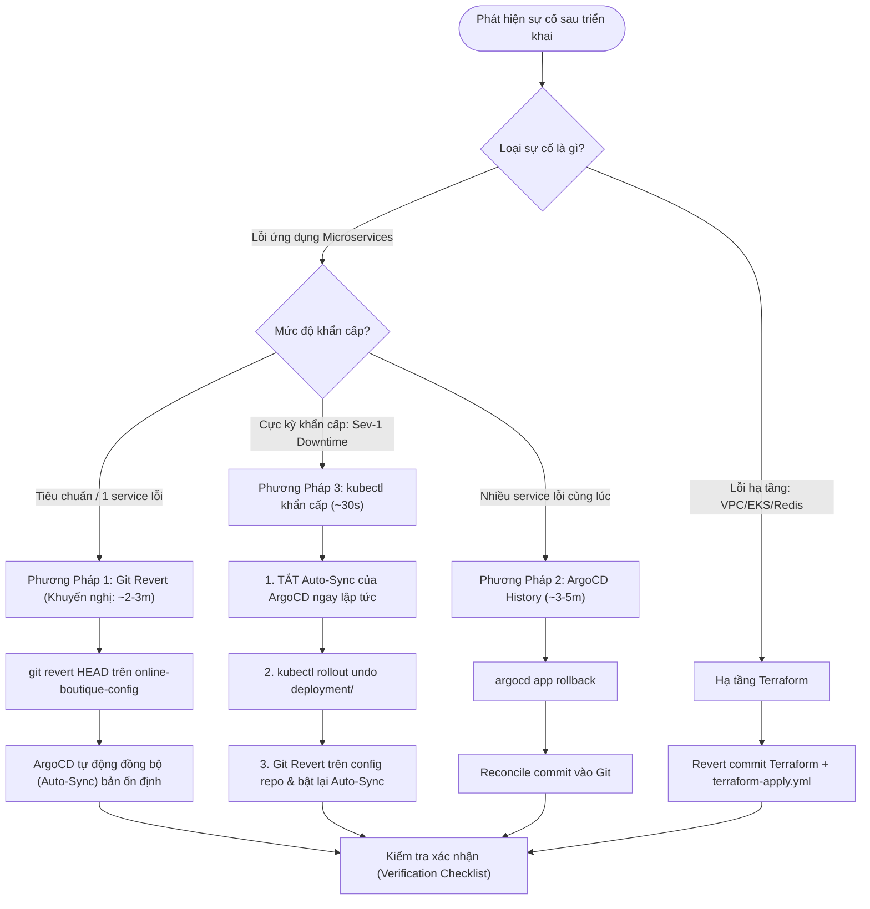
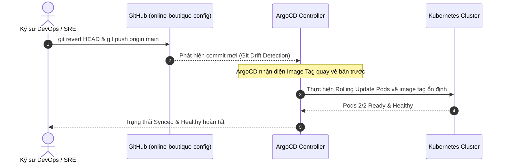
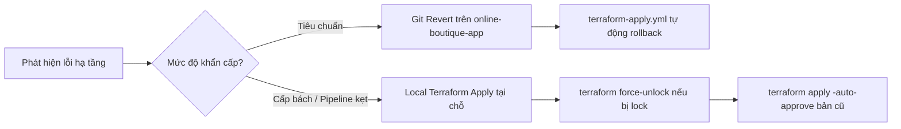

# 🔄 Runbook: Quy Trình Hoàn Nguyên (Rollback Guide)

> **Mục tiêu:** Hướng dẫn các phương pháp hoàn nguyên (rollback) nhanh chóng và an toàn khi xảy ra sự cố triển khai ứng dụng microservices hoặc hạ tầng trên AWS EKS.  
> **Phạm vi:** Ứng dụng Online Boutique (11 microservices), cấu hình GitOps K8s, và mã nguồn hạ tầng Terraform.  
> **Tài liệu đối chiếu:** `devops/plan.md`, `devops/architecture.md`, `.ai/stage-7-integration-spec.md` §4.2, `devops/runbooks/deploy.md`.

---

## 1. Tổng Quan & Ma Trận Quyết Định Hoàn Nguyên (Decision Matrix)

Trong môi trường triển khai hiện đại kết hợp **GitOps (ArgoCD)** và **Infrastructure as Code (Terraform)**, việc rollback không chỉ đơn thuần là quay lại phiên bản container cũ, mà phải đảm bảo tính nhất quán (consistency) giữa trạng thái khai báo trong kho lưu trữ Git (Single Source of Truth) và trạng thái hoạt động thực tế trên cụm Kubernetes.

### 1.1 Ma Trận Quyết Định Phương Pháp Rollback

| Tình huống sự cố | Phương pháp khuyến nghị | Thời gian phục hồi (RTO) | Mức độ rủi ro | Hành động cần thực hiện |
| :--- | :--- | :---: | :---: | :--- |
| **Deploy lỗi 1 service** (Logic bug, crash nhẹ) | **Phương pháp 1: Git Revert** trên config repo | ~2–3 phút | 🟢 Thấp | Revert commit trên `online-boutique-config` → ArgoCD auto-sync |
| **Deploy lỗi hàng loạt / Bad release batch** | **Phương pháp 2: ArgoCD History Rollback** | ~3–5 phút | 🟡 Trung bình | Rollback revision trên ArgoCD UI/CLI → Reconcile lại Git |
| **Sự cố tối khẩn (Sev-1 Outage, Pod CrashLoop)** | **Phương pháp 3: kubectl rollout undo** | **~30 giây** | 🔴 Cao (cần tắt auto-sync) | Tắt auto-sync → Rollout undo → Patch Git sau đó |
| **Lỗi hạ tầng AWS / EKS / Redis** | **Terraform Revert + Apply** | ~15–20 phút | 🟡 Trung bình | Revert mã Terraform → Chạy `terraform-apply.yml` |

---

### 1.2 Cây Quyết Định Xử Lý Sự Cố (Decision Flowchart)



---

## 2. Phương Pháp 1: Git Revert trên Config Repo (Khuyến Nghị Hàng Đầu)

Đây là **phương pháp chuẩn mực nhất trong kiến trúc GitOps**. Khi revert trực tiếp trên kho cấu hình `online-boutique-config`, Git tiếp tục duy trì vai trò là Nguồn Sự Thật Duy Nhất (Single Source of Truth), toàn bộ lịch sử thay đổi được lưu vết kiểm toán (audit log) rõ ràng, và ArgoCD sẽ tự động kéo trạng thái Kubernetes về đúng phiên bản mong muốn.



### Các Bước Thực Hiện Chi Tiết

#### Bước 1: Điều hướng vào repository cấu hình `online-boutique-config`

##### Linux / macOS (Bash):
```bash
cd /d/online-boutique/online-boutique-config
git checkout main
git pull origin main

# Xem 5 commit gần nhất để xác định commit vừa triển khai bị lỗi
git log --oneline -n 5
```

##### Windows (PowerShell):
```powershell
Set-Location -Path "d:\online-boutique\online-boutique-config"
git checkout main
git pull origin main

# Xem 5 commit gần nhất để xác định commit vừa triển khai bị lỗi
git log --oneline -n 5
```

---

#### Bước 2: Hoàn nguyên commit lỗi và đẩy lên Git

##### Linux / macOS (Bash):
```bash
# Trường hợp 1: Revert commit gần nhất (HEAD)
git revert HEAD --no-edit

# Trường hợp 2: Nếu cần revert một commit cụ thể
# git revert <commit-sha> --no-edit

# Đẩy commit hoàn nguyên lên nhánh main
git push origin main
```

##### Windows (PowerShell):
```powershell
# Trường hợp 1: Revert commit gần nhất (HEAD)
git revert HEAD --no-edit

# Trường hợp 2: Nếu cần revert một commit cụ thể
# git revert <commit-sha> --no-edit

# Đẩy commit hoàn nguyên lên nhánh main
git push origin main
```

---

#### Bước 3: Quan sát ArgoCD tự động đồng bộ và Pods khôi phục

##### Linux / macOS (Bash):
```bash
# 1. Kích hoạt sync ngay lập tức nếu không muốn đợi chu kỳ polling 3 phút
argocd app sync online-boutique-dev

# 2. Theo dõi tiến trình cập nhật ứng dụng
argocd app get online-boutique-dev

# 3. Theo dõi trạng thái Pods trên Kubernetes
kubectl get pods -n online-boutique -w
```

##### Windows (PowerShell):
```powershell
# 1. Kích hoạt sync ngay lập tức nếu không muốn đợi chu kỳ polling 3 phút
argocd app sync online-boutique-dev

# 2. Theo dõi tiến trình cập nhật ứng dụng
argocd app get online-boutique-dev

# 3. Theo dõi trạng thái Pods trên Kubernetes
kubectl get pods -n online-boutique -w
```

---

## 3. Phương Pháp 2: Hoàn Nguyên Qua Lịch Sử ArgoCD (ArgoCD History & Rollback)

Áp dụng khi cần hoàn nguyên nhanh toàn bộ Application về một phiên bản triển khai cụ thể trong quá khứ thông qua ArgoCD CLI hoặc Web UI mà không cần can thiệp Git ngay lập tức.

> [!WARNING]
> **CƠ CHẾ AUTO-SYNC CỦA ARGOCD:**  
> Khi bạn chạy lệnh `argocd app rollback`, ArgoCD sẽ **tự động vô hiệu hóa tính năng Auto-Sync** của Application đó. Điều này nhằm bảo vệ cluster không bị Git ghi đè ngược lại phiên bản lỗi.  
> Do đó, sau khi sự cố được khắc phục, bạn **bắt buộc phải thực hiện Git Reconcile** (sửa Git cho khớp với cluster) rồi kích hoạt lại Auto-Sync:  
> `argocd app set online-boutique-dev --sync-policy automated`

---

### 3.1 Thực Hiện Bằng ArgoCD CLI

#### Bước 1: Tra cứu lịch sử các lần triển khai (Revisions)

##### Linux / macOS (Bash):
```bash
# Liệt kê lịch sử các lần deploy kèm Revision ID, thời gian và Git Commit SHA
argocd app history online-boutique-dev
```

##### Windows (PowerShell):
```powershell
# Liệt kê lịch sử các lần deploy kèm Revision ID, thời gian và Git Commit SHA
argocd app history online-boutique-dev
```

*Ví dụ kết quả hiển thị:*
```text
ID    DATE                            REVISION
1     2026-10-31 08:30:15 +0700 +07   a1b2c3d (overlays/dev)
2     2026-10-31 14:15:22 +0700 +07   e4f5g6h (overlays/dev)
3     2026-11-01 09:10:00 +0700 +07   9876543 (overlays/dev)  <-- Bản lỗi hiện tại
```

---

#### Bước 2: Thực thi lệnh Rollback về Revision ổn định

##### Linux / macOS (Bash):
```bash
# Rollback về ID trước đó (ví dụ ID: 2)
argocd app rollback online-boutique-dev 2

# Kiểm tra trạng thái ứng dụng sau rollback
argocd app get online-boutique-dev
```

##### Windows (PowerShell):
```powershell
# Rollback về ID trước đó (ví dụ ID: 2)
argocd app rollback online-boutique-dev 2

# Kiểm tra trạng thái ứng dụng sau rollback
argocd app get online-boutique-dev
```

---

#### Bước 3: Đồng bộ lại trạng thái Git (Git Reconciliation) & Bật lại Auto-Sync

Sau khi cluster đã hoạt động ổn định ở bản cũ:
1. Thực hiện `git revert` trên repo `online-boutique-config` để Git trỏ về đúng tag của revision đã rollback.
2. Bật lại Auto-Sync cho ứng dụng:

##### Linux / macOS (Bash):
```bash
argocd app set online-boutique-dev --sync-policy automated --auto-prune --self-heal
```

##### Windows (PowerShell):
```powershell
argocd app set online-boutique-dev --sync-policy automated --auto-prune --self-heal
```

---

### 3.2 Thực Hiện Bằng ArgoCD Web UI

1. Mở trình duyệt và truy cập ArgoCD UI: `https://localhost:8080` (sau khi chạy `kubectl port-forward -n argocd svc/argocd-server 8080:443`).
2. Đăng nhập bằng tài khoản `admin`.
3. Bấm chọn Application: `online-boutique-dev`.
4. Trên thanh công cụ trên cùng, chọn **History and Rollback**.
5. Danh sách các Revisions trước đó sẽ hiển thị cùng Commit Message. Chọn phiên bản ổn định cần quay lại.
6. Bấm nút **Rollback** và xác nhận trên hộp thoại cảnh báo.
7. Trạng thái Application sẽ chuyển sang `Synced` với revision được chọn và Auto-Sync tự động tạm dừng (Paused).

---

## 4. Phương Pháp 3: Hoàn Nguyên Khẩn Cấp Bằng kubectl (Emergency Rollback)

Áp dụng khi xảy ra sự cố nghiêm trọng cấp độ 1 (**Sev-1 Outage**): Pod liên tục `CrashLoopBackOff`, khách hàng không thể thanh toán, và yêu cầu khôi phục dịch vụ trong vòng **dưới 30 giây**.

> [!CAUTION]
> **NGUY CƠ BỊ ARGOCD OVERRIDE:**  
> Nếu bạn chỉ chạy `kubectl rollout undo` mà không can thiệp vào ArgoCD, ArgoCD sẽ phát hiện ra **Cluster Drift** và trong vòng tối đa 3 phút (chu kỳ Reconciliation), nó sẽ **tự động deploy đè bản lỗi trở lại cluster!**  
> **Quy trình 4 bước dưới đây là bắt buộc để ngăn chặn tình trạng này.**

---

### Quy Trình 4 Bước Khẩn Cấp Chuẩn SOP

#### Bước 1: VÔ HIỆU HÓA AUTO-SYNC CỦA ARGOCD NGAY LẬP TỨC

Tạm dừng cơ chế tự động đồng bộ để ArgoCD không can thiệp vào hành động khẩn cấp của bạn.

##### Linux / macOS (Bash):
```bash
# Cách 1: Qua ArgoCD CLI (khuyên dùng nếu đã login)
argocd app set online-boutique-dev --sync-policy manual

# Cách 2: Qua kubectl patch trực tiếp vào CRD Application (không cần đăng nhập ArgoCD CLI)
kubectl patch application online-boutique-dev -n argocd --type merge -p '{"spec":{"syncPolicy":null}}'
```

##### Windows (PowerShell):
```powershell
# Cách 1: Qua ArgoCD CLI (khuyên dùng nếu đã login)
argocd app set online-boutique-dev --sync-policy manual

# Cách 2: Qua kubectl patch trực tiếp vào CRD Application (không cần đăng nhập ArgoCD CLI)
kubectl patch application online-boutique-dev -n argocd --type merge -p '{"spec":{"syncPolicy":null}}'
```

---

#### Bước 2: Thực thi `kubectl rollout undo` cho service bị lỗi

Quay ngược Deployment về ReplicaSet hợp lệ gần nhất trong Kubernetes:

##### Linux / macOS (Bash):
```bash
# Ví dụ hoàn nguyên checkoutservice
kubectl rollout undo deployment/checkoutservice -n online-boutique

# Hoặc hoàn nguyên nhiều service nếu cần
kubectl rollout undo deployment/frontend -n online-boutique
kubectl rollout undo deployment/cartservice -n online-boutique
```

##### Windows (PowerShell):
```powershell
# Ví dụ hoàn nguyên checkoutservice
kubectl rollout undo deployment/checkoutservice -n online-boutique

# Hoặc hoàn nguyên nhiều service nếu cần
kubectl rollout undo deployment/frontend -n online-boutique
kubectl rollout undo deployment/cartservice -n online-boutique
```

---

#### Bước 3: Theo dõi quá trình hoàn nguyên hoàn tất

##### Linux / macOS (Bash):
```bash
# Chờ đợi pod quay về trạng thái Ready
kubectl rollout status deployment/checkoutservice -n online-boutique --timeout=60s

# Kiểm tra trạng thái Pods thực tế
kubectl get pods -n online-boutique -l app=checkoutservice
```

##### Windows (PowerShell):
```powershell
# Chờ đợi pod quay về trạng thái Ready
kubectl rollout status deployment/checkoutservice -n online-boutique --timeout=60s

# Kiểm tra trạng thái Pods thực tế
kubectl get pods -n online-boutique -l app=checkoutservice
```

---

#### Bước 4: Khắc phục GitOps Manifests & Tái kích hoạt Auto-Sync

Sau khi hệ thống đã hồi phục và hoạt động bình thường:
1. Quay lại repo `online-boutique-config`, cập nhật lại tag của service vừa rollback trong `overlays/dev/kustomization.yaml` bằng đúng tag đang chạy ổn định.
2. Commit và push lên `main`.
3. Bật lại chính sách Auto-Sync cho ArgoCD:

##### Linux / macOS (Bash):
```bash
cd /d/online-boutique/online-boutique-config
git add overlays/dev/kustomization.yaml
git commit -m "fix(gitops): reconcile checkoutservice image tag after emergency rollback"
git push origin main

# Bật lại Auto-Sync
argocd app set online-boutique-dev --sync-policy automated --auto-prune --self-heal
```

##### Windows (PowerShell):
```powershell
Set-Location -Path "d:\online-boutique\online-boutique-config"
git add overlays/dev/kustomization.yaml
git commit -m "fix(gitops): reconcile checkoutservice image tag after emergency rollback"
git push origin main

# Bật lại Auto-Sync
argocd app set online-boutique-dev --sync-policy automated --auto-prune --self-heal
```

---

## 5. Hoàn Nguyên Thay Đổi Hạ Tầng Terraform (Infrastructure Rollback)

Khi một thay đổi hạ tầng (sửa đổi VPC, nâng cấp EKS Node Group, sửa subnet, chỉnh ElastiCache Redis) gây mất kết nối mạng hoặc lỗi hệ thống, áp dụng quy trình sau:



### 5.1 Phương Án A: GitOps CI Pipeline (Khuyến Nghị)

1. Mở repository `online-boutique-app`.
2. Tạo commit hoàn nguyên mã nguồn Terraform trong thư mục `terraform-aws/`.
3. Push lên branch và merge vào `main` (hoặc revert trực tiếp commit trên `main`).
4. Workflow `.github/workflows/terraform-apply.yml` tự động kích hoạt và đưa hạ tầng AWS về trạng thái cũ an toàn.

---

### 5.2 Phương Án B: Can Thiệp Trực Tiếp Cục Bộ (Local Emergency Apply)

Áp dụng khi GitHub Actions bị lỗi kết nối hoặc cần xử lý khẩn cấp tại máy trạm quản trị:

##### Linux / macOS (Bash):
```bash
cd /d/online-boutique/online-boutique-app/terraform-aws/environments/dev

# 1. Checkout phiên bản commit Terraform ổn định trước đó
git log --oneline -n 5
git checkout <stable-commit-hash> -- .

# 2. Kiểm tra các thay đổi dự kiến
terraform plan

# 3. Áp dụng hoàn nguyên
terraform apply -auto-approve

# 4. Sau khi xong, trả lại HEAD nhánh chính và commit khắc phục
git checkout HEAD -- .
```

##### Windows (PowerShell):
```powershell
Set-Location -Path "d:\online-boutique\online-boutique-app\terraform-aws\environments\dev"

# 1. Checkout phiên bản commit Terraform ổn định trước đó
git log --oneline -n 5
git checkout <stable-commit-hash> -- .

# 2. Kiểm tra các thay đổi dự kiến
terraform plan

# 3. Áp dụng hoàn nguyên
terraform apply -auto-approve

# 4. Sau khi xong, trả lại HEAD nhánh chính và commit khắc phục
git checkout HEAD -- .
```

---

### 5.3 Xử Lý Sự Cố Kẹt State Lock (Terraform State Lock Resolution)

Nếu quá trình apply trước đó bị ngắt đột ngột (do hủy workflow giữa chừng), DynamoDB sẽ giữ State Lock và từ chối các lệnh apply tiếp theo:
`Error: Error acquiring the state lock: ConditionalCheckFailedException... Lock Info: ID: <lock-id>`

##### Lệnh mở khóa cưỡng chế (Force Unlock):

##### Linux / macOS (Bash):
```bash
cd /d/online-boutique/online-boutique-app/terraform-aws/environments/dev
terraform force-unlock -force <LOCK-ID>
```

##### Windows (PowerShell):
```powershell
Set-Location -Path "d:\online-boutique\online-boutique-app\terraform-aws\environments\dev"
terraform force-unlock -force <LOCK-ID>
```

---

## 6. Checklist Xác Nhận Sau Rollback & Quy Trình Post-Mortem

### 6.1 Checklist Xác Minh Phục Hồi Dịch Vụ (Post-Rollback Checklist)

| # | Mục tiêu kiểm tra | Cách thức xác minh | Kỳ vọng đạt được | Trạng thái |
|---|---|---|---|:---:|
| 1 | **Pod Status** | `kubectl get pods -n online-boutique` | 100% pods `Running`, `Ready 2/2` (không còn crash/restart liên tục) | [ ] |
| 2 | **Traffic Gateway** | `curl -I http://<NLB-DNS>/` | HTTP Status `200 OK`, response time < 200ms | [ ] |
| 3 | **ArgoCD Health** | `argocd app get online-boutique-dev` | Status: `Healthy`, Sync: `Synced` | [ ] |
| 4 | **Istio Mesh Metrics** | Grafana Dashboard: `Microservices Overview` | Error rate (5xx) giảm về 0%, request rate ổn định | [ ] |
| 5 | **Loki Logs** | Grafana Explore: `{namespace="online-boutique"} \|= "error"` | Không còn log exception hoặc panic bất thường | [ ] |
| 6 | **Git Source of Truth** | `git status` trên cả 2 repos | Trạng thái Git khớp 100% với phiên bản đang chạy trong cụm | [ ] |

---

### 6.2 Lệnh Xác Minh Nhanh Sau Rollback

##### Linux / macOS (Bash):
```bash
# 1. Kiểm tra trạng thái Pods của service vừa rollback
kubectl get pods -n online-boutique -l app=checkoutservice

# 2. Kiểm tra logs gần nhất của container chính
kubectl logs -n online-boutique -l app=checkoutservice -c server --tail=30

# 3. Kiểm tra HTTP Status từ Public NLB
NLB_URL=$(kubectl get svc istio-ingressgateway -n istio-system -o jsonpath='{.status.loadBalancer.ingress[0].hostname}')
curl -s -o /dev/null -w "Public Endpoint Status: %{http_code}\n" "http://${NLB_URL}/"
```

##### Windows (PowerShell):
```powershell
# 1. Kiểm tra trạng thái Pods của service vừa rollback
kubectl get pods -n online-boutique -l app=checkoutservice

# 2. Kiểm tra logs gần nhất của container chính
kubectl logs -n online-boutique -l app=checkoutservice -c server --tail=30

# 3. Kiểm tra HTTP Status từ Public NLB
$NLB_URL = (kubectl get svc istio-ingressgateway -n istio-system -o jsonpath='{.status.loadBalancer.ingress[0].hostname}')
curl.exe -s -o $null -w "Public Endpoint Status: %{http_code}`n" "http://$NLB_URL/"
```

---

### 6.3 Mẫu Biên Bản Phân Tích Nguyên Nhân Gốc Rễ (Post-Mortem Template)

Sau khi hệ thống được khôi phục, đội ngũ kỹ thuật bắt buộc phải lập biên bản sự cố theo biểu mẫu sau:

```markdown
# 📋 Biên Bản Sự Cố & Phân Tích Nguyên Nhân Gốc Rễ (Post-Mortem Report)

- **Mã sự cố (Incident ID):** INC-YYYYMMDD-01
- **Thời gian bắt đầu (Incident Start):** YYYY-MM-DD HH:MM UTC+7
- **Thời gian phục hồi (Recovery Time):** YYYY-MM-DD HH:MM UTC+7
- **Tổng thời gian gián đoạn (Downtime/Impact Duration):** XX phút
- **Mức độ nghiêm trọng (Severity):** [Sev-1 / Sev-2 / Sev-3]
- **Dịch vụ bị ảnh hưởng:** [ví dụ: checkoutservice, cartservice]
- **Người chủ trì xử lý (Incident Commander):** [Tên kỹ sư DevOps]

---

### 1. Tóm Tắt Sự Cố (Executive Summary)
[Mô tả ngắn gọn điều gì đã xảy ra, khách hàng bị ảnh hưởng như thế nào và hệ thống đã được phục hồi ra sao].

### 2. Dòng Thời Gian Xử Lý (Timeline of Events)
- **HH:MM** - Kỹ sư merge PR #... vào branch main.
- **HH:MM** - CI hoàn tất build, ArgoCD auto-sync image tag mới.
- **HH:MM** - Hệ thống cảnh báo Alertmanager kích hoạt: `High5xxRate` trên checkoutservice.
- **HH:MM** - Kỹ sư trực phát hiện lỗi qua Grafana và quyết định thực hiện Rollback.
- **HH:MM** - Áp dụng phương pháp Rollback [Git Revert / ArgoCD / kubectl].
- **HH:MM** - Pods quay về trạng thái Ready, HTTP 200 được khôi phục.

### 3. Nguyên Nhân Gốc Rễ (Root Cause Analysis - 5 Whys)
1. *Tại sao service bị crash?* -> Do biến môi trường Redis connection string bị null.
2. *Tại sao biến môi trường bị null?* -> Do thay đổi config Kustomize chưa bổ sung secret key mới.
3. *Tại sao không phát hiện trước khi deploy?* -> Do bài test unit chưa cover kịch bản missing env var.

### 4. Phương Pháp Khắc Phục (Resolution)
- Đã hoàn nguyên về image tag `sha-<previous_commit>`.
- Đã reconcile GitOps repo và bật lại Auto-Sync.

### 5. Hành Động Phòng Ngừa (Preventative Action Items)
| Hành động | Người chịu trách nhiệm | Hạn chót | Trạng thái |
| :--- | :--- | :--- | :---: |
| Bổ sung kiểm tra cấu hình env var trong CI Hadolint/Trivy | DevOps Team | YYYY-MM-DD | To Do |
| Thêm integration test cho redis connection timeout | Dev Team | YYYY-MM-DD | To Do |
| Thiết lập canary deployment qua Argo Rollouts thay vì rolling update | SRE Team | YYYY-MM-DD | Backlog |
```
