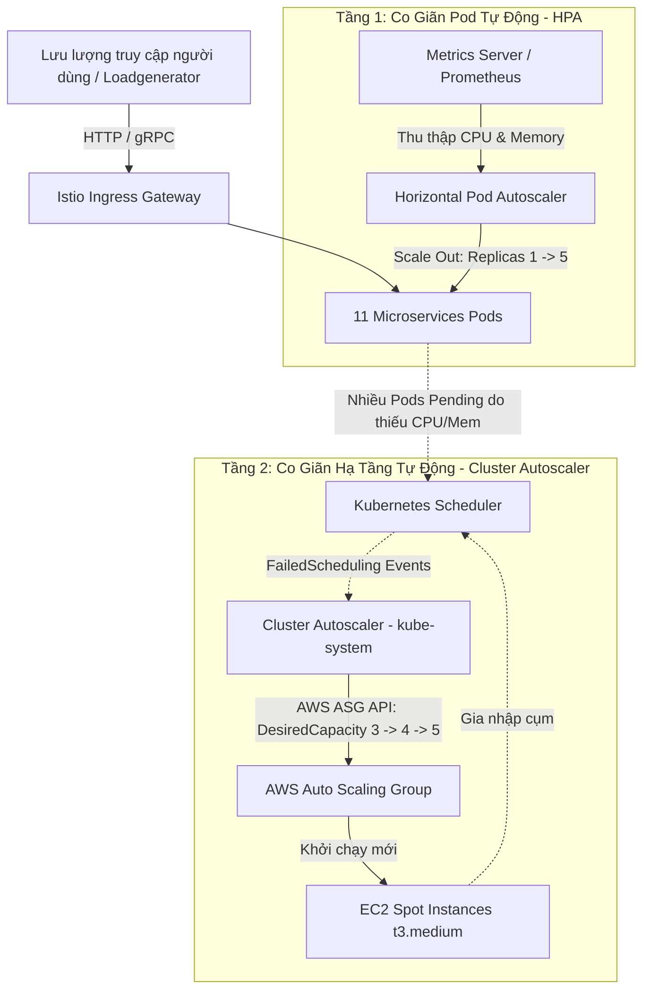

# 📈 Runbook: Hướng Dẫn Co Giãn Tài Nguyên (Scaling Guide)

> **Dành cho:** Kỹ sư Vận hành (SRE) / DevOps Engineer phụ trách hệ thống Online Boutique trên AWS EKS.  
> **Phạm vi áp dụng:** Cụm EKS `online-boutique-dev` (v1.36), khu vực `ap-southeast-1`, tài khoản AWS `798836978890`.  
> **Mục tiêu:** Hướng dẫn quy trình co giãn tự động và thủ công ở cả 2 tầng: **Pod (HPA)** và **Node (Cluster Autoscaler)**, kết hợp tối ưu chi phí trên nền tảng **EC2 Spot Instances**.

---

## 📑 Bảng Tra Cứu Nhanh (Quick Navigation Matrix)

| Chủ đề | Thành phần áp dụng | Mục tiêu chính | Tham chiếu |
| :--- | :--- | :--- | :--- |
| **1. Horizontal Pod Autoscaler** | 11 Microservices (`online-boutique`) | Co giãn số lượng Pods theo CPU 70% / Memory 80% | [Mục 1](#1-hướng-dẫn-cấu-hình-horizontal-pod-autoscaler-hpa) |
| **2. Cluster Autoscaler** | EKS Managed Node Group (`kube-system`) | Co giãn số lượng Node (min 2, desired 3, max 5) | [Mục 2](#2-quản-trị-cluster-autoscaler) |
| **3. Manual Scaling** | Deployments (`kubectl scale`) | Can thiệp khẩn cấp & xử lý xung đột ArgoCD GitOps | [Mục 3](#3-co-giãn-thủ-công-manual-scaling--cảnh-báo-argocd-drift) |
| **4. Spot Instance Resilience** | Worker Nodes (EC2 Spot `t3.medium`) | Chống gián đoạn thu hồi 2 phút, cấu hình PDB | [Mục 4](#4-lưu-ý-khi-sử-dụng-ec2-spot-instances--chống-gián-đoạn) |
| **5. Cost Optimization** | Toàn bộ hạ tầng AWS | Tiết kiệm ~67% chi phí qua mô hình Ephemeral | [Mục 5](#5-chiến-lược-tối-ưu-chi-phí-đám-mây-cost-optimization-tips) |

---

## 🏗️ Kiến Trúc Co Giãn 2 Tầng (Two-Tier Scaling Architecture)



---

## 1. Hướng Dẫn Cấu Hình Horizontal Pod Autoscaler (HPA)

### 1.1 Nguyên Lý & Điều Kiện Hoạt Động
- **Cơ chế thu thập:** HPA định kỳ (mặc định mỗi 15 giây) truy vấn Kubernetes Metrics Server để lấy mức tiêu thụ CPU (`container_cpu_usage_seconds_total`) và Memory (`container_memory_working_set_bytes`) của các container trong Pod.
- **Điều kiện tiên quyết:** Container ứng dụng **bắt buộc phải có khai báo `resources.requests`** trong Deployment manifest. Nếu thiếu trường `requests`, HPA không thể tính toán được tỷ lệ phần trăm sử dụng và sẽ hiển thị `<unknown>/70%`.

### 1.2 Ngưỡng Tiêu Chuẩn Khuyến Nghị (Recommended Thresholds)

> [!IMPORTANT]
> - **CPU Utilization Target: 70%** — Ngưỡng tối ưu cho phép Pod xử lý các đợt tăng tải đột ngột (traffic burst) trong khi chờ Pod mới khởi động hoàn tất mà không bị CPU throttling.
> - **Memory Utilization Target: 80%** — Ngưỡng an toàn bảo vệ container không bị Linux OOM-Killer tiêu diệt (Exit Code 137) khi bộ nhớ phình to đột biến.

#### Bảng Phân Tầng Co Giãn Cho 11 Microservices:

| Nhóm dịch vụ | Microservices cụ thể | Replicas (Min - Max) | Ngưỡng kích hoạt | Lý do kiến trúc |
| :--- | :--- | :---: | :---: | :--- |
| **Tier 1: Cổng Ingress & Web** | `frontend` | 2 – 10 | CPU: 70%, Mem: 80% | Chịu toàn bộ lưu lượng HTTP bên ngoài, xử lý SSR template và gọi gRPC xuống dưới. |
| **Tier 2: Giao Dịch Cốt Lõi** | `checkoutservice`<br/>`cartservice`<br/>`paymentservice`<br/>`currencyservice` | 1 – 5 | CPU: 70%, Mem: 80% | Chuỗi xử lý thanh toán và giỏ hàng. `cartservice` kết nối ElastiCache Redis ngoài mesh. |
| **Tier 3: Hỗ Trợ & Bất Đồng Bộ** | `productcatalogservice`<br/>`recommendationservice`<br/>`shippingservice`<br/>`emailservice`<br/>`adservice` | 1 – 3 | CPU: 70%, Mem: 80% | Tác vụ phụ trợ, có thể chịu độ trễ nhẹ hoặc đọc dữ liệu tĩnh trong bộ nhớ. |
| **Testing** | `loadgenerator` | 1 (Cố định) | Không áp dụng HPA | Công cụ sinh tải (Locust), điều khiển thủ công khi cần kiểm thử tải. |

---

### 1.3 Mẫu Manifest YAML Chuẩn Mực (`autoscaling/v2`)

Dưới đây là mẫu định nghĩa HPA chuẩn mực tích hợp cả 2 chỉ số CPU và Memory, kèm chính sách giảm quy mô (Scale Down Stabilization) an toàn chống rung lắc pod (flapping):

```yaml
apiVersion: autoscaling/v2
kind: HorizontalPodAutoscaler
metadata:
  name: frontend-hpa
  namespace: online-boutique
  labels:
    app: frontend
    tier: web
spec:
  scaleTargetRef:
    apiVersion: apps/v1
    kind: Deployment
    name: frontend
  minReplicas: 2
  maxReplicas: 10
  metrics:
    - type: Resource
      resource:
        name: cpu
        target:
          type: Utilization
          averageUtilization: 70
    - type: Resource
      resource:
        name: memory
        target:
          type: Utilization
          averageUtilization: 80
  behavior:
    scaleDown:
      stabilizationWindowSeconds: 300 # Chờ 5 phút ổn định trước khi hạ số pod
      policies:
        - type: Percent
          value: 20 # Mỗi lần hạ không quá 20% tổng số pod
          periodSeconds: 60
    scaleUp:
      stabilizationWindowSeconds: 0 # Tăng pod ngay lập tức khi tải tăng
      policies:
        - type: Percent
          value: 100 # Cho phép nhân đôi số pod nếu cần thiết
          periodSeconds: 15
        - type: Pods
          value: 4 # Hoặc tăng tối đa 4 pods mỗi 15 giây
          periodSeconds: 15
      selectPolicy: Max
```

---

### 1.4 Lệnh Quản Trị HPA Nhanh Bằng Kubectl

#### Tạo nhanh HPA bằng lệnh:

##### Trên Linux / macOS (Bash):
```bash
# Tạo HPA cho frontend: min 2, max 10, ngưỡng CPU 70%
kubectl autoscale deployment frontend -n online-boutique --cpu-percent=70 --min=2 --max=10

# Tạo HPA cho checkoutservice: min 1, max 5, ngưỡng CPU 70%
kubectl autoscale deployment checkoutservice -n online-boutique --cpu-percent=70 --min=1 --max=5

# Tạo HPA cho cartservice: min 1, max 5, ngưỡng CPU 70%
kubectl autoscale deployment cartservice -n online-boutique --cpu-percent=70 --min=1 --max=5
```

##### Trên Windows (PowerShell):
```powershell
# Tạo HPA cho frontend: min 2, max 10, ngưỡng CPU 70%
kubectl autoscale deployment frontend -n online-boutique --cpu-percent=70 --min=2 --max=10

# Tạo HPA cho checkoutservice: min 1, max 5, ngưỡng CPU 70%
kubectl autoscale deployment checkoutservice -n online-boutique --cpu-percent=70 --min=1 --max=5

# Tạo HPA cho cartservice: min 1, max 5, ngưỡng CPU 70%
kubectl autoscale deployment cartservice -n online-boutique --cpu-percent=70 --min=1 --max=5
```

#### Kiểm tra trạng thái HPA:

##### Trên Linux / macOS (Bash):
```bash
# Liệt kê tất cả HPA trong namespace online-boutique
kubectl get hpa -n online-boutique

# Xem chi tiết điều kiện kích hoạt và sự kiện scale của frontend
kubectl describe hpa frontend-hpa -n online-boutique
```

##### Trên Windows (PowerShell):
```powershell
# Liệt kê tất cả HPA trong namespace online-boutique
kubectl get hpa -n online-boutique

# Xem chi tiết điều kiện kích hoạt và sự kiện scale của frontend
kubectl describe hpa frontend-hpa -n online-boutique
```

---

## 2. Quản Trị Cluster Autoscaler

### 2.1 Cấu Hình Hiện Tại Cụm EKS Dev
Cụm `online-boutique-dev` sử dụng AWS Managed Node Group với loại máy ảo **EC2 Spot `t3.medium`** (2 vCPU, 4 GiB Memory mỗi node).

- **`node_min_size`:** `2` nodes (Mức sàn tiết kiệm chi phí ngoài giờ).
- **`node_desired_size`:** `3` nodes (Mức thông thường đảm bảo chạy 11 microservices + Istio).
- **`node_max_size`:** `5` nodes (Trần tối đa khi chạy load testing hoặc có thêm stack monitoring).

> [!WARNING]
> **Hiện tượng nghẽn tài nguyên:** Tổng dung lượng CPU Allocatable của 3 nodes `t3.medium` là **~5790m CPU**. Trong khi đó, tổng resource requests của toàn bộ hệ thống (Istio + 11 microservices + 11 Envoy sidecars + Monitoring Prometheus/Loki/Tempo) là **~5855m CPU**. Do đó, khi vừa triển khai toàn bộ hệ thống, một số pods sẽ rơi vào trạng thái `Pending` để kích hoạt Cluster Autoscaler tự động mở rộng lên **4 hoặc 5 nodes**.

---

### 2.2 Cơ Chế Tự Động Phát Hiện Qua AWS ASG Tags
Cluster Autoscaler tự động nhận biết Auto Scaling Group nào thuộc quyền quản lý của nó thông qua 2 thẻ (tags) được Terraform tự động gán vào ASG:
1. `k8s.io/cluster-autoscaler/enabled = true`
2. `k8s.io/cluster-autoscaler/online-boutique-dev = owned`

Khi có Pod rơi vào trạng thái `Pending` với sự kiện `FailedScheduling` (Insufficient cpu / Insufficient memory), Cluster Autoscaler tính toán số lượng node cần thiết và gọi API của AWS EC2 Auto Scaling để tăng `DesiredCapacity`.

---

### 2.3 Quy Trình Thay Đổi Quy Mô Cụm Qua Terraform

Khi cần chuẩn bị cho đợt kiểm thử tải lớn (Stress Testing) hoặc khi số lượng workloads tăng, hãy nâng ngưỡng node thông qua Terraform:

#### Bước 1: Điều chỉnh biến số cấu hình
Mở tệp `terraform-aws/environments/dev/terraform.tfvars`:

```hcl
node_desired_size = 4
node_min_size     = 2
node_max_size     = 8   # Nâng trần tối đa từ 5 lên 8 nodes
```

#### Bước 2: Thực thi Terraform Apply

##### Trên Linux / macOS (Bash):
```bash
cd terraform-aws/environments/dev

# 1. Khởi tạo và kiểm tra kế hoạch thay đổi
terraform plan -target=module.eks

# 2. Áp dụng thay đổi cấu hình Node Group
terraform apply -target=module.eks -auto-approve
```

##### Trên Windows (PowerShell):
```powershell
Set-Location -Path "d:\online-boutique\online-boutique-app\terraform-aws\environments\dev"

# 1. Khởi tạo và kiểm tra kế hoạch thay đổi
terraform plan -target=module.eks

# 2. Áp dụng thay đổi cấu hình Node Group
terraform apply -target=module.eks -auto-approve
```

---

### 2.4 Lệnh Giám Sát & Kiểm Tra Cluster Autoscaler

##### Trên Linux / macOS (Bash):
```bash
# 1. Đọc logs thời gian thực của Cluster Autoscaler
kubectl logs -n kube-system -l app.kubernetes.io/name=aws-cluster-autoscaler -f --tail=30

# 2. Kiểm tra ConfigMap trạng thái co giãn của Cluster Autoscaler
kubectl get cm cluster-autoscaler-status -n kube-system -o yaml

# 3. Liệt kê danh sách các Nodes và nhãn vòng đời (Spot / On-Demand)
kubectl get nodes -L node.kubernetes.io/instance-type,karpenter.sh/capacity-type,topology.kubernetes.io/zone
```

##### Trên Windows (PowerShell):
```powershell
# 1. Đọc logs thời gian thực của Cluster Autoscaler
kubectl logs -n kube-system -l app.kubernetes.io/name=aws-cluster-autoscaler -f --tail=30

# 2. Kiểm tra ConfigMap trạng thái co giãn của Cluster Autoscaler
kubectl get cm cluster-autoscaler-status -n kube-system -o yaml

# 3. Liệt kê danh sách các Nodes và nhãn vòng đời (Spot / On-Demand)
kubectl get nodes -L node.kubernetes.io/instance-type,karpenter.sh/capacity-type,topology.kubernetes.io/zone
```

---

## 3. Co Giãn Thủ Công (Manual Scaling) & Cảnh Báo ArgoCD Drift

### 3.1 Lệnh Scale Thủ Công Bằng Kubectl

Trong một số tình huống khẩn cấp, bạn có thể tăng giảm số lượng replica ngay lập tức:

##### Trên Linux / macOS (Bash):
```bash
# Scale dịch vụ frontend lên 5 replicas
kubectl scale deployment frontend -n online-boutique --replicas=5

# Tắt tạm thời loadgenerator để giảm tải cluster
kubectl scale deployment loadgenerator -n online-boutique --replicas=0
```

##### Trên Windows (PowerShell):
```powershell
# Scale dịch vụ frontend lên 5 replicas
kubectl scale deployment frontend -n online-boutique --replicas=5

# Tắt tạm thời loadgenerator để giảm tải cluster
kubectl scale deployment loadgenerator -n online-boutique --replicas=0
```

---

### 3.2 ⚠️ CẢNH BÁO QUAN TRỌNG: ArgoCD GitOps Drift

> [!CAUTION]
> **Nguy cơ Revert Cấu Hình Của ArgoCD:**  
> Hệ thống Online Boutique được quản lý theo mô hình **GitOps chuẩn mực** qua ArgoCD Application `online-boutique-dev` với chính sách tự phục hồi:
> ```yaml
> syncPolicy:
>   automated:
>     prune: true
>     selfHeal: true
> ```
> Khi bạn chạy lệnh `kubectl scale`, Kubernetes API sẽ cập nhật số replicas mới. Tuy nhiên, sau khoảng **10–30 giây**, ArgoCD Controller sẽ phát hiện trạng thái trên cụm lệch so với khai báo trong Git repo (`online-boutique-config`), nhận diện đây là **Cấu hình trôi dạt (Drift)**, và **tự động ép số replica quay trở về giá trị gốc trong Git**!

---

### 3.3 Ba Phương Án Xử Lý Khi Cần Co Giãn An Toàn

#### Phương án 1: Chuẩn GitOps-Native (Khuyên Dùng Cho Mọi Tình Huống Bình Thường)
Thực hiện thay đổi số lượng replica trực tiếp trong repository cấu hình:
1. Mở file `online-boutique-config/base/online-boutique/<service>.yaml` (hoặc patch overlay dev).
2. Sửa giá trị `spec.replicas: N`.
3. Commit và push lên GitHub. ArgoCD sẽ phát hiện commit mới và đồng bộ an toàn 100%.

#### Phương án 2: Can Thiệp Khẩn Cấp (Emergency Override)
Nếu đang trong lúc sự cố cần scale gấp bằng `kubectl` mà không muốn ArgoCD tự revert:

##### Trên Linux / macOS (Bash) & Windows (PowerShell):
```bash
# 1. Tạm thời tắt tính năng self-heal của ArgoCD Application
argocd app set online-boutique-dev --self-heal=false

# 2. Thực hiện lệnh scale bằng kubectl tùy ý
kubectl scale deployment frontend -n online-boutique --replicas=5

# 3. Sau khi sự cố đã được khắc phục hoàn toàn, cập nhật lại Git và bật lại self-heal
argocd app set online-boutique-dev --self-heal=true
```

#### Phương án 3: Kết Hợp Hòa Bình Giữa HPA và ArgoCD
Khi sử dụng HPA để tự động điều chỉnh `replicas`, cấu hình tệp Application của ArgoCD (`argocd/apps/dev/online-boutique.yaml`) bỏ qua trường `spec.replicas`:

```yaml
spec:
  ignoreDifferences:
    - group: apps
      kind: Deployment
      jsonPointers:
        - /spec/replicas
```
*(Cấu hình này cho phép HPA toàn quyền tăng/giảm replicas mà ArgoCD không báo OutOfSync).*

---

## 4. Lưu Ý Khi Sử Dụng EC2 Spot Instances & Chống Gián Đoạn

### 4.1 Cơ Chế Thu Hồi Của Spot Instance (2-Minute Notice)
- **Ưu điểm:** Tiết kiệm từ **60% đến 70% chi phí điện toán** so với giá On-Demand.
- **Rủi ro gián đoạn:** AWS có quyền thu hồi Spot Instance bất kỳ lúc nào khi nhu cầu On-Demand tăng cao. AWS sẽ gửi tín hiệu cảnh báo trước **đúng 2 phút (120 giây)** thông qua:
  1. EC2 Instance Metadata Service (IMDS): `http://169.254.169.254/latest/meta-data/spot/instance-action`.
  2. Amazon EventBridge: Sự kiện `EC2 Spot Instance Interruption Warning`.
- EKS Node Group tự động kích hoạt tiến trình đánh dấu node (`taint: NoSchedule`) và thực hiện di tản pod (`drain`).

### 4.2 Cảnh Báo Giám Sát `SpotInstanceInterruption`
Hệ thống Prometheus của dự án (Stage 5) đã tích hợp sẵn cảnh báo thông minh trong `PrometheusRule`:

```yaml
- alert: SpotInstanceInterruption
  expr: kube_node_spec_taint{key="aws-node-termination-handler/spot-itn",effect="NoSchedule"} == 1
  for: 0m
  labels:
    severity: warning
    tier: infrastructure
  annotations:
    summary: "Spot instance {{ $labels.node }} is being interrupted"
    description: "AWS Spot instance {{ $labels.node }} has received an interruption notice. Pods on this node will be drained."
```

---

### 4.3 Giải Pháp Đảm Bảo Tính Sẵn Sàng Cao (Zero-Downtime Resilience)

#### 1. Áp dụng PodDisruptionBudget (PDB)
PDB ngăn chặn Kubernetes tiêu hủy quá nhiều pod cùng một lúc trong quá trình di tản (node draining).

Mẫu manifest PDB bảo vệ các dịch vụ nhạy cảm trong `online-boutique-config/base/online-boutique/`:

```yaml
apiVersion: policy/v1
kind: PodDisruptionBudget
metadata:
  name: frontend-pdb
  namespace: online-boutique
spec:
  minAvailable: 1 # Luôn đảm bảo có ít nhất 1 pod frontend hoạt động
  selector:
    matchLabels:
      app: frontend
---
apiVersion: policy/v1
kind: PodDisruptionBudget
metadata:
  name: checkout-pdb
  namespace: online-boutique
spec:
  maxUnavailable: 1 # Tối đa chỉ cho phép 1 pod checkoutservice bị gián đoạn cùng lúc
  selector:
    matchLabels:
      app: checkoutservice
```

#### 2. Phân Tán Pods Trải Đều Các Vùng Khả Dụng (Topology Spread Constraints)
Đảm bảo các bản sao của cùng một microservice không bao giờ bị xếp chung trên cùng một Node hoặc cùng một Availability Zone (AZ):

```yaml
spec:
  topologySpreadConstraints:
    - maxSkew: 1
      topologyKey: topology.kubernetes.io/zone
      whenUnsatisfiable: ScheduleAnyway
      labelSelector:
        matchLabels:
          app: frontend
```

#### 3. Cấu hình Graceful Termination trong Deployment
Đảm bảo container và Envoy sidecar có đủ thời gian hoàn tất các request đang dang dở trước khi bị SIGKILL:
```yaml
spec:
  template:
    spec:
      terminationGracePeriodSeconds: 45
```

---

## 5. Chiến Lược Tối Ưu Chi Phí Đám Mây (Cost Optimization Tips)

### 5.1 Tiêu Hủy Môi Trường Staging Khi Không Sử Dụng
Môi trường `staging` chỉ nên được kích hoạt phục vụ cho các đợt nghiệm thu phát hành lớn (Release Acceptance Testing). Khi chu kỳ kiểm thử hoàn tất, lập tức gỡ bỏ staging application để giải phóng tài nguyên CPU/Memory:

##### Trên Linux / macOS (Bash) & Windows (PowerShell):
```bash
# Xóa bỏ Application staging trên ArgoCD
kubectl delete application online-boutique-staging -n argocd --ignore-not-found
```

---

### 5.2 Mô Hình Hạ Tầng Tạm Thời (Ephemeral Infrastructure Pattern)

> [!TIP]
> **Quy tắc vàng tiết kiệm ngân sách:**  
> Môi trường phát triển (Dev) không cần hoạt động 24/7. Áp dụng chu trình vận hành **Ephemeral**:
> - **Cuối ngày làm việc (~18h00 – 19h00):** Tiêu hủy toàn bộ hạ tầng bằng quy trình chuẩn tại [`devops/destroy-guide.md`](../destroy-guide.md).
> - **Đầu ngày mới (~8h30 – 9h00):** Tái tạo tự động bằng kịch bản `terraform apply` và đồng bộ GitOps ArgoCD.
>
> 💰 **Hiệu quả tài chính:**  
> Hệ thống chỉ chạy khoảng 9–10 giờ/ngày thay vì 24 giờ $\rightarrow$ **Giảm chi phí từ ~$180/tháng xuống còn ~$55–60/tháng (Tiết kiệm ~67% ngân sách Cloud)**.

---

### 5.3 Co Giãn Giảm Tải Ngoài Giờ Làm Việc (Scale Down Off-Hours)
Nếu có nhu cầu giữ lại cluster qua đêm để phục vụ test tự động nhưng muốn tối ưu chi phí:

1. **Tắt tải nhân tạo (Stop Loadgenerator):**
   ```bash
   kubectl scale deployment loadgenerator -n online-boutique --replicas=0
   ```
   *(Hành động này giảm gần 40% CPU request và 100% traffic giả lập, cho phép HPA tự động co cụm các microservices về `minReplicas = 1`).*

2. **Hạ số lượng Worker Nodes về mức tối thiểu:**
   Chỉnh `node_min_size = 2` và `node_desired_size = 2` trong `terraform.tfvars`.

---

### 5.4 Tối Ưu Hóa Kích Thước Yêu Cầu Tài Nguyên (Right-Sizing)
Thường xuyên quan sát Dashboard **Pod Resources** trên Grafana (`http://localhost:3000`):
- So sánh giữa `CPU Throttling %` và `CPU Usage vs Request`.
- Nếu một service liên tục tiêu thụ dưới 20% mức CPU request đã khai báo, hãy điều chỉnh giảm request trong manifest base. Điều này giúp tối ưu hóa mật độ đóng gói (Bin Packing), cho phép nhiều Pods chạy trên số lượng node ít hơn mà không cần scale thêm node mới.

---

## 6. Danh Mục Tài Liệu Tham Chiếu (References)

- [Runbook: Xử Lý Sự Cố Hệ Thống (Troubleshooting)](troubleshooting.md)
- [Quy trình Triển Khai & Vận Hành Hàng Ngày](deploy.md)
- [Quy trình Hoàn Nguyên Ứng Dụng (Rollback)](rollback.md)
- [Hướng Dẫn Tiêu Hủy & Tái Tạo Hạ Tầng An Toàn](../destroy-guide.md)
- [Báo Cáo Nghiệm Thu Khả Năng Quan Sát Stage 5](../stage-5-monitoring.md)
