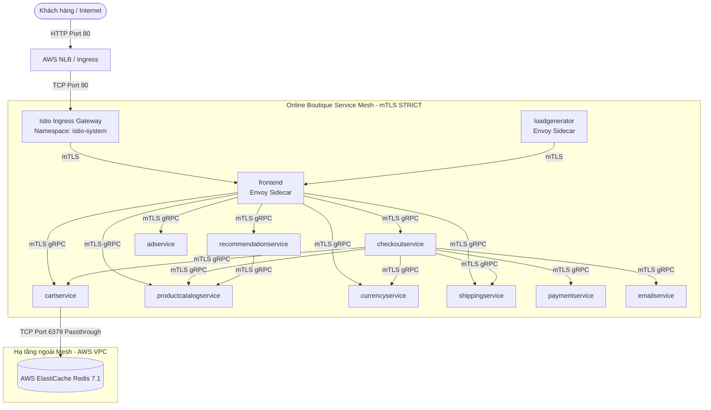

# 🕸️ Stage 4 – Service Mesh: Istio + Kiali

> **Ngày hoàn thành:** 2026-10-18  
> **Áp dụng cho:** `online-boutique-app` và `online-boutique-config`  
> **Tác giả:** DevOps Team  
> **Branch:** `feature/stage-4-service-mesh`

---

## 1. Tổng Quan & Mục Tiêu

Stage 4 triển khai giải pháp **Service Mesh** sử dụng **Istio** và bảng điều khiển trực quan hóa **Kiali** trên cụm AWS EKS v1.36. Sau khi hoàn thành stage này, hệ thống Online Boutique đạt được:

- **Mã hóa toàn diện (mTLS STRICT):** 100% lưu lượng giao tiếp service-to-service giữa 11 microservices được mã hóa hai chiều bằng chứng chỉ x509 tự động do `istiod` quản lý.
- **Kiểm soát truy cập đặc quyền tối thiểu (Least Privilege Access Control):** Áp dụng chính sách `AuthorizationPolicy` `deny-all` mặc định, chỉ cho phép các luồng gọi hợp lệ giữa các ServiceAccount theo ma trận phụ thuộc.
- **Quản lý lưu lượng Ingress tập trung:** Thay thế toàn bộ Service `frontend-external` (LoadBalancer độc lập cũ) bằng **Istio Ingress Gateway** kết nối với AWS Network/Application Load Balancer, định tuyến thông minh qua Istio `Gateway` và `VirtualService`.
- **Khả năng phục hồi (Resilience):** Cấu hình `DestinationRule` với connection pool và outlier detection (circuit breaking) chống sập theo tầng (cascading failures).
- **Khả năng quan sát trực quan (Observability):** Tích hợp **Kiali Dashboard** để trực quan hóa sơ đồ topology microservices, trạng thái mã hóa mTLS và lưu lượng thời gian thực.
- **Tương thích với ElastiCache Redis ngoài mesh:** Đảm bảo `cartservice` kết nối thông suốt ra cụm AWS ElastiCache Redis ngoài mesh qua giao thức TCP port 6379.

---

## 2. Kiến Trúc Lưu Lượng (Traffic Architecture)



### So Sánh Trước & Sau Stage 4

| Tiêu chí | Trước Stage 4 (Stage 3) | Sau Stage 4 |
| :--- | :--- | :--- |
| **Cổng vào Ingress** | Service `frontend-external` (NLB trỏ trực tiếp pod) | **Istio Ingress Gateway** + Gateway & VirtualService |
| **Bảo mật nội bộ** | Plaintext giữa các Pod | **mTLS STRICT** (Mutual TLS 100%) |
| **Quyền truy cập** | Tự do gọi qua Kubernetes DNS nội bộ | **AuthorizationPolicy Whitelist** (Deny-All mặc định) |
| **Circuit Breaker** | Không có | **DestinationRule** (Connection pool + Outlier detection) |
| **Giám sát Topology** | Chưa có | **Kiali Dashboard** quan sát real-time service graph |

---

## 3. Các Quyết Định Thiết Kế Quan Trọng

### 3.1 Thay Thế `frontend-external` Bằng Istio Ingress Gateway
- **Hiện trạng:** Ở Stage 3, `frontend-external` là một Service kiểu `LoadBalancer` riêng biệt do AWS Load Balancer Controller cấp phát NLB độc lập.
- **Giải pháp:** 
  1. **Xóa bỏ hoàn toàn Service `frontend-external`** khỏi base manifest `base/online-boutique/frontend.yaml`. Điều này giúp manifests trong sạch, không cần dùng Kustomize delete patch, và khi ArgoCD đồng bộ nhánh mới thì tự động prune Service `frontend-external` để AWS Load Balancer Controller giải phóng NLB cũ.
  2. Bổ sung `Gateway` (`online-boutique-gateway`) lắng nghe trên port 80 tại namespace `istio-system` và `VirtualService` (`frontend`) tại namespace `online-boutique` định tuyến traffic vào Service ClusterIP nội bộ `frontend:80`.
  3. Cấu hình annotation `service.beta.kubernetes.io/aws-load-balancer-scheme: "internet-facing"` trên Service `istio-ingressgateway` để AWS LB Controller tạo public NLB/ALB duy nhất làm cổng vào.
- **Lợi ích & Bản chất kiến trúc:**
  1. **Gom cổng vào khi hệ thống mở rộng (Tránh phát sinh thêm Load Balancer):** Nếu chỉ có 1 frontend duy nhất, số lượng Load Balancer là 1 đổi 1. Tuy nhiên, khi hệ thống cần public thêm các dịch vụ khác (như Kiali dashboard, Grafana/Prometheus ở Stage 5, API cho Mobile App, Admin portal...), nếu tiếp tục dùng Service type `LoadBalancer` thì mỗi dịch vụ sẽ tạo thêm 1 AWS NLB riêng biệt (khoảng ~$18/tháng/cái trên AWS). Với Istio Ingress Gateway, **toàn bộ các dịch vụ công khai đều dùng chung 1 AWS Load Balancer duy nhất**, việc chia tải theo tên miền (host) hoặc đường dẫn (path) được xử lý bằng các `VirtualService` phần mềm bên trong cụm (hoàn toàn miễn phí).
  2. **Khả năng điều phối Layer 7 (Điều mà LoadBalancer L4 cũ không làm được):** Service kiểu LoadBalancer của Kubernetes chỉ là forwarder TCP/UDP tầng 4. Trong khi Istio Ingress Gateway là một Envoy proxy tầng 7, cho phép:
     - **Canary Release:** Chia tỷ lệ traffic (ví dụ 90% vào v1, 10% vào v2) trực tiếp từ cổng vào.
     - **Định tuyến thông minh:** Routing theo HTTP Header, Cookie, Path hoặc User-Agent.
     - **Bảo mật biên:** Tích hợp kiểm tra JWT, Rate Limiting, CORS policy ngay trước khi request vào sâu bên trong cụm.
  3. **Khép kín vòng mTLS STRICT:** Ingress Gateway là một thành phần có định danh SPIFFE chính thống trong mesh (`istio-ingressgateway-service-account`). Nhờ đó, ngay khi traffic từ bên ngoài chạm vào Gateway, kết nối từ Gateway tới pod `frontend` được mã hóa và chứng thực bằng mTLS STRICT ngay lập tức, đảm bảo tính toàn vẹn và khớp với chính sách `AuthorizationPolicy`.

### 3.2 Cơ Chế Least Privilege Với AuthorizationPolicy
- Triển khai policy `deny-all` tại namespace `online-boutique` để chặn đứng toàn bộ traffic không được định nghĩa rõ ràng.
- Định nghĩa 10 rule ALLOW dựa trên ServiceAccount principal định danh SPIFFE:
  - Format principal: `cluster.local/ns/<namespace>/sa/<serviceaccount-name>`
  - Phù hợp chính xác với service dependency matrix của Online Boutique.
  - Phép ngoại lệ cho `loadgenerator` (gửi request kiểm thử HTTP vào `frontend`).

### 3.3 Đảm Bảo Kết Nối Ra ElastiCache Redis Ngoài Mesh
- `cartservice` kết nối với AWS ElastiCache Redis tại endpoint `online-boutique-dev.e9wc6a.ng.0001.apse1.cache.amazonaws.com:6379`.
- Istio mặc định sử dụng `meshConfig.outboundTrafficPolicy.mode = ALLOW_ANY`, cho phép Envoy sidecar pass-through trực tiếp các kết nối ra ngoài cụm.
- `DestinationRule` áp dụng scope `*.online-boutique.svc.cluster.local`, do đó không can thiệp hay ép mTLS lên endpoint ElastiCache của AWS.

---

## 4. Cấu Trúc Thư Mục Cấu Hình (Repository `online-boutique-config`)

```
online-boutique-config/
├── argocd/
│   └── apps/
│       └── dev/
│           ├── online-boutique.yaml        # ArgoCD App cho 11 microservices
│           ├── aws-lb-controller.yaml      # ArgoCD App cho AWS LB Controller
│           ├── cluster-autoscaler.yaml     # ArgoCD App cho Cluster Autoscaler
│           └── istio-config.yaml           # [MỚI] ArgoCD App đồng bộ Istio manifests
│
├── base/
│   ├── online-boutique/                    # 11 microservices base manifests (đã xóa frontend-external)
│   └── istio/                              # [MỚI] Istio Base Manifests
│       ├── kustomization.yaml              # Tập hợp các manifests Istio
│       ├── namespace.yaml                  # Định nghĩa namespace istio-system
│       ├── gateway.yaml                    # Istio Gateway trên Ingress Gateway
│       ├── virtual-service.yaml            # VirtualService định tuyến frontend
│       ├── peer-authentication.yaml        # mTLS STRICT mode cho online-boutique
│       ├── authorization-policies.yaml     # Deny-all + 10 allow policies (Least Privilege)
│       ├── destination-rules.yaml          # Connection pool + Outlier detection
│       └── kiali-values.yaml               # Helm values cấu hình Kiali Server
│
└── overlays/
    └── dev/
        ├── kustomization.yaml              # Overlay dev đồng bộ image tags & patches
        └── patches/
            └── cartservice-redis.yaml      # Patch inject ElastiCache Redis
```


---

## 5. Hướng Dẫn Cài Đặt Chi Tiết (Installation Guide)

Dưới đây là các bước cài đặt chi tiết Istio và Kiali trên cụm EKS (áp dụng khi triển khai mới hoặc sau mỗi lần khởi tạo lại hạ tầng):

### Bước 1: Cài Đặt Istio & Cấu Hình Internet-Facing Ingress Gateway

Cài đặt Istio với profile `default` (bao gồm `istiod` và `istio-ingressgateway`):

**Trên cả Windows & Linux:**
```bash
istioctl install --set profile=default -y
```

Sau khi cài đặt xong, gắn annotation để AWS Load Balancer Controller tự động tạo **Public Internet-Facing NLB** cho Ingress Gateway:

```bash
kubectl annotate svc istio-ingressgateway -n istio-system service.beta.kubernetes.io/aws-load-balancer-scheme="internet-facing" --overwrite
```


---

### Bước 2: Bật Istio Sidecar Injection & Khởi Động Lại Pods
Gắn nhãn namespace `online-boutique` để kích hoạt tự động tiêm sidecar Envoy và khởi động lại toàn bộ deployments:

**Trên cả Windows & Linux:**
```bash
kubectl label namespace online-boutique istio-injection=enabled --overwrite
kubectl rollout restart deployment -n online-boutique
```
*Kiểm tra trạng thái rollout:*
```bash
kubectl get pods -n online-boutique
# Kỳ vọng: Tất cả 11 pods đều hiển thị trạng thái 2/2 Running
```

---

### Bước 3: Áp Dụng Cấu Hình Istio Bằng ArgoCD (Hoặc Kubectl)
Sau khi repo `online-boutique-config` đã có các manifests trong thư mục `base/istio/`, áp dụng ArgoCD Application để GitOps tự động quản lý:

**Trên cả Windows & Linux:**
```bash
kubectl apply -f argocd/apps/dev/istio-config.yaml
```
*(Nếu muốn áp dụng trực tiếp qua Kustomize:* `kubectl apply -k base/istio`*)*

---

### Bước 4: Cài Đặt Kiali Dashboard Bằng Helm
Cài đặt Kiali Server vào namespace `istio-system` với chiến lược xác thực `anonymous`.

**Cách 1 (Khuyên dùng – Dùng file values cấu hình sẵn):**
> Trong thư mục `base/istio/` đã chuẩn bị sẵn file `kiali-values.yaml`. Lệnh này chạy được ngay trên cả Windows (PowerShell) và Linux (Bash) mà không lo lỗi ngắt dòng:
```bash
helm repo add kiali https://kiali.org/helm-charts
helm repo update
helm upgrade --install kiali-server kiali/kiali-server -n istio-system -f base/istio/kiali-values.yaml
```

**Cách 2 (Dùng cờ `--set` trực tiếp trên CLI):**

- **Trên Windows (PowerShell):**
  > 💡 *Lưu ý:* PowerShell dùng dấu backtick (`` ` ``) để ngắt dòng (KHÔNG dùng `\` như Linux), hoặc chạy trên 1 dòng duy nhất:
  ```powershell
  helm upgrade --install kiali-server kiali/kiali-server `
    --namespace istio-system `
    --set auth.strategy=anonymous `
    --set server.web_fqdn="" `
    --set external_services.prometheus.url="http://prometheus-server.monitoring:80" `
    --set external_services.grafana.url="http://grafana.monitoring:80"
  ```
  *(Hoặc chạy trên 1 dòng duy nhất)*:
  ```powershell
  helm upgrade --install kiali-server kiali/kiali-server --namespace istio-system --set auth.strategy=anonymous --set server.web_fqdn="" --set external_services.prometheus.url="http://prometheus-server.monitoring:80" --set external_services.grafana.url="http://grafana.monitoring:80"
  ```

- **Trên Linux / macOS (Bash):**
  ```bash
  helm upgrade --install kiali-server kiali/kiali-server \
    --namespace istio-system \
    --set auth.strategy="anonymous" \
    --set server.web_fqdn="" \
    --set external_services.prometheus.url="http://prometheus-server.monitoring:80" \
    --set external_services.grafana.url="http://grafana.monitoring:80"
  ```

---

## 6. Hướng Dẫn Kiểm Thử & Nghiệm Thu Chi Tiết (Testing & Verification Guide)

Mục tiêu của giai đoạn này là xác nhận toàn bộ 11 microservices của Online Boutique đã tích hợp thành công vào Istio Service Mesh, lưu lượng Ingress đi qua Istio Ingress Gateway an toàn, chính sách bảo mật Zero-Trust (`mTLS STRICT` & `AuthorizationPolicy`) có hiệu lực đầy đủ, và kết nối ra dịch vụ ngoài mesh (AWS ElastiCache Redis) hoạt động thông suốt.

---

### 6.1. Kiểm Tra Trạng Thái Pods & Sidecar Envoy (`2/2 Running`)

#### Mục đích & Ý nghĩa
Khi kích hoạt nhãn tự động tiêm sidecar (`istio-injection=enabled`) trên namespace `online-boutique`, bộ điều khiển Istio Mutating Webhook sẽ tự động chèn thêm container `istio-proxy` (Envoy) vào mỗi Pod. Việc kiểm tra trạng thái `2/2 Running` đảm bảo cả container ứng dụng chính và proxy Envoy đều đã khởi chạy và vượt qua các bài kiểm tra probe.

#### Lệnh thực thi

**Trên Windows (PowerShell) & Linux / macOS (Bash):**
```bash
# 1. Kiểm tra trạng thái toàn bộ Pods trong namespace online-boutique
kubectl get pods -n online-boutique

# 2. Kiểm tra danh sách container bên trong một Pod đại diện (ví dụ: frontend)
kubectl get pods -n online-boutique -l app=frontend -o jsonpath='{.items[0].spec.containers[*].name}'
```

#### Kết quả kỳ vọng & Thực tế
- Cột `READY` của tất cả 11 Pods hiển thị `2/2` và `STATUS` là `Running`:
```text
NAME                                     READY   STATUS    RESTARTS   AGE
adservice-64f8c57b97-75xhs               2/2     Running   0          6h41m
cartservice-58788df567-qx2p5             2/2     Running   0          6h41m
checkoutservice-9b6dcddc7-l2b64          2/2     Running   0          6h41m
currencyservice-d94474d55-crgvp          2/2     Running   0          6h41m
emailservice-86f46c95-lnq72              2/2     Running   0          6h41m
frontend-f989df867-tcqgn                 2/2     Running   0          6h41m
loadgenerator-8469769b5f-8trp7           2/2     Running   0          6h41m
paymentservice-5698b5fb79-m62sd          2/2     Running   0          6h41m
productcatalogservice-cbf846b49-x7ppt    2/2     Running   0          6h41m
recommendationservice-6cf7dc6dbf-47ktr   2/2     Running   0          6h41m
shippingservice-57d7dc6f7c-m7nbc         2/2     Running   0          6h41m
```
- Lệnh kiểm tra container trả về đủ 2 container: `server istio-proxy`.

---

### 6.2. Lấy URL & Kiểm Tra Truy Cập Qua Istio Ingress Gateway

#### Mục đích & Ý nghĩa
Service `istio-ingressgateway` (loại `LoadBalancer`) tại namespace `istio-system` nhận lưu lượng HTTP từ AWS Network Load Balancer (NLB) công khai, sau đó chuyển tiếp qua `Gateway` và `VirtualService` để tới Service ClusterIP `frontend:80`. Việc kiểm tra header `server: istio-envoy` là bằng chứng xác nhận lưu lượng đã thực sự đi qua Envoy Gateway tầng 7 thay vì đi thẳng vào ứng dụng.

#### Lệnh thực thi

**Trên Windows (PowerShell):**
```powershell
# 1. Lấy địa chỉ DNS của AWS Load Balancer từ Ingress Gateway
$GATEWAY_URL = (kubectl -n istio-system get service istio-ingressgateway -o jsonpath='{.status.loadBalancer.ingress[0].hostname}')
Write-Output "URL Ứng Dụng (Istio Ingress): http://$GATEWAY_URL"

# 2. Kiểm tra mã phản hồi HTTP và Header máy chủ (sử dụng curl.exe của Windows)
curl.exe -s -I "http://$GATEWAY_URL" | Select-String -Pattern "HTTP/|server:"
```

**Trên Linux / macOS (Bash):**
```bash
# 1. Lấy địa chỉ DNS của AWS Load Balancer từ Ingress Gateway
export GATEWAY_URL=$(kubectl -n istio-system get service istio-ingressgateway -o jsonpath='{.status.loadBalancer.ingress[0].hostname}')
echo "URL Ứng Dụng (Istio Ingress): http://${GATEWAY_URL}"

# 2. Kiểm tra mã phản hồi HTTP và Header máy chủ
curl -s -I "http://$GATEWAY_URL" | grep -E "HTTP/|server:"
```

#### Kết quả kỳ vọng & Thực tế
- Trả về mã trạng thái `HTTP/1.1 200 OK` (hoặc `HTTP/2 200`) và header máy chủ xác thực `server: istio-envoy`:
```http
HTTP/1.1 200 OK
server: istio-envoy
```
- Khi mở URL trên trình duyệt web, giao diện cửa hàng **Online Boutique** hiển thị hoàn chỉnh (danh mục sản phẩm, banner quảng cáo, giỏ hàng).

---

### 6.3. Kiểm Tra Mã Hóa mTLS STRICT & AuthorizationPolicy Trên Pod `frontend`

#### Mục đích & Ý nghĩa
Lệnh `istioctl experimental describe pod` truy vấn trực tiếp cấu hình xDS từ Envoy proxy của Pod để xác minh 2 cơ chế bảo mật then chốt:
1. **PeerAuthentication (`STRICT`):** Toàn bộ lưu lượng gửi tới Pod bắt buộc phải dùng chứng chỉ mTLS hợp lệ do Istiod cấp. Các kết nối văn bản thô (Plaintext) sẽ bị từ chối ngay lập tức.
2. **AuthorizationPolicy (RBAC):** Đảm bảo Pod chỉ chấp nhận yêu cầu từ các ServiceAccount được phép (ở đây là Ingress Gateway và `loadgenerator`).

#### Lệnh thực thi

**Trên Windows (PowerShell):**
```powershell
$FRONTEND_POD = (kubectl get pod -n online-boutique -l app=frontend -o jsonpath='{.items[0].metadata.name}')
istioctl experimental describe pod "$FRONTEND_POD.online-boutique"
```

**Trên Linux / macOS (Bash):**
```bash
export FRONTEND_POD=$(kubectl get pod -n online-boutique -l app=frontend -o jsonpath='{.items[0].metadata.name}')
istioctl experimental describe pod "${FRONTEND_POD}.online-boutique"
```

#### Kết quả kỳ vọng & Thực tế
```text
Pod: frontend-f989df867-tcqgn.online-boutique
   Pod Revision: default
   Pod Ports: 8080 (server)
--------------------
Service: frontend.online-boutique
   Port: http 80/HTTP targets pod port 8080
DestinationRule: default-destination-rule.online-boutique for "*.online-boutique.svc.cluster.local"
   Policies: connection pool/outlier detection
RBAC policies: ns[online-boutique]-policy[allow-frontend]-rule[0], ns[online-boutique]-policy[deny-all]-rule[0]
--------------------
Effective PeerAuthentication:
   Workload mTLS mode: STRICT
Applied PeerAuthentication:
   default.online-boutique
--------------------
Exposed on Ingress Gateway http://
VirtualService: frontend.online-boutique
   1 HTTP route(s)
```
- `Workload mTLS mode: STRICT`: Toàn bộ kết nối được mã hóa mTLS.
- `RBAC policies`: Được bảo vệ bởi chính sách `deny-all` kết hợp `allow-frontend`.
- `VirtualService`: Được định tuyến từ Ingress Gateway.

---

### 6.4. Kiểm Tra Lưu Lượng Sinh Tải Từ `loadgenerator` (0% Lỗi)

#### Mục đích & Ý nghĩa
Component `loadgenerator` sử dụng Locust liên tục gửi các tác vụ mô phỏng khách hàng thực tế (xem sản phẩm, đổi tiền tệ, thêm giỏ hàng, đặt hàng thanh toán) xuyên suốt toàn bộ chuỗi 11 microservices. Nếu bất kỳ chính sách `AuthorizationPolicy` nào bị cấp thiếu quyền (ví dụ `checkoutservice` không được phép gọi `paymentservice`), Locust sẽ ghi nhận lỗi HTTP `403 Forbidden` (RBAC access denied). Việc tỷ lệ lỗi duy trì ở mức `0.00%` chứng minh toàn bộ ma trận giao tiếp nội bộ trong mesh hoạt động hoàn hảo.

#### Lệnh thực thi

**Trên Windows (PowerShell) & Linux / macOS (Bash):**
```bash
# Xem 30 dòng log thống kê mới nhất của loadgenerator
kubectl logs -n online-boutique deployment/loadgenerator -c main --tail=30
```

#### Kết quả kỳ vọng & Thực tế
Log hiển thị bảng thống kê các endpoint với tỷ lệ thất bại `# fails` đạt `0(0.00%)`:
```text
Type     Name                                           # reqs      # fails |    Avg     Min     Max    Med |   req/s  failures/s
--------|---------------------------------------------|-------|-------------|-------|-------|-------|-------|--------|-----------
GET      /                                               2326      0(0.00%) |     43      19    1104     41 |    0.10        0.00
GET      /cart                                           6891      0(0.00%) |     35      22     229     34 |    0.10        0.00
POST     /cart                                           6938      0(0.00%) |     46      32     237     44 |    0.40        0.00
POST     /cart/checkout                                  2296      0(0.00%) |     52      19    1047     50 |    0.20        0.00
GET      /product/0PUK6V6EV0                             3267      0(0.00%) |     30      24     157     30 |    0.40        0.00
POST     /setCurrency                                    4465      0(0.00%) |     45      36    1115     44 |    0.10        0.00
--------|---------------------------------------------|-------|-------------|-------|-------|-------|-------|--------|-----------
         Aggregated                                     52746      0(0.00%) |     36      19    1230     32 |    2.40        0.00
```

---

### 6.5. Kiểm Tra Kết Nối TCP Passthrough Từ `cartservice` Ra AWS ElastiCache Redis

#### Mục đích & Ý nghĩa
Trong kiến trúc triển khai thực tế trên AWS, `cartservice` kết nối trực tiếp với cụm **AWS ElastiCache Redis 7.1** (`port 6379`) nằm ngoài cụm Kubernetes. Vì ElastiCache là dịch vụ AWS quản lý không có sidecar Envoy, nó không thể thực hiện bắt tay mTLS. Việc kiểm tra này xác nhận Istio đang ở chế độ `outboundTrafficPolicy.mode = ALLOW_ANY` và `DestinationRule` chỉ áp dụng trong phạm vi cụm (`*.online-boutique.svc.cluster.local`), cho phép lưu lượng TCP cổng 6379 đi xuyên qua sidecar (TCP Passthrough) thông suốt mà không bị lỗi SSL/mTLS.

#### Lệnh thực thi

**Trên Windows (PowerShell) & Linux / macOS (Bash):**
```bash
# 1. Kiểm tra log ứng dụng cartservice (xác nhận giao dịch giỏ hàng thành công)
kubectl logs -n online-boutique deployment/cartservice -c server --tail=30

# 2. Kiểm tra log của proxy Envoy trên cartservice (xác nhận không có lỗi kết nối outbound)
kubectl logs -n online-boutique deployment/cartservice -c istio-proxy --tail=50
```

#### Kết quả kỳ vọng & Thực tế
- Container ứng dụng `cartservice` ghi nhận liên tục các hàm `AddItemAsync`, `GetCartAsync`, `EmptyCartAsync`, hoàn toàn không có lỗi `RedisConnectionException` hay timeout:
```text
AddItemAsync called with userId=8bf37408-03e5-4510-bfe0-d81c813f95f9, productId=LS4PSXUNUM, quantity=4
GetCartAsync called with userId=8bf37408-03e5-4510-bfe0-d81c813f95f9
EmptyCartAsync called with userId=fb82f1c6-750f-4d55-86b3-0e129776126e
Checking CartService Health
```
- Container `istio-proxy` ghi nhận `Envoy proxy is ready` và duy trì kết nối xDS ổn định với `istiod`.

---

### 6.6. Kiểm Tra Kiali Dashboard & Giải Thích Tab `Traffic Graph`

#### Mục đích & Ý nghĩa
Kiali cung cấp giao diện đồ họa quản trị toàn diện cho Istio Service Mesh, giúp kiểm tra tính toàn vẹn của mesh, cấu hình xác thực (Validation) và cấu trúc liên kết các dịch vụ.

#### Mở Kiali Dashboard

**Trên cả Windows & Linux:**
```bash
# Sử dụng kubectl port-forward mở cổng 20001 về máy cục bộ
kubectl port-forward svc/kiali 20001:20001 -n istio-system
```
*(Truy cập trình duyệt tại địa chỉ: [http://localhost:20001/kiali](http://localhost:20001/kiali))*. Hoặc dùng lệnh tự động: `istioctl dashboard kiali`.

#### Trạng Thái Các Tab Trên Kiali UI

| Tab chức năng | Kết quả kiểm tra thực tế | Ý nghĩa xác minh |
| :--- | :--- | :--- |
| **Workloads** | 11/11 workloads trong `online-boutique` hiển thị trạng thái **Healthy** (xanh lá). Không có cảnh báo `Missing Sidecar`. | Kiali đọc thành công Kubernetes API; toàn bộ Pods đều đã có `istio-proxy` hoạt động. |
| **Services** | Toàn bộ 11 Services hiển thị trạng thái **Healthy**, nhận diện đầy đủ `VirtualService` và `DestinationRule`. | Định tuyến dịch vụ nội bộ liên kết chuẩn xác. |
| **Istio Config** | Các tài nguyên `Gateway`, `VirtualService`, `PeerAuthentication`, `AuthorizationPolicy` đều có trạng thái **Valid** (xanh lá). Không có lỗi cú pháp hoặc xung đột. | Cấu hình YAML của Istio đạt chuẩn ngữ nghĩa của Istio Control Plane. |
| **Traffic Graph** | Hiển thị thông báo: **"Metrics are disabled. Graph requires a metrics store (Prometheus) to be enabled."** | **Hành vi hoàn toàn bình thường và đúng thiết kế của Stage 4** *(xem giải thích chi tiết bên dưới)*. |

#### ⚠️ Giải Thích Kỹ Thuật: Tại Sao Tab `Traffic Graph` Thông Báo "Metrics are disabled"?

1. **Cơ chế thu thập của Kiali:**
   - Kiali **không tự lưu trữ dữ liệu đo lường lưu lượng (Metrics)**.
   - Để hiển thị các tab **Workloads**, **Services**, và **Istio Config**, Kiali chỉ cần truy vấn trực tiếp vào **Kubernetes API Server** và **Istiod**. Do đó các tab này hoạt động đầy đủ ngay ở Stage 4.
2. **Sự phụ thuộc vào Prometheus cho đồ thị lưu lượng (Traffic Graph):**
   - Để vẽ được sơ đồ mạng động (`Traffic Graph`), tính toán tốc độ request/giây (RPS), độ trễ (latency), tỷ lệ lỗi và hiển thị đường truyền mTLS thời gian thực, Kiali **bắt buộc phải truy vấn các chỉ số time-series từ Prometheus** (các metric như `istio_requests_total`, `istio_tcp_connections_opened_total` do Envoy sidecar xuất ra).
3. **Phân tách trách nhiệm theo kế hoạch (Roadmap Alignment):**
   - Theo lộ trình dự án tại [plan.md](file:///d:/online-boutique/online-boutique-app/devops/plan.md), toàn bộ hệ thống giám sát tập trung gồm **Prometheus, Grafana, Alertmanager, Loki, và Tempo** sẽ được thiết kế, cài đặt và cấu hình bài bản trong **Stage 5: Monitoring & Observability**.
   - Tại Stage 4, Kiali được cài đặt sẵn sàng với cấu hình trỏ tới Prometheus nội bộ (`http://prometheus-server.monitoring:80`). Ngay sau khi Stage 5 hoàn thành việc triển khai Prometheus Stack trong namespace `monitoring`, tab **Traffic Graph** trên Kiali sẽ tự động kích hoạt và hiển thị đầy đủ sơ đồ topology kèm biểu tượng ổ khóa mTLS mà không cần cài đặt lại Kiali.

---

### 6.7. Bảng Tổng Hợp Checklist Nghiệm Thu Stage 4 (Sign-off Checklist)

| STT | Tiêu chí kiểm thử | Kỳ vọng | Kết quả thực tế | Trạng thái |
| :-: | :--- | :--- | :--- | :-: |
| 1 | **Trạng thái Pods & Sidecar** | 100% (11/11) Pods đạt `2/2 Running` | 11/11 Pods `2/2 Running` | **PASS** |
| 2 | **Istio Ingress Gateway** | Truy cập trả về `HTTP 200 OK` + header `server: istio-envoy` | `HTTP/1.1 200 OK`, `server: istio-envoy` | **PASS** |
| 3 | **mTLS STRICT & RBAC** | `istioctl describe pod` xác nhận mode `STRICT` & policy RBAC | Workload mTLS mode: `STRICT`, Applied policies đầy đủ | **PASS** |
| 4 | **Lưu lượng tải nội bộ** | `loadgenerator` gửi tải liên tục với tỷ lệ lỗi `0%` | 52,746+ requests thành công, tỷ lệ lỗi `0.00%` | **PASS** |
| 5 | **Kết nối ElastiCache Redis** | `cartservice` đọc/ghi giỏ hàng ra Redis port 6379 thông suốt | `AddItemAsync`, `GetCartAsync` hoạt động bình thường | **PASS** |
| 6 | **Kiali Dashboard** | Workloads, Services, Istio Config báo xanh; ghi nhận chờ Prometheus ở Stage 5 | Workloads Healthy, Istio Config Valid, sẵn sàng cho Stage 5 | **PASS** |

