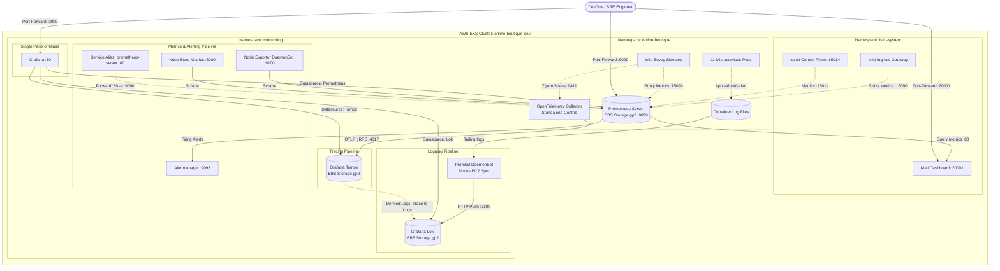

# 📊 Stage 5 – Monitoring & Observability: Prometheus + Grafana + Loki + Tempo + OpenTelemetry

> **Ngày hoàn thành:** 2026-10-21  
> **Áp dụng cho:** `online-boutique-app` và `online-boutique-config`  
> **Tác giả:** DevOps Team  
> **Branch:** `feature/stage-5-monitoring`

---

## 1. Tổng Quan & Mục Tiêu

Stage 5 hoàn thiện trụ cột cốt lõi **Giám sát & Khả năng quan sát (Observability)** cho hệ thống microservices Online Boutique trên cụm AWS EKS v1.36. Hệ thống triển khai toàn diện mô hình Observability 3 trụ cột (Metrics, Logs, Traces) kết hợp Service Mesh Observability theo chuẩn Cloud Native:

1. **Trụ cột Metrics (Số liệu giám sát):** Triển khai `kube-prometheus-stack` (Prometheus Operator v0.94.1, Prometheus v3.15, Alertmanager, Node Exporter, Kube State Metrics). Tự động cào (scrape) số liệu hạ tầng Kubernetes và toàn bộ Envoy Proxy sidecars trong mesh (cổng 15090).
2. **Trụ cột Logs (Nhật ký tập trung):** Triển khai `loki-stack` (Loki v2.9.3 + Promtail DaemonSet). Promtail tự động thu thập stdout/stderr container logs trên toàn bộ các nodes EC2 (Spot instances) và đẩy về Loki kèm metadata giàu ngữ cảnh (namespace, pod, container, job).
3. **Trụ cột Traces (Dấu vết phân tán):** Triển khai `tempo` kết hợp `opentelemetry-collector`. Cấu hình Envoy sidecars của Istio tự động trích xuất distributed trace spans (Zipkin format port 9411) gửi sang OTel Collector, pipeline xử lý và chuyển tiếp qua giao thức OTLP gRPC (port 4317) lưu trữ vào Tempo.
4. **Trực quan hóa tập trung (Unified Visualization - Grafana):** Cung cấp sẵn các Dashboards chuyên sâu được nạp tự động qua Kubernetes ConfigMaps (`sidecar.dashboards.enabled: true`):
   - **Microservices Overview:** Giám sát 4 Golden Signals (Request Rate, Error Rate 5xx %, Latency P95, Pod Replicas Health).
   - **Istio Service Mesh:** Giám sát Ingress Gateway RPS, Inter-service traffic, TCP Connections, Envoy Sidecar Memory.
   - **Pod Resources:** Giám sát CPU/Memory Usage, Container Restarts, CPU Throttling.
5. **Cảnh báo thông minh (Proactive Alerting):** Định nghĩa Custom `PrometheusRule` (`online-boutique-alerts`) giám sát Pod CrashLooping, tỷ lệ lỗi 5xx vượt 5%, thời gian phản hồi P95 > 1s, bộ nhớ container > 85%, và trạng thái thiếu Replicas.
6. **Khôi phục hoàn toàn Kiali Service Mesh Graph:** Nhờ Prometheus sẵn sàng tại endpoint `prometheus-server.monitoring:80`, Kiali tự động phục hồi tính năng Traffic Graph, vẽ sơ đồ phụ thuộc thời gian thực của 11 microservices.
7. **GitOps Tự động hóa qua ArgoCD:** Khai báo toàn bộ monitoring stacks thành các ArgoCD Applications chuẩn mực trong thư mục `argocd/apps/dev/`.

---

## 2. Kiến Trúc Observability Tổng Thể



---

## 3. Chi Tiết Thành Phần Triển Khai

| Thành phần | Chart / Công cụ | Phiên bản App / Image | Endpoint nội bộ cụm | Trách nhiệm chính |
| :--- | :--- | :--- | :--- | :--- |
| **Prometheus Server** | `kube-prometheus-stack` | `quay.io/prometheus/prometheus:v3.15.0` | `prometheus-kube-prometheus-stack-prometheus:9090`<br/>(Alias: `prometheus-server:80`) | Thu thập số liệu chuỗi thời gian (time-series TSDB) từ node, pod, istio-proxy với chu kỳ 15s. Lưu trữ 7 ngày trên EBS GP2 10Gi. |
| **Alertmanager** | `kube-prometheus-stack` | `quay.io/prometheus/alertmanager:v0.28.0` | `alertmanager-kube-prometheus-stack-alertmanager:9093` | Tiếp nhận, gom nhóm (deduplication), lọc cảnh báo từ Prometheus và điều phối thông báo. |
| **Grafana** | `kube-prometheus-stack` | `grafana/grafana:11.5.2` | `kube-prometheus-stack-grafana:80` | Giao diện hiển thị trực quan hóa Dashboards. Tự động kết nối Prometheus, Loki, Tempo. |
| **Grafana Loki** | `loki-stack` | `grafana/loki:v2.9.3` | `loki-stack:3100` | Cơ sở dữ liệu lưu trữ log dạng phân tán, đánh chỉ mục theo label (LogQL). Lưu trữ trên EBS GP2 10Gi. |
| **Promtail** | `loki-stack` | `grafana/promtail:v2.9.3` | DaemonSet trên từng node EC2 | Đọc file container logs trực tiếp từ `/var/log/pods`, gắn kubernetes metadata và đẩy về Loki. |
| **Grafana Tempo** | `tempo` | `grafana/tempo:2.9.0` | `tempo:4317` (gRPC), `tempo:3100` (HTTP) | Cơ sở dữ liệu lưu trữ distributed trace spans dung lượng cao, chi phí tối ưu. |
| **OTel Collector** | `opentelemetry-collector` | `otel/opentelemetry-collector-contrib:0.162.0` | `otel-collector:4317` (OTLP), `otel-collector:9411` (Zipkin) | Tiếp nhận trace spans từ Istio Envoy sidecars (Zipkin format), xử lý bộ đệm theo batch và xuất sang Tempo qua OTLP. |

---

## 4. Cấu Hình Chi Tiết

### 4.1 Cấu Hình Istio Mesh Tracing & Telemetry
Để toàn bộ Envoy Proxy sidecars trong cluster gửi thông tin trace về OpenTelemetry Collector:
1. **ConfigMap `istio` trong `istio-system`:**
   ```yaml
   defaultConfig:
     discoveryAddress: istiod.istio-system.svc:15012
     tracing:
       zipkin:
         address: otel-collector.monitoring.svc.cluster.local:9411
   enablePrometheusMerge: true
   enableTracing: true
   ```
2. **Tài nguyên `Telemetry` (`base/istio/telemetry.yaml`):**
   ```yaml
   apiVersion: telemetry.istio.io/v1
   kind: Telemetry
   metadata:
     name: mesh-default
     namespace: istio-system
   spec:
     tracing:
       - randomSamplingPercentage: 100.00
   ```

### 4.2 Cấu Hình Tự Động Cào Metrics Envoy Sidecars
Prometheus scrape toàn bộ các pods có container `istio-proxy` thông qua cấu hình `additionalScrapeConfigs` (role: pod, port 15090):
```yaml
additionalScrapeConfigs:
  - job_name: 'envoy-stats'
    metrics_path: /stats/prometheus
    kubernetes_sd_configs:
      - role: pod
        namespaces:
          names:
            - online-boutique
            - istio-system
    relabel_configs:
      - source_labels: [__meta_kubernetes_pod_container_name]
        action: keep
        regex: ".*istio-proxy.*"
      - source_labels: [__address__]
        action: replace
        regex: "([^:]+)(?::\\d+)?"
        replacement: "${1}:15090"
        target_label: __address__
      - action: labelmap
        regex: __meta_kubernetes_pod_label_(.+)
      - source_labels: [__meta_kubernetes_namespace]
        action: replace
        target_label: namespace
      - source_labels: [__meta_kubernetes_pod_name]
        action: replace
        target_label: pod
```

### 4.3 Cảnh Báo Tùy Chỉnh (Custom Alert Rules)
File `base/monitoring/custom-alerts/online-boutique-alerts.yaml` định nghĩa `PrometheusRule` với nhãn `release: kube-prometheus-stack`:
- **`OnlineBoutiquePodCrashLooping`:** Cảnh báo Pod restart nhiều hơn 1 lần trong 15 phút hoặc rơi vào trạng thái `CrashLoopBackOff` (Mức độ: `critical`).
- **`OnlineBoutiqueHighErrorRate`:** Cảnh báo khi tỷ lệ lỗi HTTP 5xx của bất kỳ microservice nào vượt quá 5% liên tục trong 3 phút (Mức độ: `warning`).
- **`OnlineBoutiqueHighLatency`:** Cảnh báo khi thời gian đáp ứng P95 của microservice vượt ngưỡng 1000ms liên tục trong 5 phút (Mức độ: `warning`).
- **`OnlineBoutiqueContainerMemoryHigh`:** Cảnh báo khi bộ nhớ làm việc (working set bytes) của container vượt quá 85% limit (Mức độ: `warning`).
- **`OnlineBoutiqueServiceReplicasUnavailable`:** Cảnh báo khi số Pod khả dụng nhỏ hơn số Pod mong muốn kéo dài trên 5 phút (Mức độ: `critical`).

### 4.4 Dashboards Grafana Tự Động Nạp
Hệ thống sử dụng cơ chế Sidecar (`grafana-sc-dashboard`) tự động phát hiện các ConfigMap có nhãn `grafana_dashboard: "1"` để nạp:
- `grafana-dashboard-microservices`: Hiển thị Request Rate, 5xx Error Rate, P95 Latency, và bảng trạng thái Pods khả dụng.
- `grafana-dashboard-istio`: Hiển thị lưu lượng Ingress Gateway theo mã phản hồi HTTP, ma trận giao tiếp liên dịch vụ (Source $\rightarrow$ Destination), số kết nối TCP hoạt động, và bộ nhớ Envoy sidecar.
- `grafana-dashboard-pod-resources`: Hiển thị CPU core usage, Memory bytes usage, số lần khởi động lại của container, và tỷ lệ CPU Throttling.

### 4.5 Khai Báo GitOps Qua ArgoCD
Tất cả thành phần được khai báo dưới dạng Application trong `argocd/apps/dev/`:
1. `argocd/apps/dev/kube-prometheus-stack.yaml` (Quản lý Helm Release `kube-prometheus-stack`)
2. `argocd/apps/dev/loki.yaml` (Quản lý Helm Release `loki-stack`)
3. `argocd/apps/dev/tempo.yaml` (Quản lý Helm Release `tempo`)
4. `argocd/apps/dev/otel-collector.yaml` (Quản lý Helm Release `opentelemetry-collector`)
5. `argocd/apps/dev/monitoring-stack.yaml` (Quản lý Kustomize `base/monitoring` gồm Service Aliases, PrometheusRule, Grafana Dashboards)

---

## 5. Quy Trình Cài Đặt Lại Sau Khi Recreate Hạ Tầng (Installation / Recreate Guide)

Mục này cung cấp quy trình từng bước để tái thiết lập toàn bộ stack Monitoring & Observability khi bạn thực hiện chu trình **`terraform destroy` vào cuối ngày** và **`terraform apply` tái tạo hạ tầng vào ngày hôm sau**.

> 💡 **Tiền điều kiện:** Cụm EKS đã được tạo thành công bởi Terraform, `kubectl` đã kết nối đến cluster (`aws eks update-kubeconfig --region ap-southeast-1 --name online-boutique-dev`), và đã cài đặt Istio (từ Stage 4).

---

### Phương Án 1: Tự Động Hoàn Toàn Bằng ArgoCD GitOps (Khuyên Dùng)

Sau khi ArgoCD Controller đã được cài đặt trên cluster (Stage 3), toàn bộ stack giám sát sẽ được đồng bộ tự động chỉ bằng cách áp dụng các tệp Application đã chuẩn bị sẵn trong thư mục `argocd/apps/dev/`:

#### Trên Windows (PowerShell):
```powershell
# Chuyển vào thư mục repo config
Set-Location -Path "d:\online-boutique\online-boutique-config"

# Áp dụng tất cả các Application giám sát qua ArgoCD
kubectl apply -f argocd/apps/dev/monitoring-stack.yaml
kubectl apply -f argocd/apps/dev/kube-prometheus-stack.yaml
kubectl apply -f argocd/apps/dev/loki.yaml
kubectl apply -f argocd/apps/dev/tempo.yaml
kubectl apply -f argocd/apps/dev/otel-collector.yaml

# Hoặc áp dụng toàn bộ thư mục dev:
kubectl apply -f argocd/apps/dev/
```

#### Trên Linux / macOS (Bash):
```bash
cd /path/to/online-boutique-config

# Áp dụng toàn bộ Applications giám sát qua ArgoCD
kubectl apply -f argocd/apps/dev/monitoring-stack.yaml
kubectl apply -f argocd/apps/dev/kube-prometheus-stack.yaml
kubectl apply -f argocd/apps/dev/loki.yaml
kubectl apply -f argocd/apps/dev/tempo.yaml
kubectl apply -f argocd/apps/dev/otel-collector.yaml
```

ArgoCD sẽ tự động:
1. Tạo namespace `monitoring`.
2. Kéo Helm Charts chính thức từ Helm repositories trên Internet và nạp các giá trị tối ưu đã cấu hình.
3. Đồng bộ Kustomize (`base/monitoring`) để tạo các Service Aliases, Custom AlertRules và nạp Dashboards Grafana.

---

### Phương Án 2: Cài Đặt Trực Tiếp Bằng Helm CLI & Kubectl (Khi Cần Dựng Nhanh)

Nếu chưa dựng ArgoCD hoặc muốn cài đặt từng thành phần để kiểm tra cục bộ, sử dụng quy trình sau:

#### Bước 1: Đăng ký & Cập nhật các Helm Repositories

**Windows PowerShell & Linux / macOS:**
```bash
helm repo add prometheus-community https://prometheus-community.github.io/helm-charts
helm repo add grafana https://grafana.github.io/helm-charts
helm repo add open-telemetry https://open-telemetry.github.io/opentelemetry-helm-charts
helm repo update
```

---

#### Bước 2: Tạo Namespace & Áp Dụng Tài Nguyên Kustomize
Tạo namespace `monitoring`, các Service Aliases (`prometheus-server`, `alertmanager`, `grafana`, `otel-collector`), Custom Alert Rules và Grafana Dashboards ConfigMaps:

**Windows PowerShell & Linux / macOS:**
```bash
kubectl apply -k base/monitoring
```

---

#### Bước 3: Cấu Hình Istio Mesh Tracing
Đảm bảo Istio gửi thông tin trace về OpenTelemetry Collector và sampling 100%:

**Windows PowerShell & Linux / macOS:**
```bash
kubectl apply -f base/istio/istio-mesh-configmap.yaml
kubectl apply -f base/istio/telemetry.yaml
```

---

#### Bước 4: Cài Đặt Prometheus + Grafana + Alertmanager (`kube-prometheus-stack`)

- **Trên Windows PowerShell:**
  ```powershell
  helm upgrade --install kube-prometheus-stack prometheus-community/kube-prometheus-stack `
    --namespace monitoring `
    -f base/monitoring/prometheus-stack-values.yaml
  ```
  *(Hoặc chạy trên 1 dòng duy nhất)*:
  ```powershell
  helm upgrade --install kube-prometheus-stack prometheus-community/kube-prometheus-stack --namespace monitoring -f base/monitoring/prometheus-stack-values.yaml
  ```

- **Trên Linux / macOS (Bash):**
  ```bash
  helm upgrade --install kube-prometheus-stack prometheus-community/kube-prometheus-stack \
    --namespace monitoring \
    -f base/monitoring/prometheus-stack-values.yaml
  ```

---

#### Bước 5: Cài Đặt Loki & Promtail (`loki-stack`)

- **Trên Windows PowerShell:**
  ```powershell
  helm upgrade --install loki-stack grafana/loki-stack `
    --namespace monitoring `
    -f base/monitoring/loki-values.yaml
  ```
  *(Hoặc chạy trên 1 dòng duy nhất)*:
  ```powershell
  helm upgrade --install loki-stack grafana/loki-stack --namespace monitoring -f base/monitoring/loki-values.yaml
  ```

- **Trên Linux / macOS (Bash):**
  ```bash
  helm upgrade --install loki-stack grafana/loki-stack \
    --namespace monitoring \
    -f base/monitoring/loki-values.yaml
  ```

---

#### Bước 6: Cài Đặt Tempo Distributed Tracing

- **Trên Windows PowerShell:**
  ```powershell
  helm upgrade --install tempo grafana/tempo `
    --namespace monitoring `
    -f base/monitoring/tempo-values.yaml
  ```
  *(Hoặc chạy trên 1 dòng duy nhất)*:
  ```powershell
  helm upgrade --install tempo grafana/tempo --namespace monitoring -f base/monitoring/tempo-values.yaml
  ```

- **Trên Linux / macOS (Bash):**
  ```bash
  helm upgrade --install tempo grafana/tempo \
    --namespace monitoring \
    -f base/monitoring/tempo-values.yaml
  ```

---

#### Bước 7: Cài Đặt OpenTelemetry Collector Contrib

- **Trên Windows PowerShell:**
  ```powershell
  helm upgrade --install otel-collector open-telemetry/opentelemetry-collector `
    --namespace monitoring `
    -f base/monitoring/otel-collector-values.yaml
  ```
  *(Hoặc chạy trên 1 dòng duy nhất)*:
  ```powershell
  helm upgrade --install otel-collector open-telemetry/opentelemetry-collector --namespace monitoring -f base/monitoring/otel-collector-values.yaml
  ```

- **Trên Linux / macOS (Bash):**
  ```bash
  helm upgrade --install otel-collector open-telemetry/opentelemetry-collector \
    --namespace monitoring \
    -f base/monitoring/otel-collector-values.yaml
  ```

---

#### Bước 8: Khởi Động Lại Workloads Để Nhận Cấu Hình Tracing Mới

**Windows PowerShell & Linux / macOS:**
```bash
kubectl rollout restart deployment -n online-boutique
kubectl rollout restart deployment istio-ingressgateway -n istio-system
```

---

### Quy Trình Dọn Dẹp Trước Khi `terraform destroy` (Clean-up Guide)

Trước khi chạy `terraform destroy` vào cuối ngày, bạn nên gỡ bỏ các ứng dụng sử dụng Persistent Volume Claim (EBS gp2) và LoadBalancer để AWS giải phóng tài nguyên sạch sẽ, tránh hiện tượng Terraform bị treo (hang) do kẹt volume attachment hoặc finalizers:

#### Trên Windows PowerShell:
```powershell
# 1. Gỡ các Helm releases
helm uninstall kube-prometheus-stack -n monitoring
helm uninstall loki-stack -n monitoring
helm uninstall tempo -n monitoring
helm uninstall otel-collector -n monitoring

# 2. Xóa PVCs để giải phóng các volume AWS EBS GP2
kubectl delete pvc --all -n monitoring

# 3. Xóa namespace monitoring
kubectl delete namespace monitoring --timeout=60s
```

#### Trên Linux / macOS (Bash):
```bash
# 1. Gỡ các Helm releases
helm uninstall kube-prometheus-stack loki-stack tempo otel-collector -n monitoring

# 2. Xóa toàn bộ PVCs lưu trữ
kubectl delete pvc --all -n monitoring

# 3. Xóa namespace
kubectl delete namespace monitoring --timeout=60s
```

---

## 6. Hướng Dẫn Truy Cập & Nghiệm Thu Kiểm Thử

### 6.1 Hướng Dẫn Mở Port Truy Cập Giao Diện (Port-Forwarding)

Chạy các lệnh sau trong terminal riêng biệt để truy cập các bảng điều khiển trên máy cục bộ:

#### 1. Grafana Dashboard (Tài khoản: `admin` / Mật khẩu: `admin`):
```bash
# Linux / macOS / Windows PowerShell (Dùng Service alias hoặc tên đầy đủ):
kubectl port-forward -n monitoring svc/grafana 3000:80
# Hoặc:
kubectl port-forward -n monitoring svc/kube-prometheus-stack-grafana 3000:80
```
👉 Truy cập: `http://localhost:3000`

#### 2. Kiali Service Mesh Dashboard:
```bash
# Linux / macOS / Windows PowerShell:
kubectl port-forward -n istio-system svc/kiali 20001:20001
```
👉 Truy cập: `http://localhost:20001/kiali`

#### 3. Prometheus Web UI:
```bash
# Linux / macOS / Windows PowerShell:
kubectl port-forward -n monitoring svc/prometheus-server 9090:80
# Hoặc:
kubectl port-forward -n monitoring svc/kube-prometheus-stack-prometheus 9090:9090
```
👉 Truy cập: `http://localhost:9090`

#### 4. Alertmanager Web UI:
```bash
# Linux / macOS / Windows PowerShell (Dùng Service alias hoặc tên đầy đủ):
kubectl port-forward -n monitoring svc/alertmanager 9093:9093
# Hoặc:
kubectl port-forward -n monitoring svc/kube-prometheus-stack-alertmanager 9093:9093
```
👉 Truy cập: `http://localhost:9093`

---

### 6.2 Kiểm Thử Tính Năng Chi Tiết & Ý Nghĩa Từng Lệnh

#### Bước 1: Kiểm tra trạng thái hoạt động của toàn bộ Pods trong `monitoring`
- **Ý nghĩa:** Đảm bảo tất cả 100% daemon và services của bộ giám sát đều ở trạng thái `Running`, không có pod nào bị crash hoặc thiếu tài nguyên.
- **Lệnh thực hiện:**
  ```bash
  kubectl get pods -n monitoring
  ```
- **Kết quả kỳ vọng:**
  ```
  NAME                                                        READY   STATUS    RESTARTS   AGE
  alertmanager-kube-prometheus-stack-alertmanager-0           2/2     Running   0          ...
  kube-prometheus-stack-grafana-...                           3/3     Running   0          ...
  kube-prometheus-stack-kube-state-metrics-...                1/1     Running   0          ...
  kube-prometheus-stack-operator-...                          1/1     Running   0          ...
  kube-prometheus-stack-prometheus-node-exporter-...         1/1     Running   0          ... (1 pod/node)
  loki-stack-0                                                1/1     Running   0          ...
  loki-stack-promtail-...                                     1/1     Running   0          ... (1 pod/node)
  otel-collector-opentelemetry-collector-...                 1/1     Running   0          ...
  prometheus-kube-prometheus-stack-prometheus-0               2/2     Running   0          ...
  tempo-0                                                     1/1     Running   0          ...
  ```

#### Bước 2: Kiểm tra thu thập số liệu Service Mesh (`istio_requests_total`)
- **Ý nghĩa:** Kiểm tra xem Prometheus có cào được số liệu lưu lượng từ các Envoy Proxy sidecar của 11 microservices hay không.
- **Lệnh thực hiện (Linux / Bash):**
  ```bash
  kubectl run test-query --image=curlimages/curl --restart=Never --rm -i -- -s "http://prometheus-server.monitoring:80/api/v1/query?query=count(istio_requests_total)"
  ```
- **Lệnh thực hiện (Windows PowerShell):**
  ```powershell
  kubectl run test-query --image=curlimages/curl --restart=Never --rm -i -- -s "http://prometheus-server.monitoring:80/api/v1/query?query=count(istio_requests_total)" 2>$null
  ```
- **Kết quả kỳ vọng:** API trả về định dạng JSON `status: success` với giá trị vector $> 0$ (thực tế trả về 35-95 metric series).

#### Bước 3: Kiểm tra hệ thống thu thập Logs (Grafana Loki)
- **Ý nghĩa:** Đảm bảo Loki đã lập chỉ mục các nhãn và sẵn sàng cho các câu truy vấn LogQL trong Grafana Explore.
- **Lệnh thực hiện (Linux / Bash):**
  ```bash
  kubectl run test-loki --image=curlimages/curl --restart=Never --rm -i -- -s "http://loki-stack.monitoring:3100/loki/api/v1/labels"
  ```
- **Lệnh thực hiện (Windows PowerShell):**
  ```powershell
  kubectl run test-loki --image=curlimages/curl --restart=Never --rm -i -- -s "http://loki-stack.monitoring:3100/loki/api/v1/labels" 2>$null
  ```
- **Kết quả kỳ vọng:**
  ```json
  {"status":"success","data":["app","component","container","filename","instance","job","namespace","node_name","pod","stream"]}
  ```

#### Bước 4: Kiểm tra trạng thái sẵn sàng của Distributed Tracing (Grafana Tempo)
- **Ý nghĩa:** Đảm bảo Tempo instance đang chạy sẵn sàng ghi nhận spans từ OTel Collector.
- **Lệnh thực hiện (Linux / Bash):**
  ```bash
  kubectl run test-tempo --image=curlimages/curl --restart=Never --rm -i -- -s "http://tempo.monitoring:3100/ready"
  ```
- **Lệnh thực hiện (Windows PowerShell):**
  ```powershell
  kubectl run test-tempo --image=curlimages/curl --restart=Never --rm -i -- -s "http://tempo.monitoring:3100/ready" 2>$null
  ```
- **Kết quả kỳ vọng:** Trả về `ready`.

#### Bước 5: Kiểm tra việc tải Custom Alert Rules vào Prometheus
- **Ý nghĩa:** Xác nhận Prometheus Operator đã dịch `PrometheusRule` `online-boutique-alerts` thành file rule và nạp thành công vào Prometheus TSDB.
- **Lệnh thực hiện (Linux / Bash):**
  ```bash
  kubectl run test-rules --image=curlimages/curl --restart=Never --rm -i -- -s "http://prometheus-server.monitoring:80/api/v1/rules" | grep -A 10 "online-boutique.rules"
  ```
- **Lệnh thực hiện (Windows PowerShell):**
  ```powershell
  kubectl run test-rules --image=curlimages/curl --restart=Never --rm -i -- -s "http://prometheus-server.monitoring:80/api/v1/rules" | Select-String "online-boutique.rules"
  ```
- **Kết quả kỳ vọng:** Nhóm rule `online-boutique.rules` xuất hiện cùng với 5 alerts (`OnlineBoutiquePodCrashLooping`, `OnlineBoutiqueHighErrorRate`, `OnlineBoutiqueHighLatency`, `OnlineBoutiqueContainerMemoryHigh`, `OnlineBoutiqueServiceReplicasUnavailable`) có `health: ok`.

#### Bước 6: Kiểm tra Kiali Graph
- **Ý nghĩa:** Kiểm tra xem Kiali đã phục hồi hoàn toàn kết nối với Prometheus và không còn lỗi thiếu Prometheus.
- **Lệnh thực hiện:**
  ```bash
  kubectl logs -n istio-system deployment/kiali --tail=25
  ```
- **Kết quả kỳ vọng:** Xuất hiện log `INF Prometheus connected -- metrics features restored` và `Health refresh completed ... errors=0`. Truy cập `http://localhost:20001/kiali` $\rightarrow$ Graph $\rightarrow$ Namespace: `online-boutique` hiển thị biểu đồ đồ thị mạng trực quan, tốc độ RPS và tỷ lệ phần trăm mã hóa mTLS.

---

## 7. Tổng Kết Deliverables Stage 5

- [x] Triển khai `kube-prometheus-stack` (Prometheus Operator v0.94.1, Prometheus v3.15, Alertmanager, Grafana 11.5, Node Exporter, KSM).
- [x] Triển khai `loki-stack` (Loki v2.9.3 + Promtail DaemonSet trên toàn bộ Spot EC2 nodes).
- [x] Triển khai `tempo` cho Distributed Tracing.
- [x] Triển khai `opentelemetry-collector` tiếp nhận spans từ Istio Envoy sidecars.
- [x] Cấu hình Istio Mesh Tracing đẩy Zipkin spans về OTel Collector với 100% trace sampling.
- [x] Tạo Service Aliases (`prometheus-server:80`, `otel-collector`) tương thích với Kiali và Istio.
- [x] Xây dựng và tự động nạp 3 Custom Grafana Dashboards (Microservices Golden Signals, Istio Service Mesh, Pod Compute Resources).
- [x] Cấu hình bộ cảnh báo tiêu chuẩn `PrometheusRule` cho Online Boutique.
- [x] Khôi phục toàn diện tính năng Kiali Traffic Graph.
- [x] Khai báo đồng bộ hóa GitOps với 5 ArgoCD Applications trong `argocd/apps/dev/`.
- [x] Hoàn thiện tài liệu nghiệm thu kỹ thuật `devops/stage-5-monitoring.md`.
