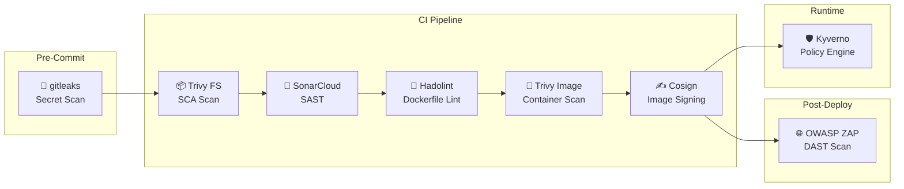

# Stage 6: DevSecOps – Security Scanning Pipeline

> **Ngày triển khai:** 2026-10-31
> **Trạng thái:** ✅ Hoàn thành
> **Branch:** `feature/stage-6-devsecops` (app repo), `feature/stage-6-kyverno` (config repo)

---

## 1. Tổng Quan

Stage 6 tích hợp **8 lớp bảo mật** vào CI/CD pipeline theo mô hình Shift-Left Security:



---

## 2. Chi Tiết Từng Lớp Bảo Mật

### 2.1 Secret Scanning (gitleaks)

| Thuộc tính | Giá trị |
|-----------|---------|
| **Tool** | gitleaks CLI v8.21.2 (open source, miễn phí) |
| **Pre-commit hook** | `.githooks/pre-commit` (scan staged changes trước khi commit) |
| **CI Workflow** | `.github/workflows/security-scan.yml` (safety net) |
| **Config** | `.gitleaks.toml` |
| **Trigger (local)** | Tự động trước mỗi `git commit` |
| **Trigger (CI)** | Push (main, feature/**, fix/**) + PR to main |
| **Security Gate** | ❌ FAIL nếu phát hiện secret |

**Chức năng:** Quét secrets, API keys, passwords bị commit nhầm vào repo.

**2 lớp bảo vệ:**
1. **Pre-commit hook (local):** Chạy `gitleaks protect --staged` trước mỗi commit → chặn secret ngay tại máy dev
2. **CI workflow (remote):** Chạy `gitleaks detect` trên toàn bộ repo → safety net cho trường hợp dev bypass hook

**Cài đặt pre-commit hook:**
```bash
# Cách 1: Cấu hình git hooks path (khuyến nghị)
git config core.hooksPath .githooks

# Cách 2: Symlink (Linux/macOS)
ln -sf ../../.githooks/pre-commit .git/hooks/pre-commit

# Cài gitleaks CLI:
# macOS:   brew install gitleaks
# Windows: choco install gitleaks  hoặc  scoop install gitleaks
# Linux:   wget từ GitHub releases
```

> **Lưu ý:** `gitleaks-action@v2` yêu cầu license trả phí cho organization. Dự án sử dụng gitleaks CLI trực tiếp (miễn phí).

### 2.2 SCA – Trivy Filesystem Scan

| Thuộc tính | Giá trị |
|-----------|---------|
| **Tool** | Trivy (aquasecurity/trivy-action) |
| **Vị trí** | Step 5.6 trong `ci-service.yml` |
| **Scan target** | `./src/<service>` |
| **Output** | SARIF → GitHub Security tab |
| **Security Gate** | ❌ FAIL nếu CRITICAL hoặc HIGH CVE |

**Chức năng:** Quét dependencies (go.mod, package.json, requirements.txt, *.csproj, build.gradle) tìm CVEs.

### 2.3 Dependabot Auto-Update

| Thuộc tính | Giá trị |
|-----------|---------|
| **Config** | `.github/dependabot.yml` |
| **Ecosystems** | Go, Python, npm, NuGet, Gradle, Docker, GitHub Actions |
| **Schedule** | Weekly (Monday) |
| **Security Gate** | Tạo PR → review → merge thủ công |

**Chức năng:** Tự động tạo PR cập nhật dependencies khi có bản vá bảo mật.

### 2.4 SAST – SonarCloud

| Thuộc tính | Giá trị |
|-----------|---------|
| **Tool** | SonarCloud (SonarSource/sonarqube-scan-action@v5) |
| **Vị trí** | Job `sonarcloud` trong `ci-main.yml` |
| **Config** | `sonar-project.properties` |
| **Organization** | `online-boutique-application-demo` |
| **Project Key** | `online-boutique-app` |
| **Dashboard** | https://sonarcloud.io/project/overview?id=online-boutique-application-demo_online-boutique-app |
| **Security Gate** | ⚠️ WARN (review qua SonarCloud dashboard) |

**Chức năng:** Phân tích static mã nguồn tìm bugs, vulnerabilities, code smells, security hotspots.

### 2.5 Dockerfile Linting (Hadolint)

| Thuộc tính | Giá trị |
|-----------|---------|
| **Tool** | Hadolint (hadolint/hadolint-action@v3.1.0) |
| **Vị trí** | Step 5.5 trong `ci-service.yml` |
| **Output** | SARIF → GitHub Security tab |
| **Security Gate** | ⚠️ WARN (continue-on-error) |

**Chức năng:** Kiểm tra Dockerfile tuân thủ best practices.

### 2.6 Container Image Scan (Trivy)

| Thuộc tính | Giá trị |
|-----------|---------|
| **Tool** | Trivy (aquasecurity/trivy-action) |
| **Vị trí** | Step 8b trong `ci-service.yml` |
| **Scan target** | Docker image đã build local |
| **Output** | SARIF → GitHub Security tab |
| **Security Gate** | ❌ FAIL nếu CRITICAL hoặc HIGH CVE |

**Chức năng:** Quét CVEs trong Docker image (OS packages + app dependencies). Image chỉ được push sau khi scan pass.

### 2.7 Image Signing (Cosign)

| Thuộc tính | Giá trị |
|-----------|---------|
| **Tool** | Cosign (sigstore/cosign-installer@v3) |
| **Mode** | Keyless (GitHub Actions OIDC → Sigstore Fulcio CA) |
| **Vị trí** | Step 8e trong `ci-service.yml` |
| **Transparency log** | Rekor (https://rekor.sigstore.dev) |

**Chức năng:** Ký container images sau khi push lên ECR. Chữ ký được lưu trong Sigstore transparency log.

**Verify signature:**
```bash
cosign verify \
  --certificate-identity-regexp="https://github.com/online-boutique-application-demo/*" \
  --certificate-oidc-issuer="https://token.actions.githubusercontent.com" \
  798836978890.dkr.ecr.ap-southeast-1.amazonaws.com/online-boutique/<service>:<tag>
```

### 2.8 DAST – OWASP ZAP

| Thuộc tính | Giá trị |
|-----------|---------|
| **Tool** | OWASP ZAP (zaproxy/action-baseline, zaproxy/action-full-scan) |
| **Workflow** | `.github/workflows/dast-scan.yml` |
| **Trigger** | Manual (workflow_dispatch) |
| **Rules** | `.zap/rules.tsv` |
| **Target** | NLB DNS URL (Istio Ingress Gateway) |

**Chức năng:** Quét ứng dụng đang chạy tìm lỗ hổng runtime (XSS, SQL Injection, CSRF, etc.)

**Cách chạy:**
1. Mở GitHub Actions → "Security – DAST Scan (OWASP ZAP)" → "Run workflow"
2. Nhập target URL (NLB DNS): `http://<NLB-DNS>`
3. Chọn scan type: `baseline` (nhanh) hoặc `full` (kỹ)
4. Xem report trong Artifacts

### 2.9 Kyverno – Runtime Policy Engine

| Thuộc tính | Giá trị |
|-----------|---------|
| **Tool** | Kyverno v3.3.7 |
| **Deploy** | ArgoCD Helm chart → namespace `kyverno` |
| **ArgoCD Apps** | `kyverno` (Helm), `kyverno-policies` (Kustomize) |

**6 ClusterPolicies:**

| Policy | Mode | Mục đích |
|--------|------|----------|
| `disallow-privileged-containers` | **Enforce** | Chặn privileged containers trong `online-boutique` |
| `require-labels` | Audit | Yêu cầu label `app` trên Deployments |
| `require-resource-limits` | Audit | Yêu cầu CPU/memory limits |
| `require-probes` | Audit | Yêu cầu readinessProbe |
| `disallow-latest-tag` | Audit | Cấm sử dụng tag `:latest` |
| `verify-image-signatures` | Audit | Verify Cosign keyless signatures từ ECR images |

> **Lưu ý:** Chỉ `disallow-privileged` ở mode Enforce (chặn thật). Các policy khác ở Audit mode (chỉ báo cáo). Chuyển sang Enforce sau khi kiểm tra ổn định.

---

## 3. CI Pipeline Flow Mới

### 3.1 Luồng ci-service.yml (per-service)

```
 1. Checkout
 2. Language Setup + Cache
 3. Install Dependencies
 4. Unit Tests
 5. Lint (go vet, flake8, eslint)
 ──── SECURITY STEPS (chạy trên MỌI branch) ────
 5.5. Hadolint (Dockerfile lint)           [WARN]
 5.6. Trivy FS Scan (SCA)                  [FAIL on CRITICAL/HIGH]
 ──── BUILD → SCAN → SIGN → PUSH ────
 6. Compute image tags
 7. AWS OIDC + ECR Login
 8. Set up Docker Buildx
 8a. Docker Build (LOCAL only)             ← chạy trên mọi branch
 8b. Trivy Image Scan                      [FAIL on CRITICAL] ← chạy trên mọi branch
 8c. Install Cosign                        ← chỉ main (push_to_ecr)
 8d. Push to ECR                           ← chỉ main (push_to_ecr)
 8e. Cosign Sign (keyless)                 ← chỉ main (push_to_ecr)
 ──── DEPLOY ────
 9. Update manifests in config repo        ← chỉ main
 10. Summary
```

> **Quan trọng:** Hadolint, Trivy FS, Docker Build local, và Trivy Image Scan chạy trên **tất cả branches** (main, feature/**, fix/**). Chỉ có Push ECR, Cosign Sign, và Update manifests chỉ chạy trên `main`.

### 3.2 Luồng ci-main.yml (orchestrator)

```
 Job 1:   detect-changes (paths-filter)
 Job 1.5: sonarcloud (SAST – toàn bộ repo)     [NEW]
 Job 3:   build-<service> × N (parallel)
```

### 3.3 Standalone Workflows

| Workflow | Trigger | Mục đích |
|----------|---------|----------|
| `security-scan.yml` | Push + PR | gitleaks secret scan |
| `dast-scan.yml` | Manual | OWASP ZAP runtime scan |

---

## 4. GitHub Secrets

| Secret | Mục đích | Đã thêm? |
|--------|----------|----------|
| `SONAR_TOKEN` | SonarCloud SAST | ✅ |

> Các tool khác (Trivy, Hadolint, gitleaks, Cosign, ZAP) KHÔNG cần secret – dùng `GITHUB_TOKEN` có sẵn hoặc keyless mode.

---

## 5. Files Tạo Mới / Sửa

### Repo `online-boutique-app`:

| File | Hành động |
|------|-----------|
| `.github/workflows/security-scan.yml` | ✅ Tạo mới |
| `.github/workflows/dast-scan.yml` | ✅ Tạo mới |
| `.github/workflows/ci-main.yml` | ✅ Sửa (thêm SonarCloud job + permissions) |
| `.github/workflows/ci-service.yml` | ✅ Sửa (thêm Hadolint, Trivy, Cosign, refactor build/push) |
| `.github/dependabot.yml` | ✅ Tạo mới |
| `.githooks/pre-commit` | ✅ Tạo mới (gitleaks pre-commit hook) |
| `sonar-project.properties` | ✅ Tạo mới |
| `.gitleaks.toml` | ✅ Tạo mới |
| `.zap/rules.tsv` | ✅ Tạo mới |

### Repo `online-boutique-config`:

| File | Hành động |
|------|-----------|
| `argocd/apps/dev/kyverno.yaml` | ✅ Tạo mới |
| `argocd/apps/dev/kyverno-policies.yaml` | ✅ Tạo mới |
| `base/kyverno/kustomization.yaml` | ✅ Tạo mới |
| `base/kyverno/policies/disallow-privileged.yaml` | ✅ Tạo mới |
| `base/kyverno/policies/require-labels.yaml` | ✅ Tạo mới |
| `base/kyverno/policies/require-resources.yaml` | ✅ Tạo mới |
| `base/kyverno/policies/require-probes.yaml` | ✅ Tạo mới |
| `base/kyverno/policies/disallow-latest-tag.yaml` | ✅ Tạo mới |
| `base/kyverno/policies/verify-image-signature.yaml` | ✅ Tạo mới |

---

## 6. Verification

### 6.1 Verify CI Security Steps

```bash
# Push code → kiểm tra GitHub Actions
# 1. security-scan.yml chạy (gitleaks)
# 2. ci-main.yml → sonarcloud job chạy
# 3. ci-service.yml → Hadolint + Trivy FS + Trivy Image + Cosign steps

# Xem kết quả SARIF:
# GitHub repo → Security tab → Code scanning alerts
```

### 6.2 Verify Dependabot

```bash
# GitHub repo → Insights → Dependency graph → Dependabot
# Hoặc: Pull requests → filter label "dependencies"
```

### 6.3 Verify Kyverno

```bash
# Kiểm tra Kyverno pods
kubectl get pods -n kyverno

# Kiểm tra policies
kubectl get clusterpolicies

# Test: tạo privileged pod (phải bị reject)
kubectl run test-privileged --image=nginx --overrides='{"spec":{"containers":[{"name":"test","image":"nginx","securityContext":{"privileged":true}}]}}' -n online-boutique

# Xem policy reports
kubectl get policyreport -n online-boutique
```

### 6.4 Verify Cosign Signing

```bash
# Verify signature
cosign verify \
  --certificate-identity-regexp="https://github.com/online-boutique-application-demo/*" \
  --certificate-oidc-issuer="https://token.actions.githubusercontent.com" \
  798836978890.dkr.ecr.ap-southeast-1.amazonaws.com/online-boutique/frontend:sha-<commit>
```

### 6.5 Verify DAST

```bash
# Chạy manual:
# GitHub Actions → "Security – DAST Scan (OWASP ZAP)" → "Run workflow"
# Target: http://<NLB-DNS>
# Scan type: baseline
```

---

## 7. Lưu Ý Hạ Tầng Ephemeral

1. **Kyverno** deploy qua ArgoCD → tự động sync khi recreate cluster
2. **SonarCloud** là SaaS → data không mất khi destroy
3. **Cosign signatures** lưu trong Sigstore Rekor → không mất khi destroy
4. **SARIF results** lưu trong GitHub → không mất khi destroy
5. **DAST scan** cần app running → chạy sau deploy, trước destroy
6. **Cleanup trước destroy:** Không cần dọn gì thêm — Kyverno CRDs tự xóa cùng cluster

---

## 8. Security Gates Tổng Hợp

| Gate | Tool | Action | Severity |
|------|------|--------|----------|
| 🔑 Secret Found | gitleaks | ❌ BLOCK | Critical |
| 📦 CRITICAL/HIGH CVE (deps) | Trivy FS | ❌ BLOCK | Critical |
| 🔬 SAST Issues | SonarCloud | ⚠️ WARN | Medium |
| 📝 Dockerfile Issues | Hadolint | ⚠️ WARN | Low |
| 🐳 CRITICAL/HIGH CVE (image) | Trivy Image | ❌ BLOCK | Critical |
| ✍️ Unsigned Image | Cosign + Kyverno | ⚠️ AUDIT | Medium |
| 🌐 Runtime Vuln | OWASP ZAP | ⚠️ REPORT | Medium |
| 🛡️ Privileged Container | Kyverno | ❌ BLOCK | Critical |
