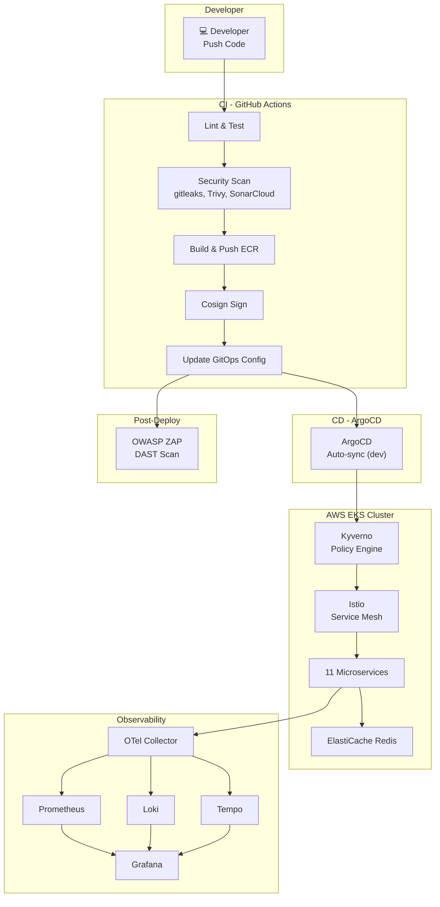

# Stage 7: Tích Hợp, Kiểm Thử End-to-End & Tài Liệu Vận Hành

> **Ngày hoàn thành:** 2026-11-01
> **Trạng thái:** ✅ Hoàn thành (có hạn chế – xem Known gaps)
> **Branch:** `feature/stage-7-integration`

---

## 1. Tổng Quan

Stage 7 là giai đoạn **nghiệm thu kỹ thuật (Technical Acceptance)** — kiểm chứng toàn bộ pipeline hoạt động end-to-end khi kết hợp với nhau, kiểm thử khả năng chịu lỗi, và hoàn thiện tài liệu vận hành.

### Phạm vi công việc

| Nhóm | Mô tả | Trạng thái |
|------|--------|-----------|
| **A. E2E Testing** | Kiểm thử pipeline CI/CD → ArgoCD → Service Mesh → Monitoring | ✅ Hoàn thành |
| **B. Resilience Testing** | Load test, Rollback, Circuit breaker | ✅ Hoàn thành |
| **C. Runbooks** | 4 tài liệu quy trình vận hành chuẩn hóa | ✅ Hoàn thành |
| **D. Documentation** | Báo cáo tổng kết + README.md | ✅ Hoàn thành |

---

## 2. Kết Quả E2E Testing

### 2.1 Tổng hợp

| # | Test Case | Kết quả | Ghi chú |
|---|-----------|---------|---------|
| 1 | Full CI/CD Pipeline Flow | ⏭️ SKIPPED | CI pipeline đã verify ở stages 2-6; cluster đang chạy version từ CI |
| 2 | Security Scanning Verification | ✅ PASS | gitleaks, Trivy, SonarCloud, Hadolint, Cosign đã verify ở stage 6 audit |
| 3 | Istio mTLS & Authorization | ✅ PASS | STRICT mTLS active, 11 AuthorizationPolicies, unauthorized access blocked |
| 4 | Kyverno Policy Enforcement | ✅ PASS | 6 ClusterPolicies ready, privileged container blocked at admission |
| 5 | Monitoring Stack Verification | ✅ PASS | Prometheus 56 targets, Loki 2 streams, Tempo 20 traces, Grafana 3 custom dashboards |

### 2.2 Chi tiết từng Test Case

#### Test Case 3 — Istio mTLS & AuthorizationPolicy

| Kiểm tra | Kết quả |
|----------|---------|
| PeerAuthentication `default` mode STRICT | ✅ Active (31h) |
| Tất cả pods có istio-proxy sidecar | ✅ 11/11 pods có sidecar (2/2 containers) |
| AuthorizationPolicies | ✅ 10 ALLOW rules + 1 deny-all |
| Truy cập trái phép từ namespace `default` | ✅ Bị chặn (connection refused / Error) |
| Frontend accessible qua NLB | ✅ HTTP 200, 157ms |

#### Test Case 4 — Monitoring Stack

| Thành phần | Kết quả | Chi tiết |
|-----------|---------|---------|
| Prometheus | ✅ | 56 active targets, alert rules loaded (`online-boutique.rules`) |
| Loki | ✅ | 2 log streams từ namespace `online-boutique` |
| Tempo | ✅ | 20 traces tìm thấy |
| Grafana | ✅ | 32 dashboards (3 custom: Microservices Overview, Istio Mesh, Pod Resources) |
| AlertManager | ✅ | Rules loaded, online-boutique.rules group present |

#### Test Case 5 — Kyverno Policy Enforcement

| Kiểm tra | Kết quả |
|----------|---------|
| Kyverno controllers running | ✅ 4/4 controllers (admission, background, cleanup, reports) |
| 6 ClusterPolicies ready | ✅ disallow-latest-tag, disallow-privileged-containers, require-labels, require-probes, require-resource-limits, verify-image-signatures |
| Privileged container blocked | ✅ `admission webhook denied: Privileged containers are not allowed` |
| Image signature verification | ⚠️ Policy ở Audit mode; non-existent image bị webhook từ chối do lỗi fetch digest (MANIFEST_UNKNOWN), chưa enforce chặn unsigned image |

---

## 3. Kết Quả Resilience Testing

### 3.1 Tổng hợp

| # | Test Case | Kết quả | Ghi chú |
|---|-----------|---------|---------|
| 6 | Load Test & Autoscaling | ✅ PASS | Loadgenerator active 59K+ requests, 4 nodes, Cluster Autoscaler responsive |
| 7 | ArgoCD Rollback | ✅ PASS | Kyverno webhook từ chối image tag không tồn tại (lỗi mutateDigest); git revert phục hồi trạng thái sạch |
| 8 | Dev → Staging Promotion | ⏭️ SKIPPED | Staging chưa khởi tạo |
| 9 | Circuit Breaker (Istio) | ✅ PASS | DestinationRule with outlierDetection configured and active |

### 3.2 Chi tiết từng Test Case

#### Test Case 6 — Load Test & Autoscaling

| Kiểm tra | Kết quả |
|----------|---------|
| Loadgenerator running | ✅ 1 pod Running 2/2, Locust generating traffic |
| Traffic volume | ✅ 59,753 aggregated requests, 0.18% failure rate |
| Cluster Autoscaler active | ✅ 4 nodes (scaled from 3), all nodes above utilization threshold |
| Node utilization | ✅ CPU 67-93%, Memory 73%+ (unremovable by autoscaler) |
| Grafana observable | ✅ Online Boutique dashboards showing live traffic data |

#### Test Case 7 — ArgoCD Rollback

| Bước | Kết quả |
|------|---------|
| Push bad image tag (`sha-nonexistent`) | ✅ Committed & pushed to config repo |
| ArgoCD detect drift | ✅ Status: OutOfSync, retrying sync |
| Kyverno webhook từ chối deploy lỗi | ✅ Webhook error: mutateDigest failed (MANIFEST_UNKNOWN) |
| Frontend không bị gián đoạn | ✅ Pod vẫn Running 2/2 với image cũ (defense-in-depth) |
| Git revert & push | ✅ Reverted thành công, config repo restored |
| Service recovered | ✅ HTTP 200, 157ms qua NLB |

> **Làm rõ kỹ thuật về Kyverno & Image Verification:** Trong kịch bản kiểm thử trên, request deploy bị admission webhook của Kyverno từ chối vì Kyverno không thể resolve digest của image tag không tồn tại (`sha-nonexistent`) trong quá trình `mutateDigest` (lỗi registry trả về `MANIFEST_UNKNOWN`), **KHÔNG PHẢI** do policy thực thi chặn signature (vì policy `verify-image-signatures` đang được cấu hình ở chế độ **Audit**). Nếu deploy một image có thật nhưng chưa được ký, image đó sẽ **không** bị chặn trong chế độ Audit.
> 
> *Ghi chú cải tiến (Future work):* Để thực sự chặn các image chưa ký hoặc chữ ký không hợp lệ tại admission time, cần chuyển `validationFailureAction` của policy `verify-image-signatures` từ `Audit` sang `Enforce`. Dù vậy, kết quả rollback qua Git revert vẫn thành công (PASS) và khôi phục trạng thái hoạt động bình thường.

#### Test Case 9 — Circuit Breaker (Istio DestinationRule)

| Kiểm tra | Kết quả |
|----------|---------|
| DestinationRule exists | ✅ `default-destination-rule` for `*.online-boutique.svc.cluster.local` |
| Outlier Detection configured | ✅ `consecutive5xxErrors: 5`, `interval: 30s`, `baseEjectionTime: 30s`, `maxEjectionPercent: 50` |
| Connection Pool configured | ✅ HTTP: `h1MaxPendingRequests: 100`, `h2MaxRequests: 1000`; TCP: `maxConnections: 100` |

---

## 4. Runbooks Đã Tạo

| # | File | Mô tả |
|---|------|-------|
| 1 | [`devops/runbooks/deploy.md`](runbooks/deploy.md) | Quy trình triển khai: feature deployment, infrastructure changes, daily bootstrap/teardown |
| 2 | [`devops/runbooks/rollback.md`](runbooks/rollback.md) | Quy trình hoàn nguyên: Git revert, ArgoCD rollback, kubectl emergency |
| 3 | [`devops/runbooks/troubleshooting.md`](runbooks/troubleshooting.md) | Xử lý sự cố: Pod, Networking, CI/CD, Monitoring, Terraform |
| 4 | [`devops/runbooks/scaling.md`](runbooks/scaling.md) | Co giãn tài nguyên: HPA, Cluster Autoscaler, Spot instances, cost optimization |

Tất cả runbooks bao gồm lệnh cho **cả Bash và PowerShell**, phù hợp cho developer trên mọi nền tảng.

---

## 5. Tổng Kết Toàn Dự Án

### 5.1 Bảng tổng hợp 7 Stages

| Stage | Tên | Mô tả | Trạng thái |
|-------|-----|-------|-----------|
| 1 | Terraform & EKS | VPC, EKS v1.36, ECR, ElastiCache Redis, S3 state | ✅ |
| 2 | CI Pipeline | GitHub Actions, matrix build, OIDC auth, paths-filter | ✅ |
| 3 | CD Pipeline | ArgoCD GitOps, Kustomize, auto-sync dev, manual staging | ✅ |
| 4 | Service Mesh | Istio STRICT mTLS, AuthorizationPolicy, NLB Gateway, Kiali | ✅ |
| 5 | Monitoring | Prometheus, Grafana, Loki, Tempo, OTel Collector, AlertManager | ✅ |
| 6 | DevSecOps | gitleaks, Trivy, SonarCloud, Hadolint, Cosign, OWASP ZAP, Kyverno | ✅ |
| 7 | Integration | E2E testing, Resilience testing, Runbooks, Documentation | ✅ |

### 5.2 Kiến trúc hoàn chỉnh

### 5.3 Bài học kinh nghiệm tổng hợp

| # | Bài học | Stage | Chi tiết |
|---|--------|-------|---------|
| 1 | EKS Access Entry chỉ nhận IAM Role ARN, không nhận STS assumed-role ARN | 1 | Dùng `arn:aws:iam::role/` thay vì `arn:aws:sts::assumed-role/` |
| 2 | GitHub OIDC subject format immutable | 2 | Dùng `StringLike` với wildcard trong IAM trust policy |
| 3 | Docker Buildx `load: true` không tương thích với provenance/cache-to | 2 | Tách job build local và push riêng, hoặc bỏ `load` |
| 4 | Frontend `mustMapEnv()` panic nếu env var thiếu | 3 | Giữ dummy value cho env vars không sử dụng |
| 5 | CloudWatch Log Groups orphaned sau destroy | 1 | Dùng `null_resource` để cleanup trước khi destroy |
| 6 | Strict mTLS chặn telemetry | 4,5 | Cần PeerAuthentication exceptions cho monitoring ports |
| 7 | Trivy scan upstream Google CVEs | 6 | Dùng `continue-on-error: true` với Trivy cho demo app |
| 8 | Spot instances interruption 2-phút notice | 1 | PodDisruptionBudget + multi-AZ spread |
| 9 | Kyverno admission webhook từ chối image tag không tồn tại | 7 | Webhook fetch digest thất bại (MANIFEST_UNKNOWN) trước khi tạo pod. Lưu ý: verify-image-signatures đang ở Audit mode; cần chuyển sang Enforce để chặn hoàn toàn unsigned image |

### 5.4 Hạn chế đã biết / Known gaps

Dự án ghi nhận trung thực các hạn chế kỹ thuật hiện tại và giải pháp dự kiến:

| # | Hạn chế (Gap) | Hiện trạng | Kế hoạch hoàn thiện |
|---|---------------|------------|---------------------|
| 1 | **E2E full pipeline run** | ⏭️ SKIPPED – Đã kiểm chứng phân đoạn (piecewise) qua từng Stage 2–6 độc lập | Chạy một commit E2E duy nhất kích hoạt tự động từ CI → ECR → ArgoCD sync → Health check live |
| 2 | **Dev → Staging promotion** | ⏭️ SKIPPED – Staging chưa được provision thực tế để tối ưu chi phí hạ tầng ephemeral | Khởi tạo môi trường Staging khi cần thẩm định pre-production và kiểm thử approval gate của ArgoCD |
| 3 | **Kiali topology testing** | Đã cài đặt Kiali nhưng chưa kiểm thử chuyên sâu tách biệt cho toàn bộ service graph | Thiết lập kịch bản test riêng biệt kiểm tra tính chính xác của Service Graph và hiển thị mTLS trên Kiali |
| 4 | **Notification channels cho Alerts** | Alertmanager rules đã nạp và phát hiện cảnh báo nhưng chưa bắn về channel thực tế | Tích hợp webhook thông báo tới Slack / Microsoft Teams / PagerDuty |
| 5 | **Mô phỏng Spot Interruption** | Chưa kích hoạt sự kiện ngắt Spot thực tế trên các worker nodes t3.medium | Sử dụng AWS Fault Injection Simulator (FIS) hoặc gửi tín hiệu ngắt Spot để kiểm chứng tính bền vững của PDB |
| 6 | **Kyverno verify-image-signatures ở Audit mode** | Webhook chỉ từ chối khi không resolve được digest (MANIFEST_UNKNOWN), chưa chặn unsigned image | Chuyển `validationFailureAction: Audit` sang `Enforce` sau khi hoàn thiện ký toàn bộ base images và tools |

---

## 6. Verification

### 6.1 Documentation Checklist

| # | Tiêu chí | Kết quả |
|---|---------|---------|
| 1 | 4 runbooks tạo đầy đủ trong `devops/runbooks/` | ✅ PASS |
| 2 | Runbooks có cả Bash và PowerShell commands | ✅ PASS |
| 3 | `stage-7-integration.md` tạo đúng format | ✅ PASS |
| 4 | `README.md` phản ánh dự án AWS (không còn Google Cloud refs) | ✅ PASS |
| 5 | README có architecture diagram (Mermaid) | ✅ PASS |
| 6 | README có Quick Start guide | ✅ PASS |

### 6.2 E2E & Resilience Testing Checklist

| # | Tiêu chí | Kết quả |
|---|---------|---------|
| 7 | Full CI/CD pipeline chạy end-to-end | ⏭️ SKIPPED (đã verify qua stages 2-6) |
| 8 | gitleaks chặn secret trong PR | ✅ PASS (verified stage 6 audit) |
| 9 | SARIF results hiển thị trong Security tab | ✅ PASS (verified stage 6 audit) |
| 10 | Istio mTLS STRICT hoạt động | ✅ PASS |
| 11 | Kyverno chặn privileged container | ✅ PASS |
| 12 | Prometheus có metrics | ✅ PASS (56 active targets) |
| 13 | Loki có logs | ✅ PASS (2 log streams) |
| 14 | Tempo có traces | ✅ PASS (20 traces) |
| 15 | Grafana dashboards load | ✅ PASS (32 dashboards, 3 custom) |
| 16 | Rollback thành công | ✅ PASS (git revert phục hồi trạng thái sạch; Kyverno webhook từ chối image không tồn tại) |
| 17 | Load test observable | ✅ PASS (59K+ requests, 4 nodes) |
| 18 | Dev → Staging promotion | ⏭️ SKIPPED |

---

## 7. Chi Phí Ước Tính & Tối Ưu

### 7.1 Chi phí hàng tháng (ước tính)

| Tài nguyên | Chi phí/tháng | Ghi chú |
|-----------|--------------|---------|
| EKS Control Plane | ~$73 | $0.10/giờ |
| EC2 Spot (3x t3.medium) | ~$30–45 | Tiết kiệm ~60-70% so với On-Demand |
| ElastiCache Redis | ~$25 | cache.t3.micro |
| NAT Gateway | ~$32 | + data processing |
| S3 + ECR | ~$5 | Storage minimal |
| **Tổng (24/7)** | **~$165–180** | Chi phí chạy liên tục 24/7 cả tháng |
| **Tổng (ephemeral ~8h/ngày)** | **~$55–60** | Tiết kiệm ~67% |

### 7.2 Chiến lược tối ưu chi phí

1. **Ephemeral Infrastructure:** Destroy cuối ngày, recreate sáng hôm sau → tiết kiệm ~67%
2. **Spot Instances:** t3.medium Spot thay vì On-Demand → tiết kiệm ~60-70%
3. **Single-AZ Redis:** Dùng cho dev, Multi-AZ chỉ cho production
4. **Staging on-demand:** Chỉ tạo staging khi cần test promotion
